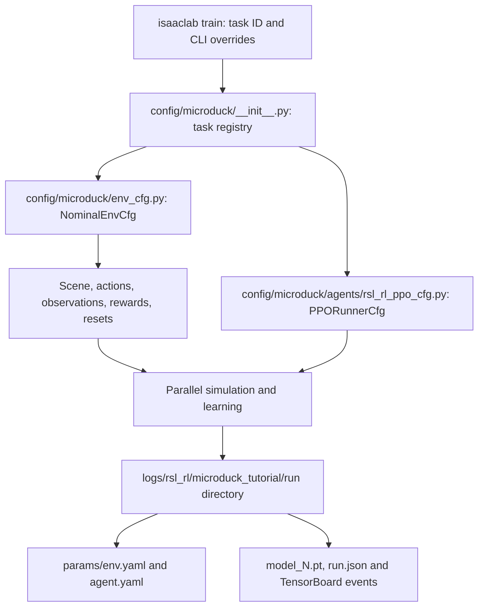

# 2. Try training before studying the recipe

**Question:** what can the duck learn from a short attempt?

## Set up

Run from the repository root:

```bash
uv sync --project environments/locomotion --locked
```

This creates a separate environment and leaves the root SO-101 lock file unchanged. The locomotion lock pins Isaac Lab commit `90a16f06685dbf7948262eafa628c470b4cdc78c`, Newton commit `42f7def118c2c4299ce493457bafd4e8a22a696e`, RSL-RL 5.5.1, and MuJoCo/MuJoCo Warp 3.15. The environment builds Isaac Lab through its supported aggregate wheel builder so runtime resources are included. Its source revision differs from the root released-wheel setup.

## Run a fresh attempt

```bash
uv run --project environments/locomotion isaaclab train --rl_library rsl_rl --task MicroDuckTutorial-Velocity-Flat --num_envs 128 --max_iterations 50 --seed 42 --run_name first_attempt --visualizer none
```

The project supplies a complete task so you can run before understanding every manager term. This command starts a fresh learner. It does not load a supplied successful policy.

<details>
<summary>Where does that command get its settings?</summary>



Config filenames above are relative to `src/isaaclab_tutorial/tasks/locomotion/`. Generated logs are relative to the repository root. The resolved YAML files capture the settings used, including your overrides. Keep them with the checkpoint; a model file alone does not describe its observation or actuator contract. The robot USD bytes are checked before scene construction; [the asset receipt](evidence/asset-lock.json) records both supported variants.

</details>

The budget is 128 environments × 24 control steps × 50 iterations = **153,600 transitions**. It is a teaching preview, not a promise to learn walking. Compilation and asset download can dominate the first launch. If memory is limited, reduce `--num_envs`; record the changed transition budget.

Find the printed run directory under `logs/rsl_rl/microduck_tutorial/`. Checkpoints are written at the configured interval and at the end. Iterations, episode duration, tracking errors, and fall terminations are more useful together than reward alone.

## Replay what you actually trained

```bash
uv run --project environments/locomotion python scripts/locomotion/evaluate.py --checkpoint latest --capture
```

This attempts the fixed command protocol and stops at the first fall or timeout. It writes `outputs/evaluation/receipt.json` and a pre-fall image. A native window is optional: add `--viewer` on a graphical desktop. `latest` selects the latest run whose `run.json` identifies the nominal tutorial task, then its highest-numbered checkpoint. An explicitly chosen checkpoint must also belong to that task. For controlled comparisons, pass its exact path so a training job cannot move the selection between trials.

**Look for:** finite learning diagnostics, a real checkpoint, and its actual behavior. Falling, drifting, or barely moving are valid learning observations. A traceback, non-finite state, or missing checkpoint is a software/setup failure to diagnose.

**Record:** “My first policy …; the episode ended because ….”

Do not wait for a good gait before moving on. Next, [control the puppet duck yourself](03-puppet.md).
