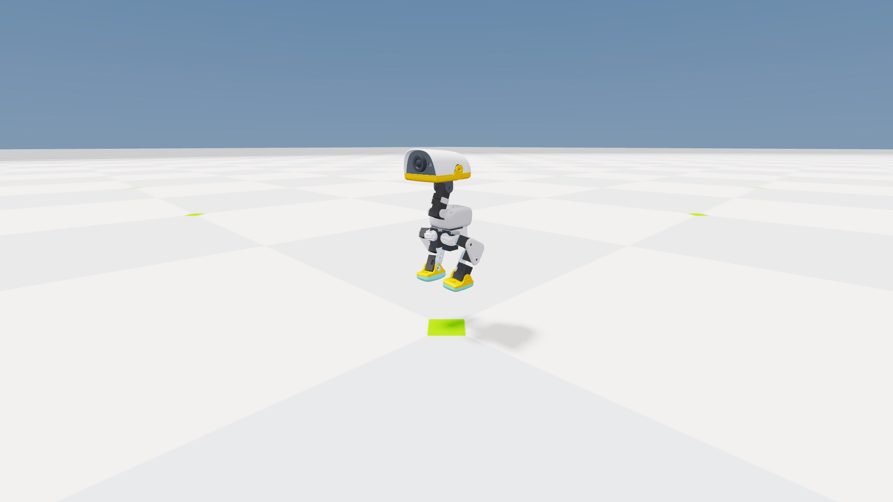
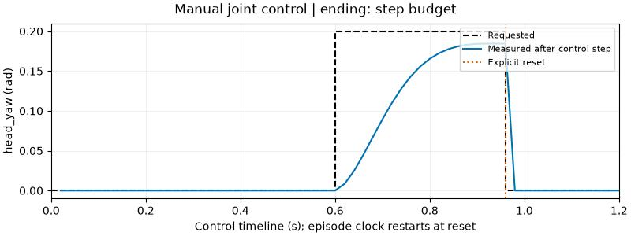

# 3. Play with a puppet duck

**Challenge:** make Microduck look left, crouch, or lift one foot.

```bash
uv run --project environments/locomotion python scripts/locomotion/playground.py
```

Open **Microduck playground** in the Newton sidebar. The head/neck group starts open; expand either leg to see its joints. Sliders display degrees; the simulation receives radians. Each joint has a target and a measured angle.

The default **Supported pose** fixes the root above the floor so you can inspect motion without balancing. It is an inspection configuration, not a trained locomotion task. The feet hanging clear of the ground are intentional.

Move `head_yaw`, then a knee. Predict the direction first. The slider sends a target through the real BAM actuator model; it does not teleport the joint. The measured angle may lag or settle away from the target.

Try this three-move challenge:

1. Move `head_yaw` to about 11°. Wait for the measured angle to settle.
2. Pause, request a different angle, and press **Single control step**. Does one 20 ms interval reach the target?
3. Press **Restore stance**, then **Reset experiment**. The first changes requested targets; the second also resets physical state and controller histories.

**Pause playground** freezes control stepping while preserving viewer interaction. **Save experiment** writes named targets and timing to `outputs/playground/experiment.json`.

## Remove support

```bash
uv run --project environments/locomotion python scripts/locomotion/playground.py --free
```

This launches a separate free-base scene. Try a small knee change. A pose that looked reasonable while supported may fall when it has to balance. Reset and try again; this activity is not a recovery controller.

At the first fall or time limit, the playground holds the final physical pose and labels the ending. Stepping is disabled until **Reset experiment** starts a new trial. The display does not present an automatic reset as continued balancing.

## No graphical desktop

```bash
uv run --project environments/locomotion python scripts/locomotion/playground.py --headless --steps 120 --scripted --capture
```

The same actuator/control path requests a 0.2 rad head-yaw change halfway through, then resets at 80% of the run. Inspect `outputs/playground/receipt.json` and `playground.png`. The receipt records the gradual measured response, one explicit reset, and 61/76 actor/critic values. The capture is a simulator view, not proof of clicking a live desktop widget.



The fixed root makes this a useful joint experiment. Its hanging feet are not evidence that a policy learned to balance.



This real 60-step capture requests the turn at 0.6 s and resets at 0.96 s. The motor has not quite reached its target before the reset. To plot your own named joint:

```bash
uv run --project environments/locomotion python scripts/locomotion/plot_playground.py --receipt outputs/playground/receipt.json --joint head_yaw --output outputs/playground/head-yaw.svg
```

**Check yourself:** why can a target slider move before the measured joint reaches it? The policy/controller requests a target; the motor, inertia, limits, and contacts determine the physical response.
