# 4. Follow one action into the robot

**Try:** open a supported head-yaw experiment. No checkpoint is needed.

```bash
uv run --project environments/locomotion python scripts/locomotion/actuator_workshop.py --output outputs/my-reversal
```

In **Supported actuator workshop**, choose a small amplitude and press **Reset and run reversal**. The duck holds, sweeps, reverses, then returns its target home over three simulated seconds. Compare requested target, actual delayed target and measured servo angle in the native viewer's live plots. Pause at a control boundary or take a single control step. Try another amplitude; it applies to the next run, which is saved separately.

**Predict:** when the target returns home, must the joint already be home? The motor has dynamics and friction. The slider requests motion; it does not prescribe the measured trajectory. [Add delay and mechanical play](11-effects.md#watch-a-bounded-reversal) once you can identify these signals. Add `--headless` to record one complete trial without a viewer.

The tutorial preserves the robot's explicit 14-servo order: five left-leg joints, four head/neck joints, then five right-leg joints. The asset's internal order can differ. Selecting by name with `preserve_order=True` keeps observations and actions consistent.

For the selected action term:

```text
target = default_joint_position + scale × action − encoder_bias
```

The puppet inverts this mapping to turn your desired physical angle into a policy-shaped action. In nominal conditions the encoder bias is zero and the scale is one. A zero action therefore requests the reference stance; it does not mean zero torque or zero angle.

Physics advances every 5 ms (200 Hz). The policy/control interval contains four physics steps, so actions update every 20 ms (50 Hz). A held position target is still processed by the actuator during the intervening physics steps.

```mermaid
flowchart LR
    A[One raw policy action] --> Scale[Multiply by configured scale]
    Scale --> Home[Add home angle, subtract encoder bias]
    Home --> Target[Requested position target, rad]
    Target --> Servo[BAM servo model at each physics step]
    Servo --> Physics[Joint dynamics and contacts]
    Physics --> Encoder[Measured position and velocity]
    Encoder --> Next[Next actor observation]
```



The nominal case has no command lag. With lag enabled, the actuator's delay buffer selects an older target before computing its response. Mechanical limits, effort limits and servo dynamics belong to the actual configured model; the action formula alone does not guarantee a reachable target.

| Simulation time | 0 ms | 5 ms | 10 ms | 15 ms | 20 ms |
| --- | --- | --- | --- | --- | --- |
| Actor input/action | Read state; produce action A | — | — | — | Read new state; produce B |
| Requested target | A | Hold A | Hold A | Hold A | B |
| Actuator and physics | Advance 0–5 | Advance 5–10 | Advance 10–15 | Advance 15–20 | Advance 20–25 |

**Predict:** can an observation that arrives 40 ms late be repaired by running physics four times per control interval? More physics steps do not make an old measurement newer; inspect this distinction in [the reality-gap sandbox](11-effects.md).

Compare a supported pose with a free-base trial. Actuator response and balance are different problems: reaching one requested angle does not ensure that the centre of mass stays supported.

**Experiment:** request a small head movement, restore stance, and repeat with a larger movement. Record target and measured values. Never infer torque, speed, or ideal tracking merely from the slider's value.

**Reference code:** `JointControls.actions()` implements the inverse mapping; the maintained task's `BiasedJointPositionAction` applies it. The source robot config owns the mechanical/actuator parameters.
