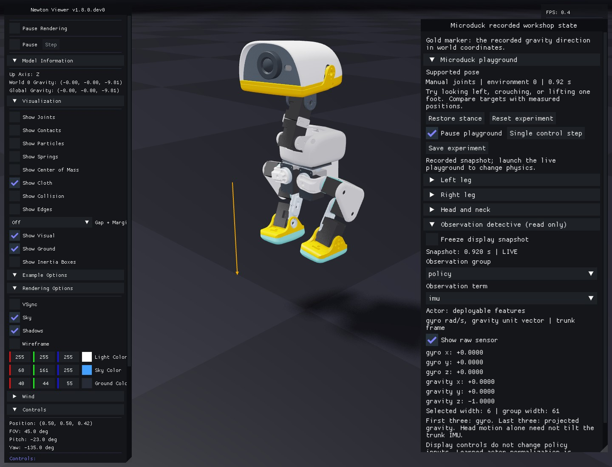
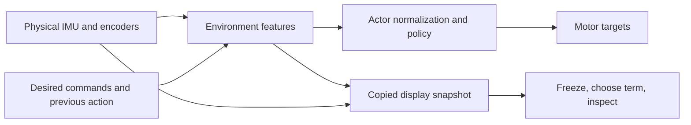
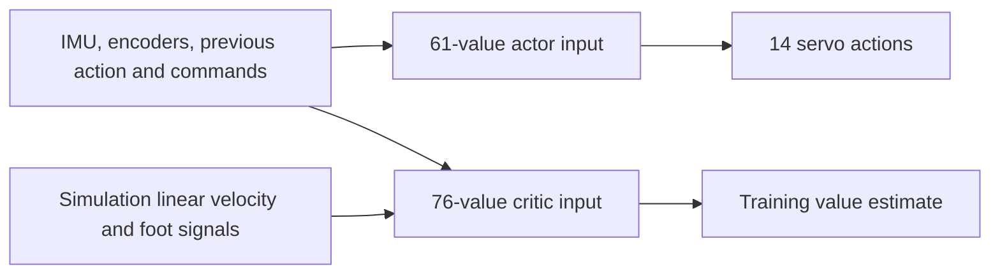

# 5. Become an observation detective

**Predict:** which signals change when you pitch the head, and which change only when the whole body tilts?

```bash
uv run --project environments/locomotion python scripts/locomotion/playground.py --mode observations
```

Open **Observation detective (read only)**. Choose the **policy** group and **joint_pos** term. Values are labeled in the same named joint order used by the controller.

1. Move `head_yaw`. Find its changing entry; compare it with the measured joint angle.
2. Enable **Show raw sensor**. The raw encoder angle is absolute; the environment feature subtracts the default home angle. Try a knee, whose home angle is nonzero, to see the difference.
3. Enable **Freeze display snapshot**, then move another joint. The snapshot and its displayed timestamp stay fixed while the live simulation continues. Unfreeze to see the latest values.
4. Select **imu**. Predict which gyro/gravity components will change before moving the head. Compare supported and free-base scenes.

<details>
<summary>Find the group, term and raw-sensor controls</summary>



The panel uses the real widget code and a recorded physical snapshot. The live gold arrow also rotates the sampled trunk-frame gravity into world coordinates. It is displayed beside the sampled trunk, offset 0.12 m along world Y and 0.03 m upward for visibility. Freezing the display freezes that arrow and its pose together. Head movement alone leaves the supported trunk's gyro/gravity unchanged.

</details>

**Freeze display snapshot** affects inspection alone. **Pause playground** stops control stepping; **Single control step** advances one 20 ms interval. Neither display control changes the policy's input vector. The displayed environment features precede the learned normalization embedded inside the actor.



The inspector reads a copy of the same named observation groups. A separate telemetry group supplies display-only physical signals, including the terminal state before autoreset. The actor and critic widths remain unchanged.

The 61-value actor vector contains angular velocity and projected gravity (6), joint-position offsets (14), joint velocities (14), previous actions (14), desired velocity (3), head-pose commands (4), and body-pose commands (6). Head/body command slots are retained but held at zero initially.

Projected gravity expresses the world down direction in the robot/sensor frame. Tilting the robot changes its components even when its world position stays fixed. Joint motion can change position/velocity signals without rotating the base; do not expect a head movement alone to change a base-mounted IMU's gravity direction.

The critic receives 76 values, including simulation-only linear velocity and foot information. It learns a value estimate during training. The deployed actor must not silently receive those privileged values.



Only the actor branch is exported to the robot. To check individual input indices and units, use [the verified bundle layout](13-deployment.md#inspect-the-standard-duck-bundle). The critic's extra information can improve learning without becoming a sensor available on hardware.

Switch the group to **critic** and find `base_lin_vel`, then `foot_contact_forces`. These are privileged simulation signals. The force feature is `sign(F) × log(1 + |F|)`, with F measured in newtons; its displayed number is not a force in newtons. Each term's panel identifies its coordinates and units.

**Try the gravity cue:** in the supported scene, move only the head. The trunk-mounted IMU and gold arrow should stay unchanged. Repeat with `--free` and watch a body tilt: the world down arrow stays downward while its coordinates in the tilted trunk change. Use a reset to retry. The arrow is display geometry and applies no force.

During training, the velocity-command manager resamples commands at its configured interval and selects standing episodes according to `rel_standing_envs`. The evaluation and scripted driving tools explicitly supply their own schedules. A new slider command is applied at the next control boundary; it is not a new motor target until the frozen actor processes it. Head/body command slots stay zero in this teaching task.

Command velocities use the task's declared heading/world conventions. Forward/lateral linear tracking is measured in the heading frame; yaw tracking uses world angular velocity about Z. Units are m/s, rad/s, and radians unless explicitly converted for display.

Observation inspection never removes a signal from the policy. Removing a field changes the model contract and requires a new architecture/configuration and training run.

**Record:** one signal that changed, one that stayed fixed, and why. Compare supported and free-base scenes if you need a body tilt.
