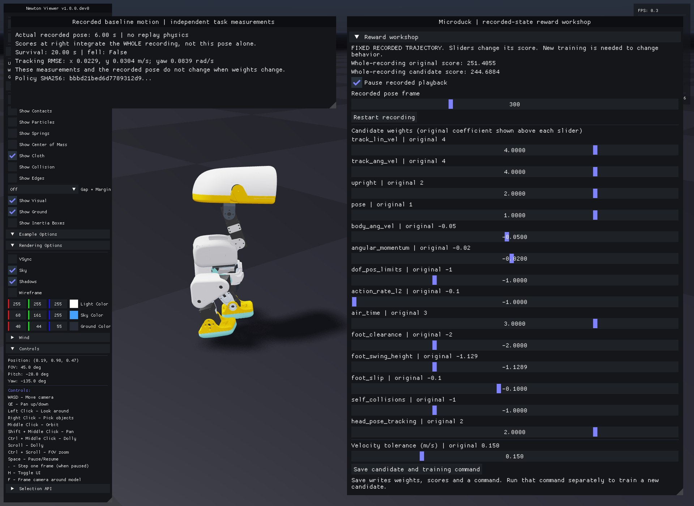
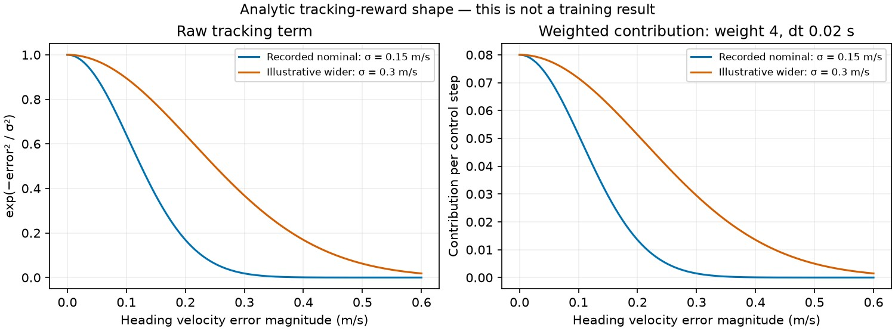
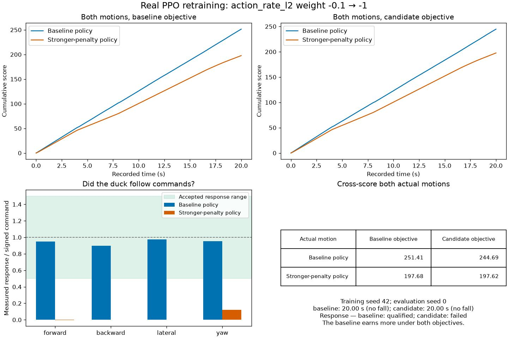
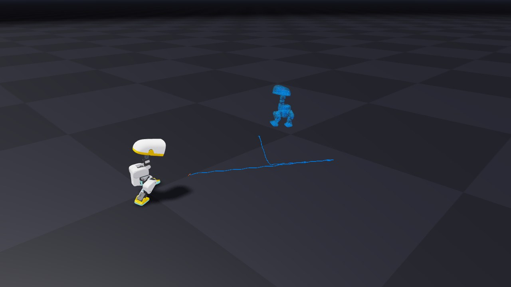

# 6. Can a better score hide worse walking?

Use the saved first-attempt variables from lesson 2 (`source outputs/tutorial.env` in a new terminal). First evaluate a trained checkpoint so there is a real trajectory to inspect:

```bash
uv run --project environments/locomotion python scripts/locomotion/evaluate.py --checkpoint "$DUCK_FIRST_CHECKPOINT"
uv run --project environments/locomotion python scripts/locomotion/reward_workshop.py --trajectory outputs/evaluation/receipt.json
```

The reward workshop replays **recorded motion**. Move reward-weight sliders and watch the original/candidate scores. Change velocity tolerance to make the tracking curve narrower or broader. These controls rescore the same states; they do not update a policy or generate alternate movement.

<details>
<summary>See the working controls before trying them</summary>



This is the baseline policy's actual pose at 6.00 s. The scores integrate all 1000 recorded transitions over 20 seconds. Changing only `action_rate_l2` from −0.1 to −1.0 gives 251.4055 → 244.6884 for this same motion; its measured tracking errors stay unchanged. The candidate **objective** is loaded here; its separately trained policy appears below.

Each original coefficient stays visible above its candidate slider. The disabled `head_pose_bias` term is absent because the recording cannot recover it. **Save candidate and training command** exports a recipe; it does not start training.

</details>

The manager evaluates each active term, multiplies it by its configured weight, sums the results, then multiplies by the 0.02 s control interval. Recorded per-term rates are converted back to raw terms before applying candidate weights. Terms disabled during collection cannot be reconstructed and are not offered as new controls.

The linear tracking reward is `exp(-squared_heading_velocity_error / std²)`. Width changes recompute this term from the squared error recorded at the same post-physics instant as the reward, before autoreset. The evaluator's separate pre-step metric velocities are not substituted for that reward-time state. Merely multiplying the previous score would be incorrect.

<details>
<summary>Predict what changing the tolerance does</summary>



At the same nonzero velocity error, a larger width gives a larger tracking reward. Both curves equal one at zero error; increasing tolerance does not create better tracking. The right panel shows this term's contribution after its actual weight and control interval are applied. These are equation curves using the nominal parameters, not learned-policy measurements.

Try the workshop's width slider, then explain why making the score easier to earn could leave task performance unchanged.

</details>

<details>
<summary>What do the other reward sliders encourage?</summary>

| Terms | Intended contribution | What excessive weight can hide |
| --- | --- | --- |
| `track_lin_vel`, `track_ang_vel` | Follow heading-frame translation and world-Z yaw | Larger tolerance can reward inaccurate motion |
| `upright`, `pose` | Trunk uprightness and home-like leg pose; pose is standing-only | Standing instead of responding to commands |
| `body_ang_vel`, `angular_momentum` | Penalize wobble and whole-body angular momentum | Suppressing useful balancing motion |
| `dof_pos_limits`, `self_collisions` | Penalize soft-limit excursions and configured self-contact | These penalties are not hard safety constraints |
| `action_rate_l2` | Penalize changes in successive raw actions | Nearly constant actions without walking |
| `air_time` | Reward touchdown after a 0.125–0.3 s air-time window when moving is commanded | Optimizing foot timing without velocity response |
| `foot_clearance`, `foot_swing_height` | Penalize the configured clearance/swing-height errors during commanded motion | Unnatural stepping if other objectives are overwhelmed |
| `foot_slip` | Penalize contact motion during commanded motion | Low slip from simply standing still |
| `head_pose_tracking` | Track the fixed zero head-command offsets | Spending capacity on posture while locomotion fails |

The feet terms use a moving-command gate at 0.01 command norm in the pinned task. Contact state, air time and touchdown peaks make some terms stateful. Read the actual values in your saved `params/env.yaml`; inactive `head_pose_bias` cannot be reconstructed from this recording.

</details>

## Predict what stronger smoothness will teach

Make the `action_rate_l2` weight ten times more negative: −0.1 → −1.0. Before retraining, predict whether the duck will walk more smoothly, stop walking, or fall. The penalty measures changes in consecutive raw actions; it does not directly measure motor torque or energy.

We actually trained this candidate from scratch with the same seed and budget as the reference: 4096 environments × 24 steps × 1000 iterations, or 98,304,000 transitions per policy. The saved task/learner recipes differ only in that reward weight. Both were evaluated on the same `balance-starts-v1` initial state and 20-second commands.



Both policies stayed upright for 20 seconds. The candidate's forward/backward/lateral response gains were approximately zero, so it failed the locomotion criteria. Its requested-target rate RMS fell from 8.17 to 0.72 rad/s, but the baseline earned more under **both** objectives: 251.41 versus 197.68 under the original, and 244.69 versus 197.62 under the candidate objective. This is a poor learned result, even under its own objective; a changed reward does not guarantee successful optimization. It is one training seed and one physical start, not an aggregate robustness result.



To inspect your own comparison, train a candidate with the workshop below, then record both policies from the same physical start. Inspect the [per-term contributions](media/reward-terms.jpg): which component was reduced, and which tracking reward was lost?

<details>
<summary>Reproduce the longer measured training run</summary>

The workshop's saved command starts with the bounded 128-environment, 50-iteration teaching preset. The measured reference comparison above used this larger equal-budget candidate:

```bash
uv run --project environments/locomotion --locked isaaclab train --rl_library rsl_rl --task MicroDuckTutorial-Velocity-Flat --num_envs 4096 --max_iterations 1000 --seed 42 --run_name reward_action_rate_x10 --visualizer none env.rewards.action_rate_l2.weight=-1.0
```

Evaluate its exact saved checkpoint with `--start-protocol balance-starts-v1 --seed 0`, then compare with the same physical start of your baseline. Keep every result; the experiment does not guarantee a particular learned outcome.

</details>

## Find a loophole

Try increasing upright/standing-related rewards while reducing velocity tracking. Can a nearly stationary trajectory earn a more attractive score? Compare task metrics before deciding that a larger return is useful.

Select **Save candidate and training command**. The workshop writes `candidate.json`, `scores.json`, a score plot, and `train-candidate.txt`. Inspect the command, then run it in a separate terminal to train a new candidate with an explicit configuration. New training is what can change behavior. Keep the candidate at the same seed, environment count and iteration budget as your first attempt; edit the printed command if you used the low-memory preset. Save its exact path as `DUCK_REWARD_CHECKPOINT` so the first attempt stays identifiable.

For headless rescoring:

```bash
uv run --project environments/locomotion python scripts/locomotion/reward_workshop.py --trajectory outputs/evaluation/receipt.json --candidate outputs/reward-workshop/candidate.json --headless --output outputs/reward-rescore
```

This reloads your saved weights and writes the rescored result to a separate directory, preserving the candidate you trained. Add `--capture` with `--headless` to render the recorded pose stream.

Once candidate training writes a checkpoint, compare the two actual policies with a ghost:

```bash
export DUCK_REWARD_CHECKPOINT="logs/rsl_rl/microduck_tutorial/YOUR_REWARD_RUN/model_49.pt"
uv run --project environments/locomotion python scripts/locomotion/reality_gap.py --checkpoint "$DUCK_FIRST_CHECKPOINT" --candidate-checkpoint "$DUCK_REWARD_CHECKPOINT" --seed 0
```

Replace `YOUR_REWARD_RUN` with the printed candidate run directory before launching. Keep `DUCK_FIRST_CHECKPOINT` from lesson 2. Reward-only rescoring keeps one motion stream; this command runs two learned policies. Compare both recorded trajectories under both objectives using the workshop and retain independent tracking/fall metrics. Do not compare only each policy's preferred reward. See [the ghost controls](11-effects.md) for synchronized playback and early-ending markers.

The evaluator uses the common nominal reward configuration when comparing policies. The workshop does not automatically recover a candidate's training objective: pass the `candidate.json` you saved before launching its matching training command. If you subsequently edited that recipe, use its actual saved reward values instead.

<details>
<summary>Fill the four cells of your own score comparison</summary>

After the ghost command records both motions, apply the saved objective to each:

```bash
uv run --project environments/locomotion python scripts/locomotion/reward_workshop.py --trajectory outputs/reality-gap/reference/receipt.json --candidate outputs/reward-workshop/candidate.json --headless --output outputs/cross-score/baseline
uv run --project environments/locomotion python scripts/locomotion/reward_workshop.py --trajectory outputs/reality-gap/candidate/receipt.json --candidate outputs/reward-workshop/candidate.json --headless --output outputs/cross-score/candidate
```

Each `scores.json` contains `original_score` and `candidate_score`. Put the two files into this table:

| Actual motion | Original objective | Candidate objective |
| --- | --- | --- |
| Baseline policy | baseline `original_score` | baseline `candidate_score` |
| Candidate policy | candidate `original_score` | candidate `candidate_score` |

Read these beside each recording's fall flag, coverage and tracking errors. If a policy falls early, cumulative scores cover different durations and are not a matched-duration ranking. Predict which row should improve under your objective, then explain the actual result.

</details>

<details>
<summary>Make a reset, a timeout and a fall distinguishable</summary>

In the puppet from lesson 3, press **Reset experiment**: this is an explicit reset, not a physical failure. Then run the fixed evaluator twice with the same first policy:

```bash
uv run --project environments/locomotion python scripts/locomotion/evaluate.py --checkpoint "$DUCK_FIRST_CHECKPOINT" --seconds 0.04 --output outputs/endings/short
uv run --project environments/locomotion python scripts/locomotion/evaluate.py --checkpoint "$DUCK_FIRST_CHECKPOINT" --output outputs/endings/full
```

The 0.04-second case is a **recorder horizon**, not the environment's timeout. Inspect its receipt's trajectory length, `terminated`/`truncated` transition fields and ending flags before calling it a timeout. For an actual task time limit, run the full case to the configured 20 seconds; if it falls sooner, that run is a fall instead. The supported two-step experiment below guarantees a time limit without asking a weak policy to balance. To deliberately observe a physical fall, remove support in the puppet and change a knee target, then inspect its saved ending label. Do this only in simulation.

To observe an actual timeout directly, shorten the **supported** inspection task after resolving its configuration:

```bash
uv run --project environments/locomotion python - <<'PY_TIMEOUT'
import gymnasium as gym
import torch
from isaaclab.app import launch_simulation
from isaaclab_tasks.utils import resolve_task_config
import isaaclab_tutorial.tasks

cfg, _ = resolve_task_config("MicroDuckTutorial-Inspect", "rsl_rl_cfg_entry_point", overrides=())
cfg.episode_length_s = 0.04
cfg.sim.visualizer_cfgs = []
with launch_simulation(cfg):
    env = gym.make("MicroDuckTutorial-Inspect", cfg=cfg)
    try:
        env.reset(seed=0)
        for _ in range(2):
            obs, reward, terminated, truncated, info = env.step(torch.zeros((1, 14), device=env.unwrapped.device))
        assert not terminated[0] and truncated[0]
        print({"terminated": bool(terminated[0]), "truncated": bool(truncated[0]), "info_keys": list(info)})
    finally:
        env.close()
PY_TIMEOUT
```

The root is supported and fall termination disabled in this inspection configuration. The task itself times out after two control steps; training/evaluation configurations remain unchanged.

A manual reset clears physical/controller history; a fall is a true terminal event; a time limit is truncation. Lesson 7 explains how the pinned runner bootstraps the latter. **Record:** which event you observed and which signal proves it. If your duck never reached a timeout, leave that outcome unobserved rather than inventing one.

</details>

**Record:** “I increased the score by …; this does/does not demonstrate improved walking because ….”
