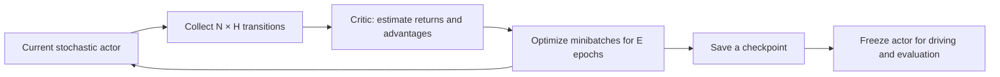

# 7. Explain the training run you already launched

**Two-minute challenge:** open the [training investigator](08-training.md#open-the-investigator). Predict the effect of doubling the number of parallel ducks, then try its budget control. A calculation you can check makes the PPO recipe easier to read.

Find the first run's environment count, rollout horizon, and iteration number. The teaching preview uses 128 ducks, 24 control steps per rollout, and 50 iterations. Each control step lasts 20 ms; the physics runs four 5 ms substeps inside it.

The loop returns to fresh simulation experience after the limited update phase. In the frozen driving/evaluation branch, there are no optimizer steps.

PPO repeats four operations: collect a recent rollout with the current stochastic actor; estimate returns and advantages with the critic; update actor and critic for a limited number of minibatch epochs; collect fresh experience.

An advantage estimates whether an action worked better than expected from its state. Positive advantage encourages that action; negative advantage discourages it. The probability ratio compares its likelihood under the candidate and rollout policies. PPO clips the surrogate objective to limit the incentive for large changes. Clipping is not a guarantee that every action probability stays inside a hard interval.

The value loss trains the critic; entropy encourages exploration; gradient clipping limits an optimizer step. The configured horizon and number of parallel environments determine the rollout size. Epochs/minibatches reuse that recent rollout without creating additional environment transitions.

The maintained PPO recipe uses 24 control steps per environment, discount 0.99, GAE lambda 0.95, clip parameter 0.2, five learning epochs, and four minibatches. A rollout of 128 × 24 contains 3,072 transitions. Fifty iterations collect 153,600 transitions, regardless of how many optimizer minibatches reuse them.

Each epoch splits the rollout into four minibatches of 768 samples. Five epochs give 20 optimizer steps per iteration, or 1,000 over the preview run. The optimizer jointly updates actor and critic; those are not two separate counts of fresh experience. The investigator reads optimizer counters from the actual saved checkpoint alongside the arithmetic prediction.

**Experiment:** change only the number of environments in a new short run. Predict the new experience budget and memory use direction. A changed transition budget is a changed experiment; do not call it an equal-data comparison.

**Check yourself:** why do we collect fresh data after the PPO updates? PPO learns from recent experience sampled by its rollout policy; indefinitely reusing old data changes that relationship.
