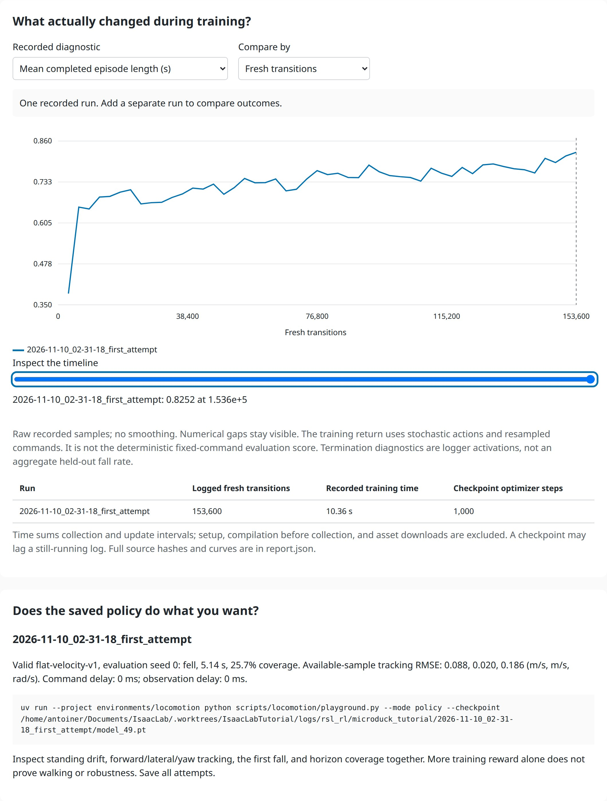
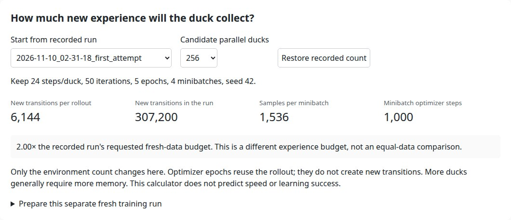
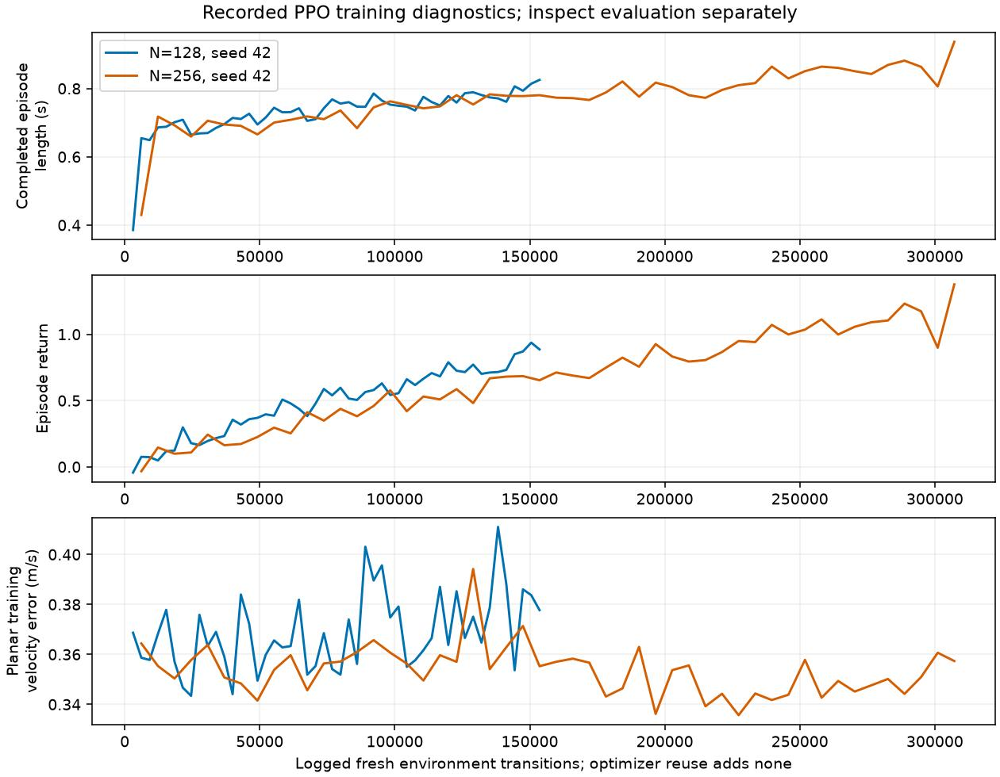
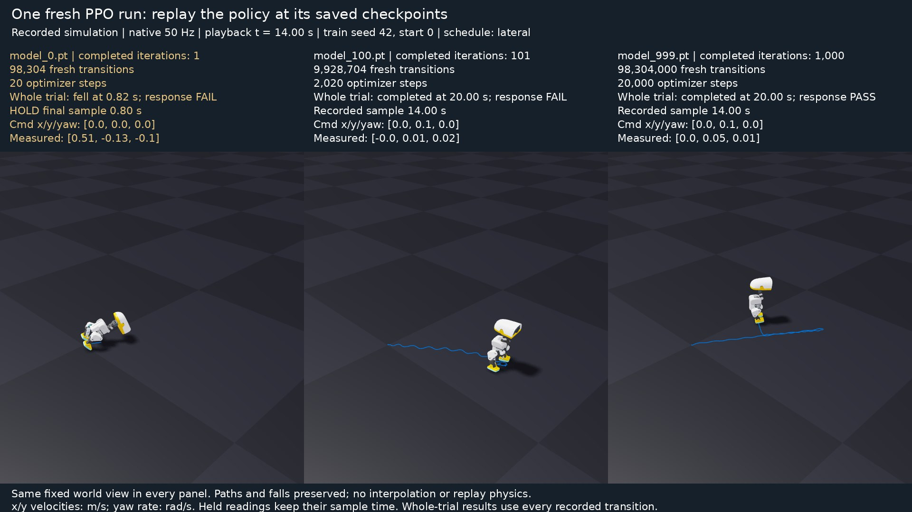

# 8. Investigate the first attempt

**Challenge:** predict what doubles when you change from 128 to 256 ducks. Then compare the prediction with two real runs.

## Open the investigator

Start with the run you trained in lesson 2:

```bash
uv run --project environments/locomotion python scripts/locomotion/training_workshop.py --run latest
```

Open the printed `outputs/training-investigator/index.html` in a browser. No server or GPU is needed to use the generated report. `latest` selects the newest nominal tutorial checkpoint's run. After selecting a run, use its exact directory to keep a later experiment from changing the selection.

If you have not trained yet, explore the supplied recorded comparison:

```bash
uv run --project environments/locomotion python scripts/locomotion/training_workshop.py --report docs/locomotion/evidence/training-comparison.json
```

This rebuilds an interactive report from actual captured data. It does not include the authors' checkpoint weights. The replay command appears only when a local checkpoint matches the recorded hash.

<details>
<summary>See the first attempt's actual progress and replay view</summary>



The curve contains the 50 raw logged samples. Its mean completed training-episode length ends near 0.825 s. That stochastic training diagnostic and the frozen policy's deterministic 5.14 s evaluation are different measurements; neither proves a useful gait. The table records the actual budget, and the final panel keeps the fall and limited coverage visible.

Explore this one-run report yourself:

```bash
uv run --project environments/locomotion --locked python scripts/locomotion/training_workshop.py --report docs/locomotion/evidence/first-attempt-training.json --output outputs/first-attempt-investigator
```

Open its `index.html`, change the diagnostic, and move the timeline. The screenshot includes the exact replay command because its checkpoint was installed on the capture machine. On another machine, the report checks the checkpoint hash again and shows an availability note until that exact model exists locally.

</details>

## Predict, then move a control

1. Choose the first attempt as the recorded run. Before changing the count, calculate `128 × 24` transitions per rollout.
2. Choose **256** parallel ducks. Which numbers double? Which stay fixed?
3. Open **Prepare this separate fresh training run** and save the candidate plan. It records your prediction and the baseline contract/hashes. Supply the downloaded file's path to the printed launcher command. It verifies the contract again before executing a fresh run; the browser does not start training.
4. Return to **128**. Predict what ten optimizer epochs would change. More reuse changes optimizer work; it does not collect extra environment transitions.



The calculator changes one factor: parallel environments. Its rollout horizon, iteration limit, epochs, minibatches, and seed remain visible. A saved plan is planned evidence; only the next run's actual logs/checkpoint prove that training occurred.

The one-factor launcher is available only when the baseline matches the current nominal task and learner configuration. A custom reward, reordered observation vector, changed control timing, or different actor cannot silently revert to defaults. Those runs remain inspectable; use their matching training configuration for a candidate. Changes to these configuration values after saving a plan also stop the launcher. To inspect a saved plan without training, run `scripts/locomotion/train_candidate.py --plan` with its path and `--dry-run` through the locomotion environment.

## Run the single-factor candidate

Reuse the first 128-environment attempt. Run this new candidate:

```bash
uv run --project environments/locomotion isaaclab train --rl_library rsl_rl --task MicroDuckTutorial-Velocity-Flat --num_envs 256 --max_iterations 50 --seed 42 --run_name investigator_n256 --visualizer none
```

Keep its printed run directory. Build a comparison with `--run` repeated for your two exact directories. The tool reads resolved `params/env.yaml`, `params/agent.yaml`, TensorBoard events, and the latest numeric checkpoint. It compares hashes of the task/objective/controller settings and reports differences. This investigator supports fresh single-GPU PPO logs; it rejects missing iteration history and inconsistent global throughput instead of guessing the amount of experience.

Switch **Compare by** between **Completed iterations**, **Fresh transitions**, and **Recorded training time**. At equal iteration count, the 256-environment run has seen twice as much experience. At equal transition count, it has made fewer PPO updates. Neither axis makes those two experiments an equal-data, equal-update comparison.

Select episode length, reward, planar velocity error, and exploration scale in turn. Move **Inspect the timeline** to read actual samples. Curves are unsmoothed; a numerical gap stays visible. Invalid evaluation receipts retain their failure reason without inventing duration or tracking scores. Training velocity errors are the task logger's metrics, not the fixed-protocol evaluation RMSE. Termination diagnostics summarize stored per-environment activations; they are not a held-out fall fraction.



## Check the behavior separately

Use [the fixed evaluator](09-evaluation.md) on each exact checkpoint. To show its results inside the report, add `--evaluation` with each receipt's path. A receipt must match a selected checkpoint's SHA-256; choosing a different policy's evaluation is rejected. The report shows its seed, conditions, available duration, coverage, and failure alongside tracking error.

In the captured example, both runs used seed 42, horizon 24, five epochs, four minibatches, and 50 iterations:

| Run | Fresh transitions | Checkpoint optimizer steps | Recorded collection + update time | Fixed-protocol result |
| --- | ---: | ---: | ---: | --- |
| 128 ducks | 153,600 | 1,000 | 10.36 s | Fell at 5.14 s; 25.7% coverage |
| 256 ducks | 307,200 | 1,000 | 10.71 s | Reached 20 s; 100% coverage |

These are actual RTX 5090 measurements, excluding setup and asset downloads. [Recorded curves and hashes](evidence/training-comparison.json) and [capture provenance](evidence/training-validation.json) preserve the evidence. Hardware, caching, and workload affect timing; the table is not a speed promise.

The surviving candidate still has tracking error. Its short-run stochastic training episodes and deterministic evaluation also measure different behavior. One seed and one deterministic nominal start do not establish a reliable improvement or a reference walking benchmark. Preserve the failed attempt; do not compare its short pre-fall RMSE as if it completed every command segment.

**Record:** identify one plausible failure cause and one observation that would distinguish it from another cause. For the next run, choose one change and state its experience budget before launching.

<details>
<summary>Compare early, middle and late checkpoints from a longer run</summary>

Predict which snapshot first survives, and which follows every command. These three checkpoints come from **one separate 4,096-environment training run**, training seed 42, evaluated independently from the same actual `balance-starts-v1` start, seed 0. All camera panels preserve the same fixed world view.



[Watch the native movie](https://github.com/AntoineRichard/IsaacLabTutorial/releases/download/microduck-tutorial-media-3463b86/training-progress.mp4). [Recording inputs and checksums](reference/downloads.md).

| Saved checkpoint | Completed iterations | Fresh transitions | Optimizer steps | This fixed-start result |
| --- | ---: | ---: | ---: | --- |
| `model_0.pt` | 1 | 98,304 | 20 | Fell at 0.82 s |
| `model_100.pt` | 101 | 9,928,704 | 2,020 | Survived 20 s; failed command response |
| `model_999.pt` | 1,000 | 98,304,000 | 20,000 | Completed 20 s and passed response criteria |

`model_0` is saved **after** the first collection/update cycle. It is not an untrained policy. The counts come from checkpoint optimizer counters and contiguous event logs, rather than filenames alone. These snapshots show one learning history and one evaluation start; they do not estimate variation across independent training seeds. Training need not improve monotonically.

[The checkpoint study](evidence/checkpoint-progress.json) retains model/receipt hashes, exact budgets and outcomes. The native-cadence movie contains 1,000 frames over 20 s with no interpolation or playback physics. After the early trial ends, its panel holds the final pre-reset pose and labels the time of its unchanged command/measurement sample. [Media validation](evidence/checkpoint-media-validation.json) records the encoding and input provenance.

To make this comparison from your own longer run, evaluate its selected checkpoints separately using identical starts and commands. For example, repeat this command with `model_100.pt` / `iteration-100` and `model_999.pt` / `iteration-999`:

```bash
uv run --project environments/locomotion --locked python scripts/locomotion/evaluate.py --checkpoint PATH_TO_YOUR_FULL_RUN/model_0.pt --start-protocol balance-starts-v1 --seed 0 --output outputs/progress/iteration-0
uv run --project environments/locomotion --locked python scripts/locomotion/collect_checkpoint_progress.py --run PATH_TO_YOUR_FULL_RUN --receipt outputs/progress/iteration-0/receipt.json --receipt outputs/progress/iteration-100/receipt.json --receipt outputs/progress/iteration-999/receipt.json --output outputs/progress/study.json
uv run --project environments/locomotion --locked python scripts/locomotion/render_checkpoint_progress.py --study outputs/progress/study.json --output outputs/progress/progress.mp4 --thumbnail outputs/progress/progress.jpg
```

Replace the run-directory placeholder with your saved run. The collector checks actual models, progress, matching physical conditions, starts and commands, and recomputes each trial's metrics before labeling it. The renderer checks the exact receipt bytes again. Preserving the early failure is part of the experiment.

</details>

<details>
<summary>Keep investigating in TensorBoard</summary>

```bash
uv run --project environments/locomotion python -m tensorboard.main --logdir logs/rsl_rl/microduck_tutorial
```

Inspect reward, mean episode length, velocity errors, exploration scale, losses, and ending diagnostics together. A high upright reward can coexist with poor command tracking. The nominal task disables extra sensor corruption, command/observation delay, battery variation, pushes, and curricula while retaining the BAM actuator model. Head/body commands remain fixed. Physical behavior, observed inputs, and learning diagnostics help distinguish causes; an extra training budget alone is not a diagnosis.

</details>
