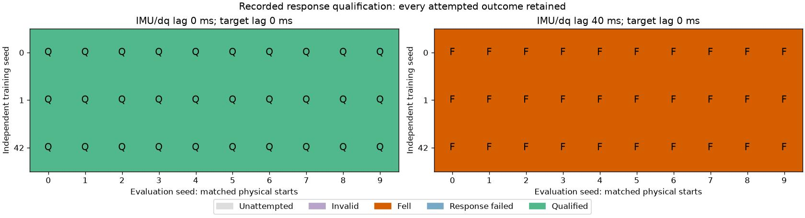
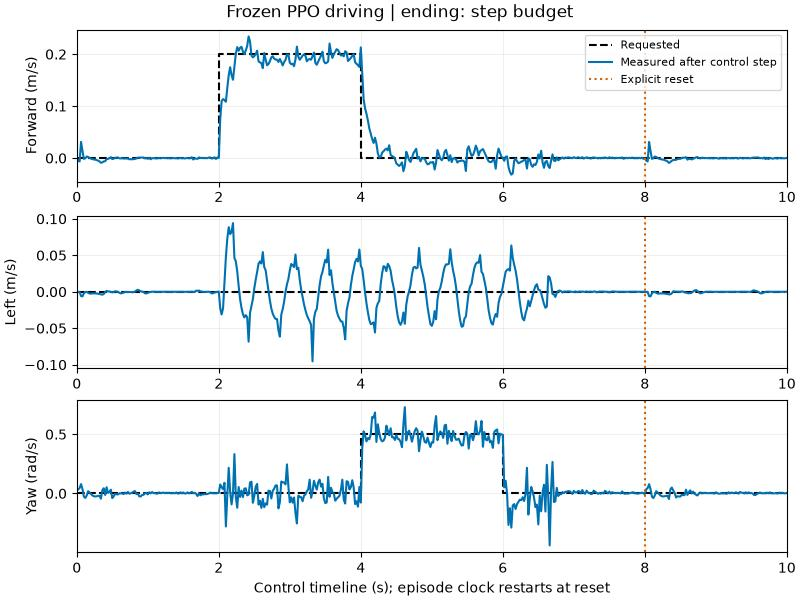
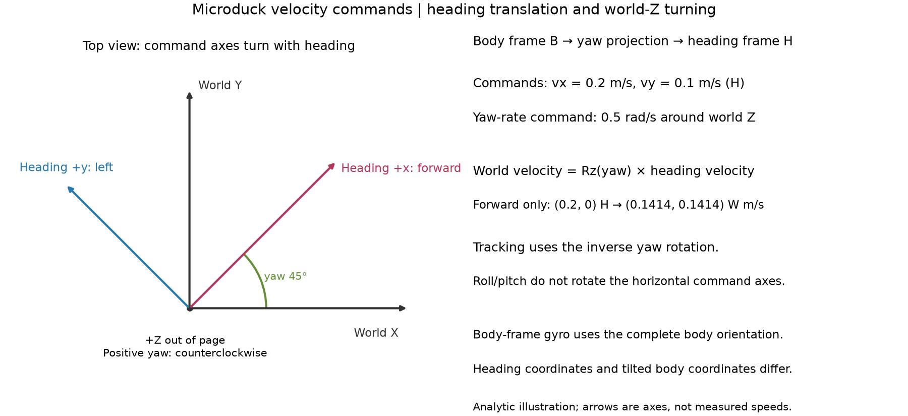

# 9. Evaluate what you actually care about

Run the fixed protocol on an exact checkpoint:

```bash
uv run --project environments/locomotion python scripts/locomotion/evaluate.py --checkpoint latest --seed 0
```

The schedule is 0–4 s standing; 4–8 s forward at 0.2 m/s; 8–12 s backward at 0.1 m/s; 12–16 s lateral at 0.1 m/s; 16–20 s turning at 0.5 rad/s. Every command is supplied in the task's declared frame. Use an exact checkpoint path once selected.

## Find the failing condition

Before running more training, predict the result of adding 40 ms of IMU/joint-velocity lag to a frozen policy. Build the offline explorer from the included measurements:

```bash
uv run --project environments/locomotion python scripts/locomotion/qualification_workshop.py --report docs/locomotion/evidence/ppo-starts-matrix.json --report docs/locomotion/evidence/ppo-delay40-matrix.json
```

Open the printed `index.html` path. Switch conditions, pick a trial, and inspect its segment coverage. Find training seed 42 / evaluation seed 0: did it reach the forward command? Its missing response bars are evidence that those segments were never attempted.



The actual nominal matrix qualified 30/30 trials. All 30 delayed trials fell between 1.38 and 5.28 seconds; 29 ended before the forward command at four seconds. Each of the three policies was trained independently for 98,304,000 transitions. The ten initial physical states are shared across policies and conditions. This result describes the declared starting-state box and delay intervention; it establishes neither general robustness nor hardware transfer. [Data and reproduction details](evidence/qualification-validation.json).

When full recordings are installed locally and their checksums match, a delayed trial also shows a command to open its baseline ghost in Newton. The included numerical report works without those larger recordings. UI selection reveals saved experiments; it does not run new physics. [Preview the actual explorer](media/qualification-explorer.jpg).

## Take the controls

```bash
uv run --project environments/locomotion python scripts/locomotion/playground.py --mode policy --checkpoint latest
```

Open **Microduck playground**. This loads your saved PPO actor in inference mode. Start with **Stand**, request 0.2 m/s forward, return to Stand, then try a 0.5 rad/s yaw command. Predict whether stopping will take one control step. Sliders stay inside the training command range; the measured velocities show the actual response. The policy owns the joint targets and remains frozen throughout.

Pause and use **Single control step** to inspect one transition. In the observation inspector, select `velocity_commands` to see the command supplied to the actor, or `actions` to inspect its previous request. Freezing that display leaves the controller running. If the duck falls, its final physical pose is held until **Reset experiment**; the reset starts a new trial with cleared histories.

For a desktop-free version:

```bash
uv run --project environments/locomotion python scripts/locomotion/playground.py --mode policy --checkpoint latest --headless --scripted --steps 500 --capture --output outputs/drive
```

The 10-second script asks for stand, forward, turn, stand, then explicitly resets and stands. It stops earlier if the duck falls. Its receipt records commands, measured velocities, policy actions, requested servo angles, observation widths, and checkpoint hash. This is a driving activity with its own schedule, not the fixed 20-second benchmark above.



This capture uses the seed-42 reference after 1,000 iterations (98,304,000 transitions). The forward response takes several steps to settle. Lateral oscillations during walking remain visible despite a zero lateral command. A short first-attempt checkpoint can fall instead; do not expect this trace from 50 iterations. [Capture provenance](evidence/playground-validation.json) identifies the policy and scripts.

```bash
uv run --project environments/locomotion python scripts/locomotion/plot_playground.py --receipt outputs/drive/receipt.json --output outputs/drive/tracking.svg
```

The viewer's native **Reset Episode** also clears the tutorial's controller and display histories. If it interrupts a transition while the scene is rendering, that transition is logged as a reset event and excluded from the motion trace. A viewer reset is not a fall.

## Which way is forward?

**Predict:** turn the duck 45°, then ask for forward motion. Should its world position change only along world X?



The tracking reward and evaluator express horizontal velocity in the **heading frame**: keep the body's yaw, remove roll and pitch. At a 45° heading, a forward-only 0.2 m/s command corresponds to world velocity `(0.1414, 0.1414, 0)` m/s. Turning is compared with angular velocity about **world Z**. The actor's body-frame gyro uses the complete body orientation; those coordinates differ when the duck tilts.

This is an analytic illustration, not a measured trajectory. Its [source and numerical transform check](evidence/velocity-frames.json) include a tilted-body negative control against the maintained quaternion functions. Rebuild the JPEG and editable SVG master with:

```bash
uv run --project environments/locomotion python scripts/locomotion/plot_velocity_frames.py --output outputs/frames/velocity-frames.jpg --master outputs/frames/velocity-frames.svg
```

## Read the benchmark honestly

The evaluator stops at the **first episode ending**. It does not silently restart a fallen robot and call the next episode a continuation. Each record saves the pre-step pose/velocities, following transition reward, reward-time tracking error, and individual termination reasons; an optional image is the final pre-step state rather than the autoreset stance. A `nan_state` termination invalidates the trial and returns an error after saving its diagnostic receipt. It is not counted as an ordinary fall, even if autoreset made the subsequent state finite.

Read tracking RMSE **together with** the fall flag, available duration, and fraction of the 20-second horizon covered. Low error over a short pre-fall segment is not full-protocol success. An early-standing failure has never attempted the later walking segments.

For publication-quality claims, compare at least three independent training seeds under a declared distribution of initial states and conditions, reporting all attempts and variation across training seeds. The nominal teaching reset is deterministic: changing its seed alone does not produce ten distinct physical starting states. The driving capture below is a one-policy preview. Use per-segment response, standing drift, and requested-target rate together with the global tracking error.

## Change the starting state deliberately

```bash
uv run --project environments/locomotion python scripts/locomotion/evaluate.py --checkpoint latest --start-protocol balance-starts-v1 --seed 0
```

Change the evaluation seed. Compare `start_condition`, `initial_state`, and `initial_actor_observation` in the receipts: which values changed? `balance-starts-v1` samples small initial tilts and velocities, plus heading, with the home joints retained. It is a declared simulation challenge. The default `nominal-v1` resets deterministically; new seed labels alone do not create different physical starts.

A matched ghost requires the same start protocol, evaluation seed, and actual initial poses **and velocities**. See the [distribution, frames, and reset sequence](reference/evaluation-protocols.md#change-the-starting-state-deliberately).

## Survival is only one check

A duck that stands still through a forward command has survived but failed the task. `flat-response-v1` requires the complete 20-second protocol, no fall, every segment's tracking limits, sufficient signed response, and limited standing drift. Unattempted segments retain unavailable scores. Open the [exact numerical criteria](reference/evaluation-protocols.md#survival-is-only-one-check) after making your prediction in the explorer.

## Repeat the same physical starts across training seeds

Use independently trained checkpoints from the same recipe and transition budget. Pass each exact checkpoint path once:

```bash
uv run --project environments/locomotion python scripts/locomotion/qualify.py --checkpoint logs/rsl_rl/microduck_tutorial/SEED_42_RUN/model_999.pt --checkpoint logs/rsl_rl/microduck_tutorial/SEED_0_RUN/model_999.pt --checkpoint logs/rsl_rl/microduck_tutorial/SEED_1_RUN/model_999.pt --output outputs/ppo-qualification
```

Replace the three run-directory names with your recorded directories. The default is `balance-starts-v1` under evaluation seeds 0–9. The tool checks recorded training seeds, task/learner settings, checkpoint hashes, and the selected checkpoints' completed collection/optimizer counters before launching. Matching requested iteration limits alone is insufficient. One worker runs by default; `--workers 3` runs three independent simulator processes when GPU memory permits. This is parallel evaluation of isolated trials, not multi-GPU training.

Each trial keeps its full receipt, log, and subprocess exit status under `trials/train-seed-…/eval-seed-…/`. `report.json` records every completed outcome and any infrastructure error. A software failure stops new work and leaves the study incomplete. A numerical trial failure remains an invalid attempted outcome. Resume the exact command with `--resume` to reuse previously accepted matching receipts, including physical failures; it checks the frozen configuration/source, algorithm, checkpoint/sample identity, and recorded receipt checksums. A receipt written by a subsequently failed process cannot become accepted just by resuming.

Read per-training-seed survival and response-pass rates, then their mean and sample standard deviation across training seeds. Invalid and fallen attempts stay in pass-rate denominators. Tracking-error means use only complete valid trials and show their count; if none completed, the mean stays unavailable. A partial study is not a completed benchmark. The summary also counts **actual distinct physical states**, so repeating a deterministic nominal reset cannot manufacture ten different starts.

The receipt includes commanded/measured velocities, root/joint poses, per-term reward rates, original weights, seed, checkpoint hash, and timing. Keep it with comparison plots so a visual result remains auditable.

**Challenge:** find a policy with a good-looking scalar score but insufficient episode coverage. Explain why reward and task success disagree.
