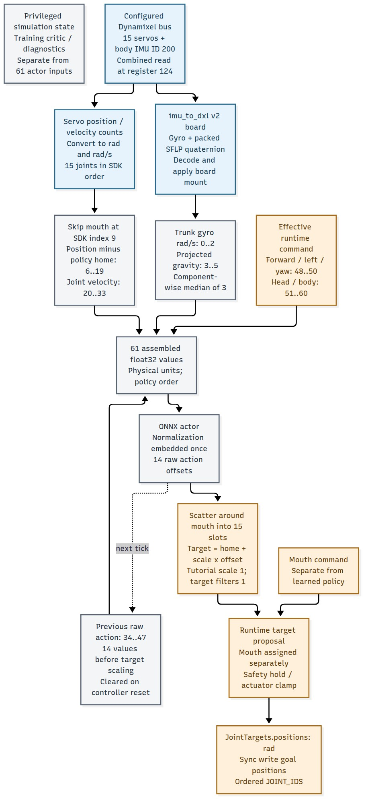
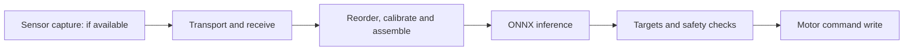

# 10. Follow one real signal into the policy

**Challenge:** the right knee answers on motor ID 13. Which observation and action slots should it use? Trace the source-based map, then check the same mapping on your own simulated recording before connecting hardware.



This schematic describes the [pinned standard Duck runtime](https://github.com/pollen-robotics/microduck/tree/da34a2212ae12eddfd73d0dfbf924f291aaf1dc9/duck-control). It is an interface map; it does not show measured wiring, calibration or timing on your robot.

## Trace the knee packet

Use the first nominal evaluation from lesson 2. Predict the right-knee feature and target before running:

```bash
uv run --project environments/locomotion python - <<'PY_PACKET'
import json
from pathlib import Path

receipt = json.loads(Path("outputs/evaluation/receipt.json").read_text())
row = receipt["trajectory"][0]
servo = receipt["joint_names"].index("right_knee")
home = receipt["contract"]["home_rad"][12]
q = row["joint_pos_rad"][servo]
feature = row["actor_observation"][18]
action = row["action"][12]
target = row["target_pos_rad"][12]
assert abs(feature - (q - home)) < 1e-5
assert abs(target - (home + action)) < 1e-5
print({"encoder_rad": q, "home_rad": home, "position_input_18": feature,
       "raw_action_12": action, "requested_target_rad": target})
PY_PACKET
```

This checks the nominal zero-bias, unit-scale packet. The SDK joint index is **13**, policy action index **12**, position input **18**, velocity input **32** and previous-action input **46**, all zero-based. They differ because the SDK includes the mouth outside the 14-action policy. Never copy the SDK index directly into a policy slot.

**Change one thing on paper:** a +0.01 rad encoder bias adds 0.01 to the position feature and subtracts 0.01 from the requested physical target under this action convention. A photo of a plausible stance would not reveal that mismatch. Try the bias knob in lesson 11 after recording your prediction.

## Match the actual interfaces

| Policy quantity | Standard Duck source and preprocessing | What to check on your robot |
| --- | --- | --- |
| Trunk angular velocity | IMU gyro converted to rad/s and rotated for the configured board/mount | Axis order/signs and motion direction |
| Projected gravity | Board-oriented IMU gravity with component-wise three-sample median preprocessing | Upright direction, tilt response and preprocessing; median is not a fixed transport delay |
| Joint position minus home | Calibrated encoder angle in rad, reordered with mouth excluded | Servo identity, signs, zero offsets and home pose |
| Joint velocity | Encoder speed converted to rad/s, same joint order | Units, update cadence and repeated/stale reads |
| Previous action | Last raw 14-value actor output | Clear feedback on re-enable; do not substitute targets after adding home |
| Desired commands | Forward/left/yaw plus fixed zero head/body slots | Frames, bounds, operator intent age and zero-command behavior |
| Joint target | Home + scale × raw action, followed by configured runtime filters and limits | Scale, filter factors, gain and approved calibrated travel |

The critic's simulation-only base velocity and contact information have no place in the deployed actor. The hardware adapter must supply only the actor's 61 inputs. Verify each conversion once, including whether a reported value already includes calibration; subtracting a calibration offset twice changes the controller.

## Start with read-only calibration checks

With the actual robot held safely and motor writes disabled by its supported setup, record one hand-moved joint and a slow trunk tilt. Identify the robot/board revision, firmware, bus, IMU mounting, encoder calibration, power conditions and update rate. Compare signs and zero pose with the puppet, then compare named values before constructing the full actor packet.

Use a record with these columns for each control tick:

```text
tick_id, channel, sensor_capture_ns, receive_ns, inference_start_ns,
inference_end_ns, target_send_ns, source_units, calibrated_value, freshness_status
```

Keep unavailable acquisition timestamps empty. A bus-read timestamp is not automatically a sensor-capture timestamp. Shared packet arrival does not establish simultaneous sampling. The same sensor value twice might mean the robot was still; it is not enough to measure sample age.

<details>
<summary>Build a timing budget before enabling a policy</summary>



At 50 Hz the target period is 20 ms. Measure read/assembly/inference/write time and deadline overruns on the robot board. Report capture-to-use age only when the clocks are aligned and the capture timestamp exists. An actor-only workstation benchmark covers just one box.

Real/sim stance photos and measured board timing are still pending hardware work. Label support conditions in any eventual comparison. The simulated packet exercise above can be completed without those measurements.

</details>

**Record:** one wrong sign, index, unit or timestamp interpretation that could pass a visual stance check. Next, [introduce the mismatch deliberately in simulation](11-effects.md).
