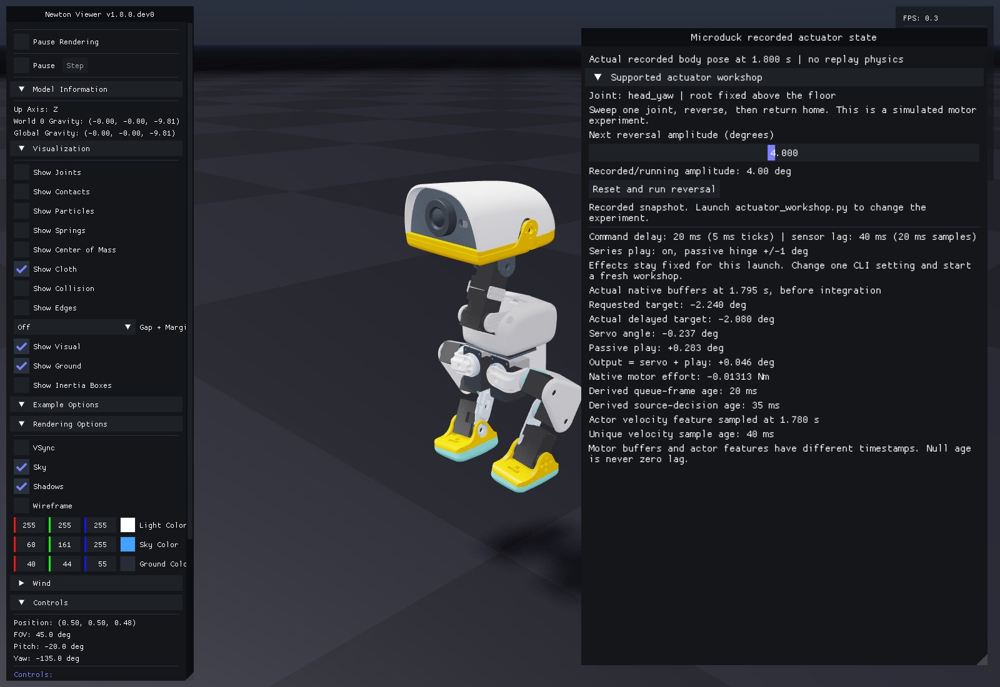
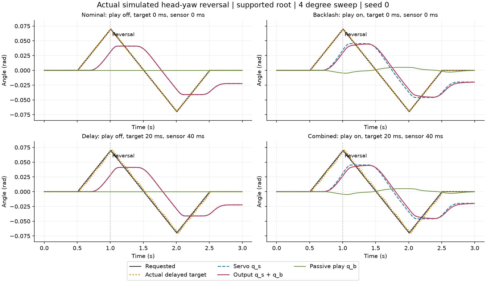
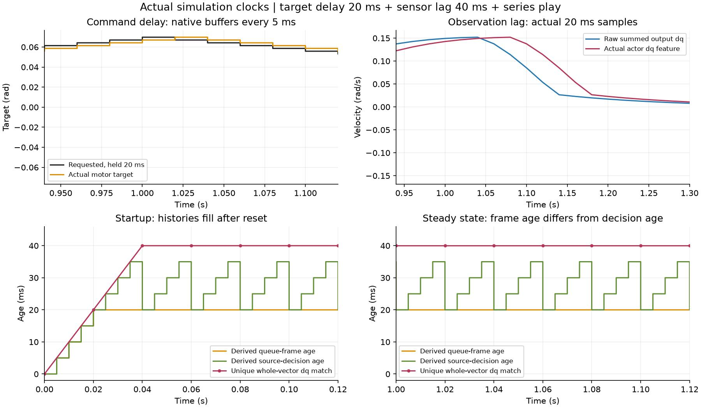
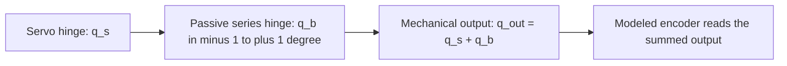
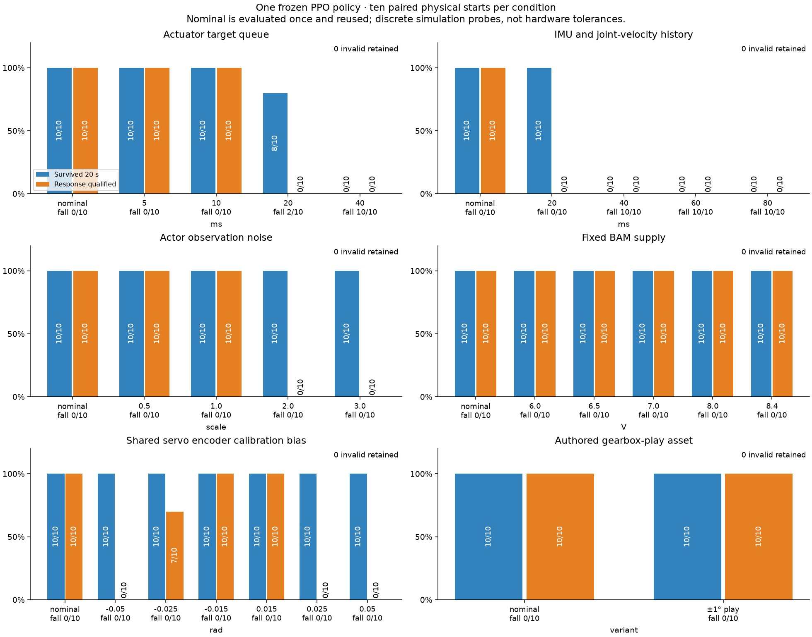
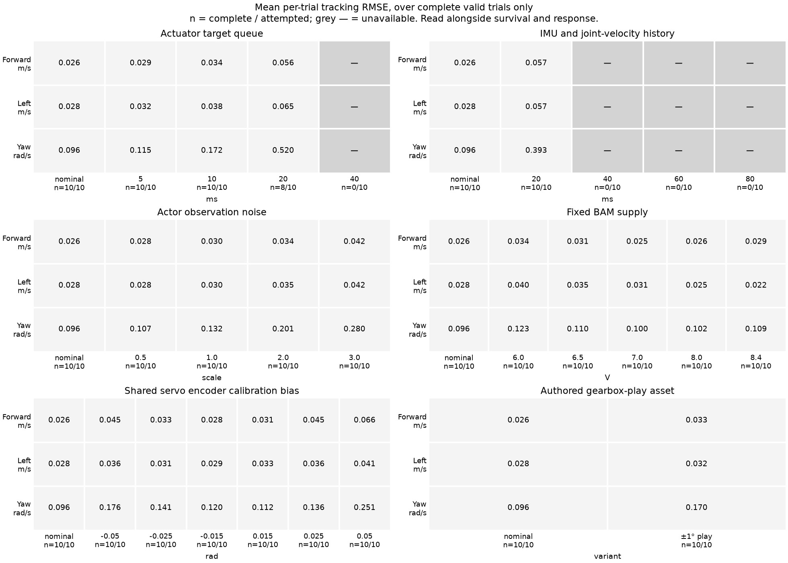
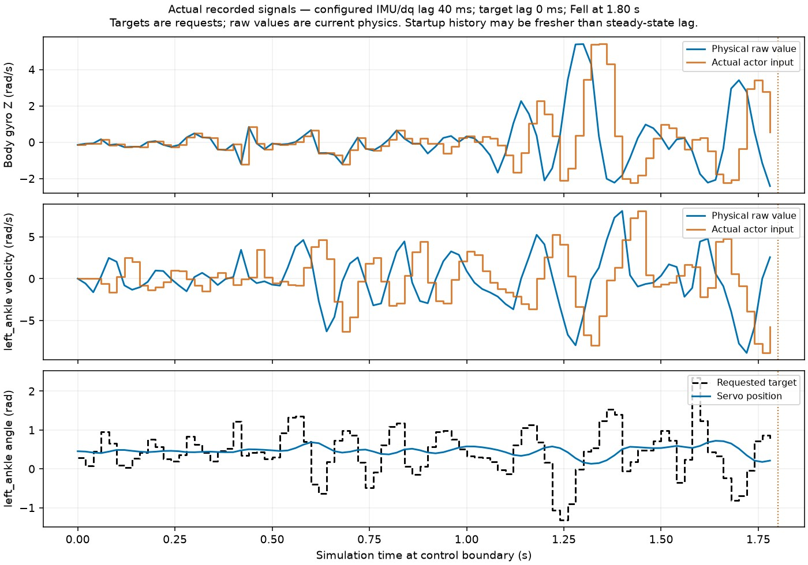

# 11. Turn a reality-gap knob

Predict whether adding 40 ms of sensor lag will change the policy's actions. Open the native Newton experiment using an exact checkpoint from your run:

```bash
uv run --project environments/locomotion python scripts/locomotion/effects_workshop.py --checkpoint logs/rsl_rl/microduck_tutorial/YOUR_RUN/model_999.pt
```

In **Reality-gap experiment**, change **IMU/dq delay** from zero to two samples and press **Apply and restart trial**. Playback closes while a fresh candidate is recorded, then reopens beside the same baseline ghost. The policy weights and initial mechanical state remain fixed. Editing a slider alone leaves the displayed recording unchanged; pending edits are labeled.

Pause, scrub, hide the ghost, or switch to side-by-side display. Find the earliest visible divergence. Then choose **Restore nominal settings** and apply again. Every application preserves its settings, log, recording, and comparison under a new `trial-…` directory. Closing the viewer finishes the workshop.


The image is an offscreen capture of the working native widgets and real recordings. Collapse **Reality-gap experiment** when you want more room for replay controls.

For an immediate activity without training or simulation, [open the included qualification explorer](09-evaluation.md#find-the-failing-condition). It contains actual nominal and delayed trials.

## Try one physical mechanism

| Control | What changes | What to inspect |
| --- | --- | --- |
| Target delay | BAM command history, in 5 ms physics steps | Requested target versus delayed motor response |
| IMU/dq delay | IMU and joint-velocity histories, in 20 ms samples | Stale motion readings; position and previous action stay undelayed |
| Sensor noise multiplier | Uniform angular-velocity, gravity, position and velocity noise | At multiplier 1: bounds ±0.03 rad/s, ±0.01, ±0.001 rad, ±0.25 rad/s respectively |
| Fixed battery voltage | BAM supply voltage, with sag disabled | Changed available motor response under the same policy |
| Encoder bias | One signed radian offset applied to every encoder, fixed for the trial | Initial observation offset and the action transform's compensating target offset |
| Mechanical gearbox play | The actual asset with 14 servo joints plus 14 passive hinges, each spanning ±1° | State-dependent play after reversals; servo and output angle differ |

These are teaching interventions, not measured hardware tolerances. Noise is added when actor observations are computed; the critic stays uncorrupted. Encoder bias is fixed rather than redrawn each step. Battery sag, IMU mounting uncertainty and other hardware effects remain separate mechanisms. The complete settings and cadence are saved in each receipt's `effect_settings`.

Every application constructs a fresh trial and clears its histories. Backlash additionally changes the physical topology. The comparison retains all 28 raw coordinates and matches the known output-angle mapping against the nominal robot, requiring zero initial passive displacement and velocity. It cannot hide a different initial motor state behind equal summed output angles.

## Watch a bounded reversal

**Predict:** is gearbox play a delayed target, or a difference between servo and output angle? Try a supported joint without needing a trained policy:

```bash
uv run --project environments/locomotion python scripts/locomotion/actuator_workshop.py --backlash --output outputs/play-reversal
```

Choose **4 degrees**, then **Reset and run reversal**. Watch the actual target, servo coordinate and passive play; the mechanical output is their sum. Pause or single-step to inspect a reversal. After completion the physical pose is held. Changing the amplitude slider prepares the next run; every run starts from the same reset and is retained in its own `trial-…/receipt.json`.



This is the working native panel at an actual recorded state: body pose at 1.800 s, motor buffers at 1.795 s, and actor velocity feature sampled at 1.780 s. The capture uses recorded transforms with zero replay physics. Open the live workshop to change the next experiment.

Now relaunch with **only** `--command-delay-ms 20` added. Predict which signal shifts. Add `--observation-delay-ms 40` in another fresh launch to inspect the separate sensor history. The root stays fixed above the floor, all other joints request their reference angles, and no policy is choosing actions. Observation lag therefore changes the displayed actor features without changing this prescribed command program.



These are simulated 4° sweeps with seed 0: nominal, play alone, both delays without play, and both delays with play. Each retains 600 native physics samples and 150 control samples. All actual servo/root starts match; passive coordinates start at zero. The play coordinate traverses only part of its available clearance here. The asset difference also adds the documented 14 mg; these plots do not measure hardware backlash or qualify walking.



**Spot the difference:** the queue receives a frame every 5 ms, even while a control decision is held for 20 ms. After startup its selected frame is 20 ms old, but the originating control decision is 20, 25, 30 or 35 ms old. The velocity feature has its own 20 ms cadence: its uniquely identified age is 0, then 20, then 40 ms in this recording. A repeated or unmatched signal gives **unavailable**, never an invented age. These are simulation-clock identities, not hardware capture/receive timestamps.

<details>
<summary>Record, rebuild, and inspect the evidence</summary>

Add `--headless` to record one full reversal without a viewer. The [portable recorded study](evidence/actuator-data.json) retains all four traces and one physical snapshot. Redraw the figures without simulation:

```bash
uv run --project environments/locomotion python scripts/locomotion/plot_actuator.py --data docs/locomotion/evidence/actuator-data.json --output outputs/rebuilt-actuator
uv run --project environments/locomotion python scripts/locomotion/capture_actuator.py --receipt docs/locomotion/evidence/actuator-data.json --output outputs/rebuilt-actuator/panel.jpg
```

To audit newly collected trials, use `plot_actuator.py --study YOUR_STUDY --output YOUR_FIGURES`. It expects `nominal`, `delay`, `backlash`, and `combined` directories with `trial-000/receipt.json`, using exactly the four configurations in the plots. Keep seed 0, joint `head_yaw`, and amplitude 4°. It checks actual starts, clocks, targets, signal-age matches and producer identity before pooling.

The recorder copies actual native buffers after actuator computation and before each integration step. One read-only internal delayed-target array is guarded by the exact pinned BAM source hash; an SDK upgrade requires re-auditing this diagnostic. The independent motor-law check agrees within 3.73×10⁻⁹ Nm in these runs. A run without the recorder produced bitwise identical joint/body/root trajectories, actions and actor velocity inputs at all 150 control frames. [Validation and limitations](evidence/actuator-validation.json) distinguish actual mouse-event checks, simulation checks and recorded-state rendering.

An in-process retry restores the same joint/base state and clears command/sensor histories, but is not promised bitwise identical. In the tested repeated 4° reversal, servo and passive coordinates differed by at most 3.47×10⁻⁷ and 4.20×10⁻⁷ rad. The native previous-solve external-load input also differed at the first tick. Use a fresh launch for controlled comparisons, as the four published conditions do; the workshop preserves each retry separately.

</details>

## Use a frozen experiment file

<details>
<summary>What does the backlash coordinate mean?</summary>



On reversal, the passive hinge can traverse its available clearance before loading the opposite stop. The transmitted motion depends on load, friction and contacts; it is not a fixed number of milliseconds or a constant offset. This is a conceptual mechanism with the exact coordinate mapping used by the known asset. The BAM controller and actor encoder feature use the summed output; the raw receipt preserves each coordinate separately.

**Predict:** after reversing a joint, which should you compare with the target: `q_s`, `q_b`, or `q_s + q_b`? Inspect both servo and output traces before treating a discrepancy as sensor delay.

</details>

This runs the same workflow without a desktop, using the supplied backlash snapshot:

```bash
uv run --project environments/locomotion python scripts/locomotion/effects_workshop.py --checkpoint logs/rsl_rl/microduck_tutorial/YOUR_RUN/model_999.pt --effects docs/locomotion/experiments/effects-backlash.json --headless --output outputs/backlash-workshop
```

Use a fresh output directory for each workshop. Add `--capture-ui` to render the actual native controls offscreen too; `--record-only` omits rendering. Other one-factor snapshots cover [40 ms lag](experiments/effects-delay40.json), [noise](experiments/effects-noise.json), [6.5 V](experiments/effects-low-voltage.json), and [encoder bias](experiments/effects-encoder-bias.json). Change one factor, predict the outcome, and compare task response as well as survival.

**Predict:** does a duck that survives a larger reality gap still follow its commands? Pick one knob in the workshop before revealing the measured study.

<details>
<summary>Reveal 250 actual frozen-policy attempts</summary>



One nominal PPO policy, training seed 42, encountered 25 distinct conditions under the same ten `balance-starts-v1` initial states and 20-second command protocol. The nominal ten attempts were evaluated once and reused in each panel. Blue counts full-trial survival; orange counts response qualification. Falls remain in every denominator. All 250 attempts were numerically valid; invalid attempts would be counted separately.

At **20 ms observation lag**, all ten trials survived but none qualified. A **20 ms actuator queue** left eight upright, again with zero qualified responses. Noise scales 2 and 3 also preserved all ten full trials while losing response qualification. The sampled voltage levels and the isolated authored backlash variant qualified on all ten starts. These results describe this one policy and these simulation probes; they do not establish a hardware tolerance or variation across independently trained policies.



Tracking means use **complete valid trials only**. The 20 ms queue column therefore describes eight of ten attempts; its two falls are absent from that conditional mean but remain in the survival and response counts. At larger delays no trial completed, so full-trial tracking is unavailable. Never read a missing or conditional error without the outcome counts.

**Explain:** why can an overall tracking error look modest while a command segment fails? Inspect the per-segment criteria and failure reasons in the [portable audited study](evidence/sensitivity-study.json). Then try a nearby setting in your own fresh workshop; interpolation between the sampled levels is not a measured failure boundary.

Rebuild both figures without simulation:

```bash
uv run --project environments/locomotion --locked python scripts/locomotion/summarize_effect_sweeps.py --data docs/locomotion/evidence/sensitivity-study.json --output outputs/rebuilt-sensitivity
```

[Validation](evidence/sensitivity-validation.json) records the actual source/model/asset locks, OSMO collection hashes, completed jobs and raw-data checks. Calibration bias changes both the actor's joint-position reading and the physical target mapping. The backlash intervention also includes its documented 14 mg authored mass difference. Every other factor uses the exact nominal settings in the plan.

</details>

<details>
<summary>Repeat a bounded one-policy sensitivity experiment</summary>

Keep one qualified policy frozen. The [declared sweep plan](experiments/sensitivity-plan.json) changes one setting at a time: target delay, observation lag, actor noise scale, fixed voltage, encoder calibration bias, or the authored backlash variant. Its 25 distinct conditions reuse the same ten physical starts. Evaluate the nominal control once, then share those ten baseline trials across all six views.

**Predict:** which setting will first prevent standing, and which might preserve standing while losing command response? The chosen levels are simulation probes, not measured hardware tolerances. This experiment has one independent training seed; the ten reused physical starts do not provide ten independent learned policies.

The encoder-bias intervention applies the same signed constant to all 14 servo encoders. The maintained action term adds that bias to the actor's joint-position reading and subtracts it from the physical joint target. It changes both sides of the interface, rather than only corrupting an observation. Noise scale also has a specific interpretation: it scales the four independent uniform component bounds recorded in the plan. Backlash selects a discrete asset variant; it does not continuously change hinge clearance.

Choose an exact checkpoint and compute its hash with `sha256sum`. Replace the path and digest below with those values:

```bash
uv run --project environments/locomotion --locked python scripts/locomotion/run_effect_sweep.py --checkpoint logs/rsl_rl/microduck_tutorial/YOUR_RUN/model_999.pt --checkpoint-sha256 YOUR_POLICY_SHA256 --mechanism observation_delay_ms --output outputs/sensitivity-observation
```

The runner launches independent evaluator processes, with no training command. It freezes settings, source and model bytes, retains every attempted outcome, and archives models, resolved parameters, locked assets, reports and receipts. A physical fall remains an evaluation outcome; a process failure leaves the sweep incomplete with its diagnostics preserved. `--workers 3` allows three independent processes if GPU memory permits. For a bounded preflight, add `--case observation_delay_ms-20 --seeds 0` and use a separate output directory. Do not pool that subset as a complete study.

Run `--mechanism nominal` once and repeat for each of the six field names in the plan. Full collection requests 250 attempts, not 250 independent physical starts. Keep response, survival, duration and missing measurements together; do not infer a hardware failure threshold by interpolating a few simulation levels.

</details>


This example uses training seed 42 and physical-start seed 0. Both completed 20 seconds; one trial cannot establish robustness. [Simulation and control verification](evidence/effects-validation.json) identifies the configurations, recording hashes, and tested interactions. A separate [three-training-seed delay matrix](09-evaluation.md#find-the-failing-condition) provides the broader delay evidence.

The [locked robot inputs](evidence/asset-lock.json) include the actual USD hashes. The backlash asset adds 14 tiny passive bodies, totaling 14 mg of additional authored mass. Treat the selection as the documented asset intervention; it is not a mathematically identical mass model with a single scalar changed.

## See what the actor actually received

**Predict:** with a configured 40 ms lag, are both IMU channels already two samples old immediately after reset?



The actor's ankle-velocity input matches the physical value from two control samples earlier after warmup. The IMU has its own startup rule: gyro and gravity delays begin at zero, then change on separate update phases. In this recording, the first gyro/raw difference occurs at 0.88 s and the first gravity/raw difference at 0.64 s. A configured lag alone does not describe the age of every initial sample. This policy fell at 1.80 s during the initial standing segment, before any walking command.

The black trace is the **requested** angle, and the blue trace is the measured servo angle. They differ because an actuator has dynamics and limits. The requested target is not a measured delayed/applied target; these control-boundary samples do not expose every 5 ms actuator step. With the backlash asset, the plot additionally shows servo angle plus passive play as the mechanical output.

After recording any new workshop trial with the current evaluator, inspect it with:

```bash
uv run --project environments/locomotion python scripts/locomotion/plot_signals.py --receipt outputs/backlash-workshop/trial-00/receipt.json --joint left_ankle --output outputs/backlash-signals/signals.jpg
```

The recorder reads raw physics alongside the actual actor input at the same pre-step simulation boundary; it does not recompute histories or alter the policy. The published [portable signal data](evidence/signal-delay40.json) rebuilds this exact figure without the full trajectory:

```bash
uv run --project environments/locomotion python scripts/locomotion/plot_signals.py --data docs/locomotion/evidence/signal-delay40.json --output outputs/signal-rebuild/signals.jpg
```

These are simulation timestamps. Sensor capture, transport, receive and motor-application timestamps on the real robot still need hardware measurement.

<details>
<summary>Inspect delay clocks and the smaller delay-only launcher</summary>

Predict the effect of a 40 ms observation delay. Choose the exact saved checkpoint from your run directory, then record matching trials and open the ghost viewer:

For an immediate experiment with existing measurements, [open the qualification explorer](09-evaluation.md#find-the-failing-condition). Switch from nominal to 40 ms lag, select a fallen trial, and identify which commands it never reached. The three-training-seed matrix supplies the broader simulation evidence; the one-policy ghost below helps inspect the mechanism.

```bash
uv run --project environments/locomotion python scripts/locomotion/reality_gap.py --checkpoint logs/rsl_rl/microduck_tutorial/YOUR_RUN/model_49.pt --seed 0 --observation-delay-ms 40
```

Use the same exact checkpoint, seed, and commands. The script changes IMU and joint-velocity observation lag; joint-position and previous-action channels are unchanged. It is a specific sensor-delay experiment, not a claim that every input is delayed.

Two independent simulator processes produce the baseline and changed-condition receipts. The blue translucent ghost is the baseline; the solid duck is the changed-condition trial. Their initial base pose, joint pose/order, seed, time step, horizon, and command sequence must match. Each policy remains in closed loop, so observations and actions can diverge after the initial state.

**Play:** pause, scrub recorded time, take one step, hide the ghost, change its opacity, and switch between a world overlay and side-by-side display. Ground trails retain drift. When one trial ends, its last recorded pre-reset pose stays visible and the panel marks the ending; the other trial continues. Scrubbing advances no physics. The ghost has no colliders or solver and cannot support or knock over the candidate.

The viewer controls change the display of recorded trials. To try another physical delay, rerun the command with a new value. Delay buffers are constructed for each trial; a display slider does not silently reconfigure an active simulator. Add `--headless` to record and render without a desktop, or `--record-only` to save trials without playback.

Replay an existing pair without repeating simulation:

```bash
uv run --project environments/locomotion python scripts/locomotion/compare.py --reference outputs/reality-gap/reference/receipt.json --candidate outputs/reality-gap/candidate/receipt.json
```

Command delay is separate. Try `--command-delay-ms 20`: it delays actuator targets by four 5 ms physics steps. A 40 ms observation delay spans two 20 ms samples. Converting both from the same step count would be wrong. Histories have startup/reset behavior; inspect and verify it before interpreting the first samples as steady-state latency.

Backlash is state-dependent mechanical play, particularly visible after reversals. It differs from fixed encoder bias, random noise, an action deadband, and pure delay. The maintained transfer task offers a backlash asset through `presets=backlash`; that changes the asset/observation mapping and requires scene reconstruction. A future sandbox control must not pretend the asset can be replaced by changing a scalar on an active scene.

In one exploratory run (4096 environments, 1000 PPO iterations, training seed 42, evaluation seed 0), the baseline completed 20 seconds while the 40 ms delayed trial fell after 1.62 seconds. This illustrates sensitivity for that saved policy; repeat across independent training/evaluation seeds before drawing a robustness conclusion.


The image uses a constant side-by-side display offset. Both recorded world paths remain intact. Its [measurement receipt](evidence/delay-preview.json) identifies the checkpoint, source pins, and input recording hashes.


Regenerate the chart from a new matched pair:

```bash
uv run --project environments/locomotion python scripts/locomotion/plot_comparison.py --reference outputs/reality-gap/reference/receipt.json --candidate outputs/reality-gap/candidate/receipt.json
```

**Record:** which signals were delayed, the delay in milliseconds and samples, and whether the policy survived long enough for the change to be interpretable.

</details>
