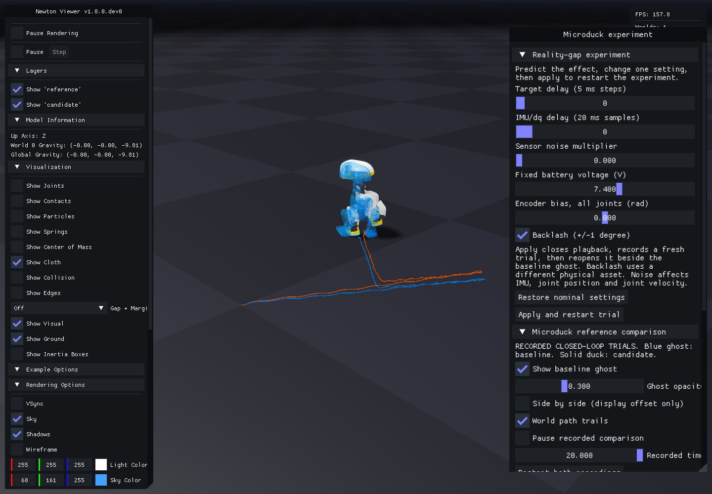
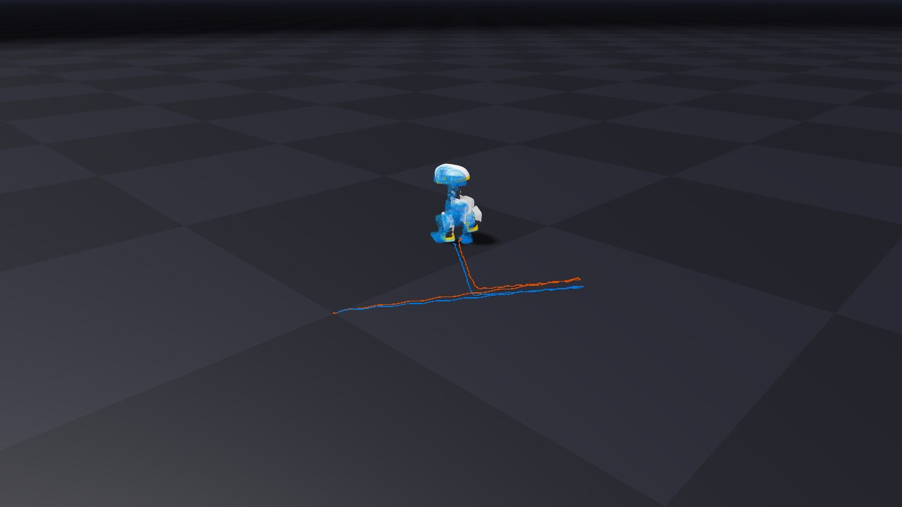
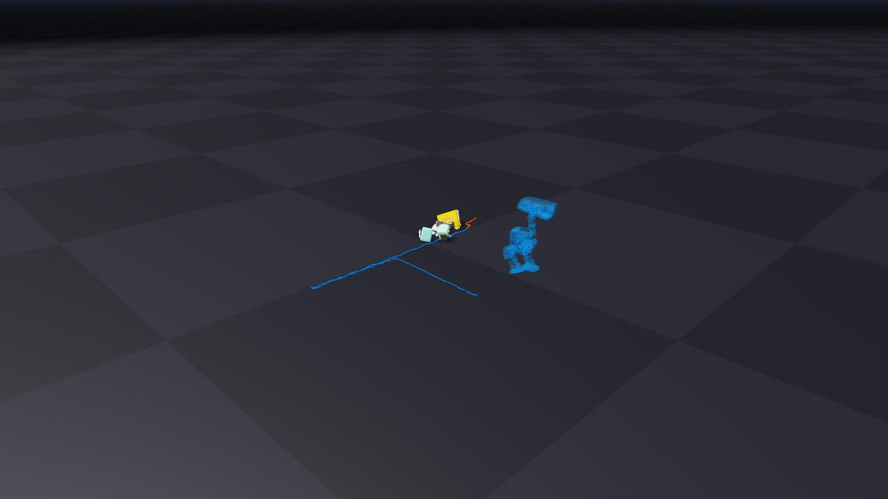
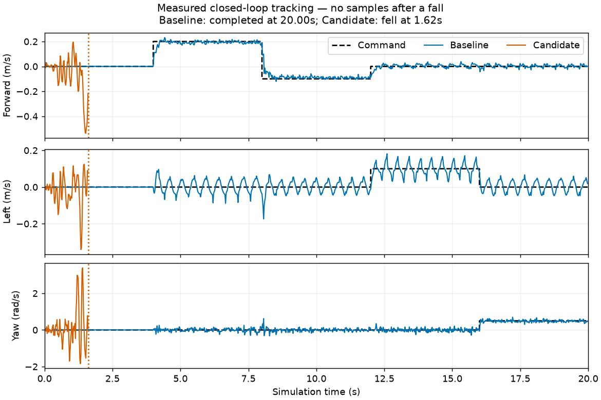

# 11. Turn a reality-gap knob

Predict whether adding 40 ms of sensor lag will change the policy's actions. Open the native Newton experiment using an exact checkpoint from your run:

```bash
uv run --project environments/locomotion python scripts/locomotion/effects_workshop.py --checkpoint logs/rsl_rl/microduck_tutorial/YOUR_RUN/model_999.pt
```

In **Reality-gap experiment**, change **IMU/dq delay** from zero to two samples and press **Apply and restart trial**. Playback closes while a fresh candidate is recorded, then reopens beside the same baseline ghost. The policy weights and initial mechanical state remain fixed. Editing a slider alone leaves the displayed recording unchanged; pending edits are labeled.

Pause, scrub, hide the ghost, or switch to side-by-side display. Find the earliest visible divergence. Then choose **Restore nominal settings** and apply again. Every application preserves its settings, log, recording, and comparison under a new `trial-…` directory. Closing the viewer finishes the workshop.



The image is an offscreen capture of the working native widgets and real recordings. Collapse **Reality-gap experiment** when you want more room for replay controls.

For an immediate activity without training or simulation, [open the included qualification explorer](09-evaluation.md#find-the-failing-condition). It contains actual nominal and delayed trials.

## Try one physical mechanism

| Control | What changes | What to inspect |
| --- | --- | --- |
| Target delay | BAM command history, in 5 ms physics steps | Requested target versus delayed motor response |
| IMU/dq delay | IMU and joint-velocity histories, in 20 ms samples | Stale motion readings; position and previous action stay undelayed |
| Sensor noise multiplier | Uniform angular-velocity, gravity, position and velocity noise | At multiplier 1: bounds ±0.03 rad/s, ±0.01, ±0.001 rad, ±0.25 rad/s respectively |
| Fixed battery voltage | BAM supply voltage, with sag disabled | Changed available motor response under the same policy |
| Encoder bias | One signed radian offset applied to every encoder, fixed for the trial | Initial observation offset and the action transform's compensating target offset |
| Mechanical gearbox play | The actual asset with 14 servo joints plus 14 passive hinges, each spanning ±1° | State-dependent play after reversals; servo and output angle differ |

These are teaching interventions, not measured hardware tolerances. Noise is added when actor observations are computed; the critic stays uncorrupted. Encoder bias is fixed rather than redrawn each step. Battery sag, IMU mounting uncertainty and other hardware effects remain separate mechanisms. The complete settings and cadence are saved in each receipt's `effect_settings`.

Every application constructs a fresh trial and clears its histories. Backlash additionally changes the physical topology. The comparison retains all 28 raw coordinates and matches the known output-angle mapping against the nominal robot, requiring zero initial passive displacement and velocity. It cannot hide a different initial motor state behind equal summed output angles.

## Use a frozen experiment file

This runs the same workflow without a desktop, using the supplied backlash snapshot:

```bash
uv run --project environments/locomotion python scripts/locomotion/effects_workshop.py --checkpoint logs/rsl_rl/microduck_tutorial/YOUR_RUN/model_999.pt --effects docs/locomotion/experiments/effects-backlash.json --headless --output outputs/backlash-workshop
```

Use a fresh output directory for each workshop. Add `--capture-ui` to render the actual native controls offscreen too; `--record-only` omits rendering. Other one-factor snapshots cover [40 ms lag](experiments/effects-delay40.json), [noise](experiments/effects-noise.json), [6.5 V](experiments/effects-low-voltage.json), and [encoder bias](experiments/effects-encoder-bias.json). Change one factor, predict the outcome, and compare task response as well as survival.



This example uses training seed 42 and physical-start seed 0. Both completed 20 seconds; one trial cannot establish robustness. [Simulation and control verification](evidence/effects-validation.json) identifies the configurations, recording hashes, and tested interactions. A separate [three-training-seed delay matrix](09-evaluation.md#find-the-failing-condition) provides the broader delay evidence.

<details>
<summary>Inspect delay clocks and the smaller delay-only launcher</summary>

Predict the effect of a 40 ms observation delay. Choose the exact saved checkpoint from your run directory, then record matching trials and open the ghost viewer:

For an immediate experiment with existing measurements, [open the qualification explorer](09-evaluation.md#find-the-failing-condition). Switch from nominal to 40 ms lag, select a fallen trial, and identify which commands it never reached. The three-training-seed matrix supplies the broader simulation evidence; the one-policy ghost below helps inspect the mechanism.

```bash
uv run --project environments/locomotion python scripts/locomotion/reality_gap.py --checkpoint logs/rsl_rl/microduck_tutorial/YOUR_RUN/model_49.pt --seed 0 --observation-delay-ms 40
```

Use the same exact checkpoint, seed, and commands. The script changes IMU and joint-velocity observation lag; joint-position and previous-action channels are unchanged. It is a specific sensor-delay experiment, not a claim that every input is delayed.

Two independent simulator processes produce the baseline and changed-condition receipts. The blue translucent ghost is the baseline; the solid duck is the changed-condition trial. Their initial base pose, joint pose/order, seed, time step, horizon, and command sequence must match. Each policy remains in closed loop, so observations and actions can diverge after the initial state.

**Play:** pause, scrub recorded time, take one step, hide the ghost, change its opacity, and switch between a world overlay and side-by-side display. Ground trails retain drift. When one trial ends, its last recorded pre-reset pose stays visible and the panel marks the ending; the other trial continues. Scrubbing advances no physics. The ghost has no colliders or solver and cannot support or knock over the candidate.

The viewer controls change the display of recorded trials. To try another physical delay, rerun the command with a new value. Delay buffers are constructed for each trial; a display slider does not silently reconfigure an active simulator. Add `--headless` to record and render without a desktop, or `--record-only` to save trials without playback.

Replay an existing pair without repeating simulation:

```bash
uv run --project environments/locomotion python scripts/locomotion/compare.py --reference outputs/reality-gap/reference/receipt.json --candidate outputs/reality-gap/candidate/receipt.json
```

Command delay is separate. Try `--command-delay-ms 20`: it delays actuator targets by four 5 ms physics steps. A 40 ms observation delay spans two 20 ms samples. Converting both from the same step count would be wrong. Histories have startup/reset behavior; inspect and verify it before interpreting the first samples as steady-state latency.

Backlash is state-dependent mechanical play, particularly visible after reversals. It differs from fixed encoder bias, random noise, an action deadband, and pure delay. The maintained transfer task offers a backlash asset through `presets=backlash`; that changes the asset/observation mapping and requires scene reconstruction. A future sandbox control must not pretend the asset can be replaced by changing a scalar on an active scene.

In one exploratory run (4096 environments, 1000 PPO iterations, training seed 42, evaluation seed 0), the baseline completed 20 seconds while the 40 ms delayed trial fell after 1.62 seconds. This illustrates sensitivity for that saved policy; repeat across independent training/evaluation seeds before drawing a robustness conclusion.



The image uses a constant side-by-side display offset. Both recorded world paths remain intact. Its [measurement receipt](evidence/delay-preview.json) identifies the checkpoint, source pins, and input recording hashes.



Regenerate the chart from a new matched pair:

```bash
uv run --project environments/locomotion python scripts/locomotion/plot_comparison.py --reference outputs/reality-gap/reference/receipt.json --candidate outputs/reality-gap/candidate/receipt.json
```

**Record:** which signals were delayed, the delay in milliseconds and samples, and whether the policy survived long enough for the change to be interpretable.

</details>
