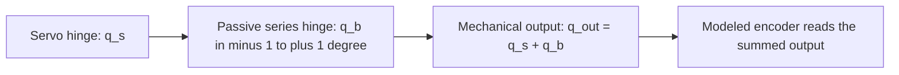

# 11. Turn a reality-gap knob

Predict whether adding 40 ms of sensor lag will change the policy's actions. Open the native Newton experiment using the exact nominal walking checkpoint saved in lesson 8 (`source outputs/tutorial.env` in a new terminal):

```bash
uv run --project environments/locomotion python scripts/locomotion/effects_workshop.py --checkpoint "$DUCK_WALK_CHECKPOINT"
```

In **Reality-gap experiment**, change **IMU/dq delay** from zero to two samples and press **Apply and restart trial**. Playback closes while a fresh candidate is recorded, then reopens beside the same baseline ghost. The policy weights and initial mechanical state remain fixed. Editing a slider alone leaves the displayed recording unchanged; pending edits are labeled.

Pause, scrub, hide the ghost, or switch to side-by-side display. Find the earliest visible divergence. Then choose **Restore nominal settings** and apply again. Every application preserves its settings, log, recording, and comparison under a new `trial-…` directory. Closing the viewer finishes the workshop.


The image is an offscreen capture of the working native widgets and real recordings. Collapse **Reality-gap experiment** when you want more room for replay controls.

After recording your own nominal and delayed trials, inspect their coverage in [the qualification explorer](09-evaluation.md#find-the-failing-condition).

## Try one physical mechanism

| Control | What changes | What to inspect |
| --- | --- | --- |
| Target delay | BAM command history, in 5 ms physics steps | Requested target versus delayed motor response |
| IMU/dq delay | IMU and joint-velocity histories, in 20 ms samples | Stale motion readings; position and previous action stay undelayed |
| Sensor noise multiplier | Uniform angular-velocity, gravity, position and velocity noise | At multiplier 1: bounds ±0.03 rad/s, ±0.01, ±0.001 rad, ±0.25 rad/s respectively |
| Fixed battery voltage | BAM supply voltage, with sag disabled | Changed available motor response under the same policy |
| Encoder bias | One signed radian offset applied to every encoder, fixed for the trial | Initial observation offset and the action transform's compensating target offset |
| Mechanical gearbox play | The actual asset with 14 servo joints plus 14 passive hinges, each spanning ±1° | State-dependent play after reversals; servo and output angle differ |

These are teaching interventions, not measured hardware tolerances. Noise is added when actor observations are computed; the critic stays uncorrupted. Encoder bias is fixed rather than redrawn each step. Battery sag, IMU mounting uncertainty and other hardware effects remain separate mechanisms. The complete settings and cadence are saved in each receipt's `effect_settings`.

Every application constructs a fresh trial and clears its histories. Backlash additionally changes the physical topology. The comparison retains all 28 raw coordinates and matches the known output-angle mapping against the nominal robot, requiring zero initial passive displacement and velocity. It cannot hide a different initial motor state behind equal summed output angles.

## Watch a bounded reversal

**Predict:** is gearbox play a delayed target, or a difference between servo and output angle? Try a supported joint without needing a trained policy:

```bash
uv run --project environments/locomotion python scripts/locomotion/actuator_workshop.py --backlash --output outputs/play-reversal
```

Choose **4 degrees**, then **Reset and run reversal**. Watch the actual target, servo coordinate and passive play; the mechanical output is their sum. Pause or single-step to inspect a reversal. After completion the physical pose is held. Changing the amplitude slider prepares the next run; every run starts from the same reset and is retained in its own `trial-…/receipt.json`.


This is the working native panel at an actual recorded state: body pose at 1.800 s, motor buffers at 1.795 s, and actor velocity feature sampled at 1.780 s. The capture uses recorded transforms with zero replay physics. Open the live workshop to change the next experiment.

Now relaunch with **only** `--command-delay-ms 20` added. Predict which signal shifts. Add `--observation-delay-ms 40` in another fresh launch to inspect the separate sensor history. The root stays fixed above the floor, all other joints request their reference angles, and no policy is choosing actions. Observation lag therefore changes the displayed actor features without changing this prescribed command program.


These are simulated 4° sweeps with seed 0: nominal, play alone, both delays without play, and both delays with play. Each retains 600 native physics samples and 150 control samples. All actual servo/root starts match; passive coordinates start at zero. The play coordinate traverses only part of its available clearance here. The asset difference also adds the documented 14 mg; these plots do not measure hardware backlash or qualify walking.


**Spot the difference:** the queue receives a frame every 5 ms, even while a control decision is held for 20 ms. After startup its selected frame is 20 ms old, but the originating control decision is 20, 25, 30 or 35 ms old. The velocity feature has its own 20 ms cadence: its uniquely identified age is 0, then 20, then 40 ms in this recording. A repeated or unmatched signal gives **unavailable**, never an invented age. These are simulation-clock identities, not hardware capture/receive timestamps.

## Use a frozen experiment file

<details>
<summary>What does the backlash coordinate mean?</summary>



On reversal, the passive hinge can traverse its available clearance before loading the opposite stop. The transmitted motion depends on load, friction and contacts; it is not a fixed number of milliseconds or a constant offset. This is a conceptual mechanism with the exact coordinate mapping used by the known asset. The BAM controller and actor encoder feature use the summed output; the raw receipt preserves each coordinate separately.

**Predict:** after reversing a joint, which should you compare with the target: `q_s`, `q_b`, or `q_s + q_b`? Inspect both servo and output traces before treating a discrepancy as sensor delay.

</details>

Save your own settings from the viewer, or create a small JSON file for a headless trial. Unspecified fields use nominal defaults:

```bash
mkdir -p outputs
printf '{"observation_delay_ms":40}\n' > outputs/delay40.json
uv run --project environments/locomotion python scripts/locomotion/effects_workshop.py --checkpoint "$DUCK_WALK_CHECKPOINT" --effects outputs/delay40.json --record-only --output outputs/delay-workshop
```

Use your saved nominal walking model. Use a fresh output directory for each workshop. `--headless` records and renders without a desktop; `--record-only` omits rendering. Change one factor, predict the outcome, and compare command response as well as survival. A successful simulated trial does not establish a hardware tolerance.


This example uses training seed 42 and physical-start seed 0. Both completed 20 seconds; one trial cannot establish robustness. The backlash asset adds 14 tiny passive bodies, totaling 14 mg of authored mass. It is a discrete asset intervention, rather than an identical model with one scalar changed.

## See what the actor actually received

**Predict:** with a configured 40 ms lag, are both IMU channels already two samples old immediately after reset?


The actor's ankle-velocity input matches the physical value from two control samples earlier after warmup. The IMU has its own startup rule: gyro and gravity delays begin at zero, then change on separate update phases. In this recording, the first gyro/raw difference occurs at 0.88 s and the first gravity/raw difference at 0.64 s. A configured lag alone does not describe the age of every initial sample. This policy fell at 1.80 s during the initial standing segment, before any walking command.

The black trace is the **requested** angle, and the blue trace is the measured servo angle. They differ because an actuator has dynamics and limits. The requested target is not a measured delayed/applied target; these control-boundary samples do not expose every 5 ms actuator step. With the backlash asset, the plot additionally shows servo angle plus passive play as the mechanical output.

These are simulation timestamps. Sensor capture, transport, receive and motor-application timestamps on the real robot still need hardware measurement.

<details>
<summary>Inspect delay clocks and the smaller delay-only launcher</summary>

Predict the effect of a 40 ms observation delay. Choose the exact saved checkpoint from your run directory, then record matching trials and open the ghost viewer:

The [qualification explorer](09-evaluation.md#find-the-failing-condition) compares your recorded outcomes; the ghost below helps inspect how their motions diverged.

```bash
uv run --project environments/locomotion python scripts/locomotion/reality_gap.py --checkpoint "$DUCK_WALK_CHECKPOINT" --seed 0 --observation-delay-ms 40
```

Use the same exact checkpoint, seed, and commands. The script changes IMU and joint-velocity observation lag; joint-position and previous-action channels are unchanged. It is a specific sensor-delay experiment, not a claim that every input is delayed.

Two independent simulator processes produce the baseline and changed-condition receipts. The blue translucent ghost is the baseline; the solid duck is the changed-condition trial. Their initial base pose, joint pose/order, seed, time step, horizon, and command sequence must match. Each policy remains in closed loop, so observations and actions can diverge after the initial state.

**Play:** pause, scrub recorded time, take one step, hide the ghost, change its opacity, and switch between a world overlay and side-by-side display. Ground trails retain drift. When one trial ends, its last recorded pre-reset pose stays visible and the panel marks the ending; the other trial continues. Scrubbing advances no physics. The ghost has no colliders or solver and cannot support or knock over the candidate.

The viewer controls change the display of recorded trials. To try another physical delay, rerun the command with a new value. Delay buffers are constructed for each trial; a display slider does not silently reconfigure an active simulator. Add `--headless` to record and render without a desktop, or `--record-only` to save trials without playback.

Replay an existing pair without repeating simulation:

```bash
uv run --project environments/locomotion python scripts/locomotion/compare.py --reference outputs/reality-gap/reference/receipt.json --candidate outputs/reality-gap/candidate/receipt.json
```

Command delay is separate. Try `--command-delay-ms 20`: it delays actuator targets by four 5 ms physics steps. A 40 ms observation delay spans two 20 ms samples. Converting both from the same step count would be wrong. Histories have startup/reset behavior; inspect and verify it before interpreting the first samples as steady-state latency.

Backlash is state-dependent mechanical play, particularly visible after reversals. It differs from fixed encoder bias, random noise, an action deadband, and pure delay. The maintained transfer task offers a backlash asset through `presets=backlash`; that changes the asset/observation mapping and requires scene reconstruction. The effects workshop reconstructs the scene when this selection changes.

In one exploratory run (4096 environments, 1000 PPO iterations, training seed 42, evaluation seed 0), the baseline completed 20 seconds while the 40 ms delayed trial fell after 1.62 seconds. This illustrates sensitivity for that saved policy; repeat across independent training/evaluation seeds before drawing a robustness conclusion.


The image uses a constant side-by-side display offset. Both recorded world paths remain intact.


Regenerate the chart from a new matched pair:

```bash
uv run --project environments/locomotion python scripts/locomotion/plot_comparison.py --reference outputs/reality-gap/reference/receipt.json --candidate outputs/reality-gap/candidate/receipt.json
```

**Record:** which signals were delayed, the delay in milliseconds and samples, and whether the policy survived long enough for the change to be interpretable.

</details>


<details>
<summary>Find a sensitivity curve with three settings of one knob</summary>

**Predict:** will 20 ms of observation lag preserve standing but lose command response? Keep one nominal policy, one actual starting state and the 20-second commands fixed. Change only observation delay:

```bash
for lag in 0 20 40; do
  uv run --project environments/locomotion python scripts/locomotion/evaluate.py --checkpoint "$DUCK_WALK_CHECKPOINT" --start-protocol balance-starts-v1 --seed 0 --observation-delay-ms "$lag" --output "outputs/sensitivity/lag-$lag"
done
uv run --project environments/locomotion python - <<'PY_SENSITIVITY'
import json
from pathlib import Path
import matplotlib
matplotlib.use("Agg")
import matplotlib.pyplot as plt
from isaaclab_tutorial.locomotion.comparison import assert_matched_start

lags = [0, 20, 40]
records = [json.loads(Path(f"outputs/sensitivity/lag-{lag}/receipt.json").read_text()) for lag in lags]
assert len({r["checkpoint_sha256"] for r in records}) == 1
assert len({r["start_condition"]["sample_sha256"] for r in records}) == 1
for lag, r in zip(lags, records):
    assert r["conditions"]["observation_delay_ms"] == lag
    assert_matched_start(records[0], r)
fig, axes = plt.subplots(1, 2, figsize=(9, 3.6), layout="constrained")
for lag, r in zip(lags, records):
    if not r["valid"]:
        axes[0].text(lag, 0, "invalid", rotation=90, ha="center")
        continue
    m, q = r["metrics"], r["qualification"]
    label = "fell" if m["fell"] else "response passed" if q["passed"] else "response failed"
    axes[0].scatter(lag, 100 * m["coverage"], marker="x" if m["fell"] else "o")
    axes[0].annotate(label, (lag, 100 * m["coverage"]), fontsize=8, rotation=25)
    if m["coverage"] >= 1 and not m["fell"]:
        axes[1].scatter(lag, m["tracking_rmse"][0], color="tab:blue")
    else:
        axes[1].text(lag, 0, "unavailable", rotation=90, ha="center", fontsize=8)
axes[0].set(xlabel="IMU/dq lag (ms)", ylabel="Horizon coverage (%)", ylim=(-5, 125))
axes[1].set(xlabel="IMU/dq lag (ms)", ylabel="Complete-trial forward RMSE (m/s)")
axes[1].set_ylim(bottom=0)
for ax in axes:
    ax.set_xticks(lags)
    ax.grid(alpha=0.2)
fig.savefig("outputs/sensitivity/curve.png", dpi=150)
print("Open outputs/sensitivity/curve.png; unavailable tracking is not zero error.")
PY_SENSITIVITY
```

A failed evaluator process is a software/numerical problem to inspect before interpreting the curve. Ordinary physical falls produce valid diagnostic receipts and remain plotted. A command-line loop alone does not validate those trials: check each receipt's initial state, command trace and effect settings if you change this experiment.

This is one trained policy on one physical start. Repeat with the same additional starts at each lag to investigate sensitivity; independent training seeds are needed to estimate variation across learned policies. Use the ghost viewer on the zero-lag and changed-lag receipts to explain a divergence you see in the curve.

</details>
