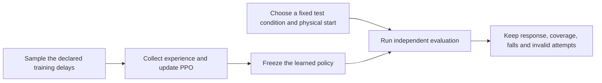
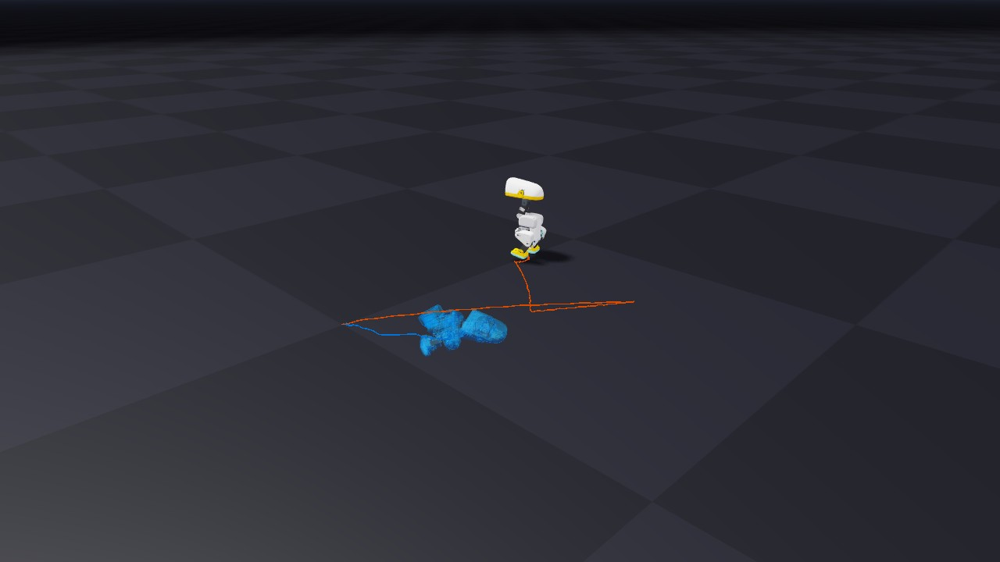
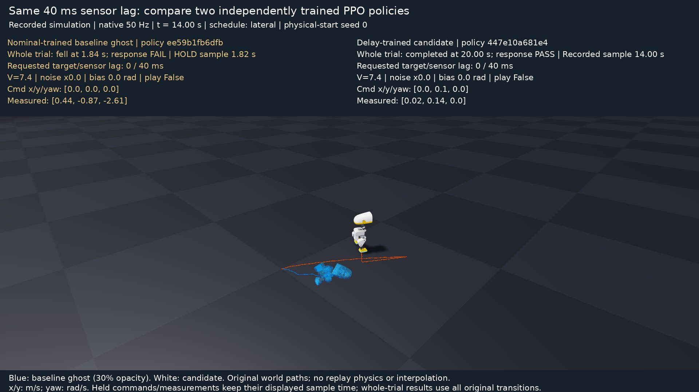

# 12. Teach the duck about uncertainty

Use [the qualification explorer](09-evaluation.md#find-the-failing-condition) to find a condition where your frozen policy struggles. Predict whether training with varied lag will help. Start a bounded fresh delay-trained policy:

```bash
uv run --project environments/locomotion isaaclab train --rl_library rsl_rl --task MicroDuckTutorial-Velocity-Flat-Delay --num_envs 128 --max_iterations 50 --seed 42 --run_name delay_preview --visualizer none
```

Replay its exact saved checkpoint with `--training-profile delay`. A short run can fail before reaching the walking commands; keep that result. The profile flag checks the saved training task and complete environment configuration before reconstructing the chosen evaluation conditions. Equal tensor widths alone do not qualify a checkpoint.

```bash
uv run --project environments/locomotion python scripts/locomotion/evaluate.py --training-profile delay --checkpoint logs/rsl_rl/microduck_tutorial/YOUR_DELAY_RUN/model_49.pt --start-protocol balance-starts-v1 --seed 0 --observation-delay-ms 40 --output outputs/delay-trained-check
```

## Change the training distribution, keep the test fixed

Use the same physical-start seed, command schedule, and test condition for each policy. Training randomization and evaluation intervention are different inputs:



The controlled configurations form a two-factor comparison:

| Training profile | Task suffix | Robot | Training delays |
| --- | --- | --- | --- |
| `nominal` | none | Nominal asset | None |
| `delay` | `-Delay` | Nominal asset | Targets 0–30 ms; IMU/dq 0–40 ms |
| `backlash` | `-Backlash` | Known series-play asset | None |
| `combined` | `-Combined` | Known series-play asset | Same delays as `delay` |

All four retain the same PPO defaults, reward weights, commands, control timing and actor information. Noise, encoder bias, supply variation, mass/friction randomization, pushes and curricula stay disabled in this comparison. The backlash factor selects the complete known asset, including its tiny additional passive-body masses.

Target lag is an integer draw in 5 ms physics steps, redrawn every physics step. Joint-velocity lag is an integer draw in 20 ms samples, held until episode reset. IMU gyro/gravity lags have separate phases and are redrawn every 64 control samples. Startup history can still return fresher data. These are declared teaching distributions, not measured hardware timing tolerances.

Forty milliseconds lies inside the sensor-delay training range. Success there tests interpolation under a fixed condition; it does not establish extrapolation to longer delays. Try 60 ms as a separately declared test after inspecting the in-range result.

## Compare policies under the same test

Before looking at the example below, predict whether delay training helps under fixed 40 ms sensor lag. Will it preserve nominal behavior? Will training both mechanisms necessarily handle both better?

Evaluate the nominal and delay-trained policies under the same start and fixed lag, keeping distinct output directories:

```bash
uv run --project environments/locomotion python scripts/locomotion/evaluate.py --checkpoint logs/rsl_rl/microduck_tutorial/YOUR_NOMINAL_RUN/model_49.pt --start-protocol balance-starts-v1 --seed 0 --observation-delay-ms 40 --output outputs/nominal-under-lag
uv run --project environments/locomotion python scripts/locomotion/evaluate.py --training-profile delay --checkpoint logs/rsl_rl/microduck_tutorial/YOUR_DELAY_RUN/model_49.pt --start-protocol balance-starts-v1 --seed 0 --observation-delay-ms 40 --output outputs/delay-under-lag
uv run --project environments/locomotion python scripts/locomotion/compare.py --reference outputs/nominal-under-lag/receipt.json --candidate outputs/delay-under-lag/receipt.json
```

Replace both paths with your saved checkpoints. Compare command response, coverage and falls, then repeat without the lag. Use equal completed transition budgets when comparing training recipes. For a broader comparison, train at least three independent seeds per profile and use `qualify.py --training-profile PROFILE` under identical evaluation starts and conditions. Use a separate report per training profile and test condition.

Keep failed and invalid attempts in the outcome counts. Full-trial tracking error stays unavailable when no trial completes. Improving one fixed test while losing nominal walking is a tradeoff to investigate, not automatic progress toward transfer.

## Look at the learned difference

In [the native effects workshop](11-effects.md), pass `--training-profile delay` (or `backlash`/`combined`) with that policy's exact checkpoint. The same frozen policy then encounters different evaluation conditions. To compare two separately trained policies, evaluate both with the same effect file and start, then pass their two receipts to `compare.py`. Keep both objectives and independent task metrics visible.



This pair uses training seed 42 and physical-start seed 0. Both policies experienced the same 40 ms sensor lag. The nominal policy fell at 1.84 s; the delay-trained policy completed 20 s and qualified. Both recorded world paths remain intact. Use the viewer's pause/scrub controls to find where the closed-loop responses diverged.

<details>
<summary>Inspect the same trials as a native-time ghost comparison</summary>



[Watch the native movie](https://github.com/AntoineRichard/IsaacLabTutorial/releases/download/microduck-tutorial-media-3463b86/stress-comparison.mp4).

This poster comes from a new 20-second, 1,000-frame movie of those exact receipts at their native 50 Hz cadence. The blue actor has no collision participation. Its final pre-reset pose and readings are explicitly held after the fall; they are not a prediction of later behavior. The white actor replays body poses from its own independent closed-loop trial. The camera stays fixed, without translating either trajectory.

Playback advances no physics. Use the interactive comparison above to pause and scrub your own trials.

</details>

<details>
<summary>Beyond this controlled ablation</summary>

The maintained full transfer task introduces additional uncertainty and curricula:

```bash
uv run --project environments/locomotion isaaclab train --rl_library rsl_rl --task MicroDuckTutorial-Velocity-Flat-Transfer --num_envs 128 --max_iterations 50 --seed 42 --run_name transfer_preview --visualizer none presets=backlash
```

This is a separate bounded execution preview. Its masses, friction, motor/sensor effects, pushes and curricula do not constitute the same two-factor experiment. Its checkpoint requires its own declared evaluator contract; the controlled-profile flag does not admit it. Record each parameter's units, bounds, sampling cadence, measurement or justification, and schedule before drawing a transfer claim.

Observation history is another explicit architecture experiment: it changes inputs, reset state and deployment requirements. Add it during training and verify the matching export/runtime rather than adding it only on the robot.

</details>

**Record:** which uncertainty was sampled per robot, per episode or over time, and whether the candidate improved the same held-fixed test without losing nominal behavior.
