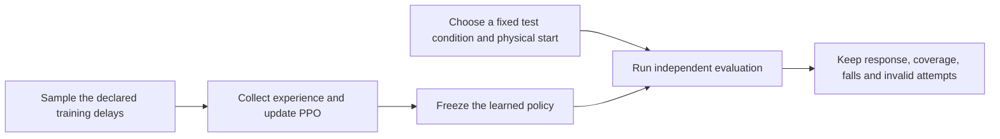
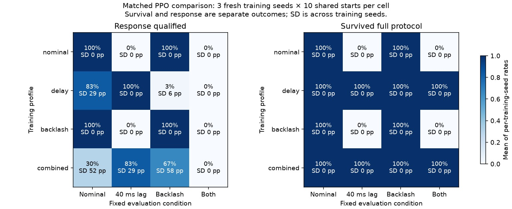
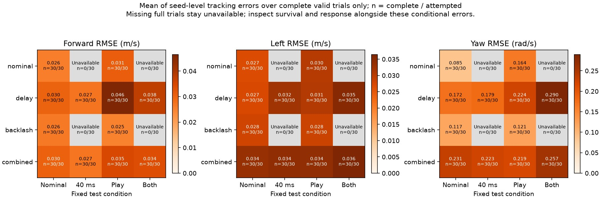

# 12. Teach the duck about uncertainty

The [measured reality-gap matrix](09-evaluation.md#find-the-failing-condition) exposed a problem: the nominal policies fell with added observation lag. Predict whether training with varied lag will help. Start a bounded fresh delay-trained policy:

```bash
uv run --project environments/locomotion isaaclab train --rl_library rsl_rl --task MicroDuckTutorial-Velocity-Flat-Delay --num_envs 128 --max_iterations 50 --seed 42 --run_name delay_preview --visualizer none
```

Replay its exact saved checkpoint with `--training-profile delay`. A short run can fail before reaching the walking commands; keep that result. The profile flag checks the saved training task and complete environment configuration before reconstructing the chosen evaluation conditions. Equal tensor widths alone do not qualify a checkpoint.

```bash
uv run --project environments/locomotion python scripts/locomotion/evaluate.py --training-profile delay --checkpoint logs/rsl_rl/microduck_tutorial/YOUR_DELAY_RUN/model_49.pt --start-protocol balance-starts-v1 --seed 0 --observation-delay-ms 40 --output outputs/delay-trained-check
```

## Change the training distribution, keep the test fixed

Use the same physical-start seed, command schedule, and test condition for each policy. Training randomization and evaluation intervention are different inputs:



The controlled configurations form a two-factor comparison:

| Training profile | Task suffix | Robot | Training delays |
| --- | --- | --- | --- |
| `nominal` | none | Nominal asset | None |
| `delay` | `-Delay` | Nominal asset | Targets 0–30 ms; IMU/dq 0–40 ms |
| `backlash` | `-Backlash` | Known series-play asset | None |
| `combined` | `-Combined` | Known series-play asset | Same delays as `delay` |

All four retain the same PPO defaults, reward weights, commands, control timing and actor information. Noise, encoder bias, supply variation, mass/friction randomization, pushes and curricula stay disabled in this comparison. The backlash factor selects the complete known asset, including its tiny additional passive-body masses; the [asset lock](evidence/asset-lock.json) records that distinction.

Target lag is an integer draw in 5 ms physics steps, redrawn every physics step. Joint-velocity lag is an integer draw in 20 ms samples, held until episode reset. IMU gyro/gravity lags have separate phases and are redrawn every 64 control samples. Startup history can still return fresher data. These are declared teaching distributions, not measured hardware timing tolerances.

Forty milliseconds lies inside the sensor-delay training range. Success there tests interpolation under a fixed condition; it does not establish extrapolation to longer delays. Try 60 ms as a separately declared test after inspecting the in-range result.

## Predict the result, then inspect it

Which training row should handle sensor lag? Will a policy trained with both mechanisms necessarily walk better under both? Keep survival and command response as separate predictions.



We trained **12 fresh policies**: three seeds per profile, each with 98,304,000 transitions and 20,000 optimizer updates on the same L40 GPU type and driver. Every policy encountered all four fixed conditions under the same ten actual physical starts and command schedule: **480 valid attempts**, including every fall. Standard deviations are across three per-training-seed rates, in percentage points; they are not confidence intervals. [Audited data and provenance](evidence/robustness-validation.json).

Delay training qualified **30/30** fixed-40-ms trials, compared with **0/30** for nominal training. It also qualified only **25/30** nominal trials and **1/30** backlash-only trials. Combined training survived **30/30** combined-stress trials, yet qualified **0/30** for locomotion. A controller can stay upright while responding poorly to commands. These results assess the declared simulated distributions, not calibrated hardware transfer.

The nominal policy already qualified 30/30 trials on this specific backlash variant. The backlash-only training row therefore shows no improvement in that response metric; baseline measurement prevents assuming every modeled effect needs a successful fix.

**Challenge:** explain the combined row's 30% nominal response rate and 52-percentage-point standard deviation. One training seed qualified 9/10 starts; the other two qualified none. Which single video would have given you a misleading impression?

<details>
<summary>Exact response counts and a reproducible figure</summary>

Each cell contains three independent training policies × ten shared starts. These are ten reused physical starts, not 480 independent starts.

| Training profile | Nominal test | 40 ms test | Backlash test | Both |
| --- | --- | --- | --- | --- |
| Nominal | 30/30 | 0/30 | 30/30 | 0/30 |
| Delay | 25/30 | 30/30 | 1/30 | 0/30 |
| Backlash | 30/30 | 0/30 | 30/30 | 0/30 |
| Combined | 9/30 | 25/30 | 20/30 | 0/30 |

The [portable report](evidence/ppo-robustness-matrix.json) retains every attempt, failure reason, conditional tracking summary and seed-level result. Its audit reads the actual checkpoints/optimizer counters, verifies resolved profiles and source/asset hashes, checks every receipt, recomputes metrics from the raw motion, and matches actual initial states across profiles and conditions. Altered budgets, mislabeled conditions and changed initial velocities are rejected.



These errors average complete-trial RMSE within each training seed, then across seeds with complete data. `n` counts complete versus attempted trials. Read this conditional view beside survival. The response test also checks individual command segments: a low full-episode mean can hide a segment that exceeds its limit. In one combined-training/combined-stress trial, forward speed gain was 1.16, yet yaw RMSE during that straight segment was 0.333 rad/s, above its 0.30 rad/s limit. Correct average forward speed alone did not qualify the response.

Rebuild the figure without the large raw archives:

```bash
uv run --project environments/locomotion python scripts/locomotion/summarize_robustness.py --data docs/locomotion/evidence/ppo-robustness-matrix.json --output outputs/robustness-rebuild
```

To audit a new complete experiment, pass `--trial PATH_TO_COLLECTED_TRIAL` once per replicate instead of `--data`. Partial studies remain incomplete. The four declared profiles bundle particular delay clocks and mechanics; identifying which delay channel caused an improvement requires another controlled experiment.

</details>

## Repeat the controlled experiment

For a meaningful comparison, use the same full transition budget and at least three independent training seeds per profile. The automated driver trains one replicate, checks actual checkpoint progress, then evaluates nominal, 40 ms lag, backlash, and backlash-plus-lag conditions under evaluation seeds 0–9:

```bash
uv run --project environments/locomotion python scripts/locomotion/run_robustness_trial.py --profile combined --seed 42 --num-envs 4096 --iterations 1000 --output outputs/combined-seed42
```

Repeat for the other profiles and training seeds 0 and 1. At 24 rollout steps this requests 98,304,000 fresh transitions per replicate. The driver records the actual completed iterations and optimizer counters, not just the requested limit. It preserves every evaluated outcome, resolved parameters, event logs, source snapshot, locked robot assets, and a compressed collection archive. An execution error leaves the study incomplete; a physical fall remains an evaluated outcome.

Use `qualify.py --training-profile PROFILE --effects SNAPSHOT.json` to qualify existing checkpoints under the same frozen hardware condition. Choose one profile per seed matrix. The saved effect snapshot is checked again when resuming; changing it creates a different experiment.

Compare per-training-seed response-pass and survival rates, their variation, and complete-trial tracking errors. Keep invalid and failed attempts in denominators. A policy that stands still can survive every trial and still fail the locomotion checks. The full driver is a runnable experiment, not a promise that the randomized policy will improve.

### Run independent replicates on OSMO

[The PPO workflow](../../scripts/locomotion/osmo_ppo.yaml) runs the same driver in one GPU task. Choose a validated container image by digest, its registry credential if needed, your pool/platform, and an immutable source commit. The default source points to the published tutorial producer; an image placeholder must be replaced before submission.

```bash
osmo workflow submit scripts/locomotion/osmo_ppo.yaml --pool YOUR_POOL --set-string image=YOUR_IMAGE_DIGEST image_credential=YOUR_REGISTRY_CREDENTIAL --set workflow_name=duck-combined-seed42 profile=combined seed=42
```

First submit a preflight with `iterations=2 eval_seed_count=1`, keeping `num_envs=4096` to test the full scene size. Check its asset hashes, realized budget, four evaluation reports and archive before launching production. A preflight checks execution; two iterations do not establish locomotion quality.

Run each of the four profiles with training seeds 42, 0 and 1 on the same GPU type and frozen source/image. The task collects `collection/` under the output path reported by OSMO, including source, device metadata, logs, `trial-artifacts.tar.gz` and `sha256.json`. Download that directory with `osmo workflow rsync download`, verify the archive digest, then create `/osmo/run/workspace/microduck-input/collected` with `osmo workflow exec` to release the GPU. The collection window is bounded at 20 minutes; collect promptly. Preserve unsuccessful trials and diagnostics too.

## Look at the learned difference

In [the native effects workshop](11-effects.md), pass `--training-profile delay` (or `backlash`/`combined`) with that policy's exact checkpoint. The same frozen policy then encounters different evaluation conditions. To compare two separately trained policies, evaluate both with the same effect file and start, then pass their two receipts to `compare.py`. Keep both objectives and independent task metrics visible.


This pair uses training seed 42 and physical-start seed 0. Both policies experienced the same 40 ms sensor lag. The nominal policy fell at 1.84 s; the delay-trained policy completed 20 s and qualified. Both recorded world paths remain intact. The [comparison receipt](evidence/robustness-validation.json) records input hashes and 1,001 playback frames with zero playback physics. Use the viewer's pause/scrub controls to find where the closed-loop responses diverged.

The delay-trained seed-42 candidate also passed 1,000 native/JIT/ONNX comparisons and the standard Duck Rust no-actuation rehearsal, with maximum action difference **8.35e-7**. That checks the software boundary for this evaluated condition; [its receipt](evidence/robust-delay-runtime.json) preserves the training profile, fixed test effect, runtime inputs and hardware-validation status.

<details>
<summary>Beyond this controlled ablation</summary>

The maintained full transfer task introduces additional uncertainty and curricula:

```bash
uv run --project environments/locomotion isaaclab train --rl_library rsl_rl --task MicroDuckTutorial-Velocity-Flat-Transfer --num_envs 128 --max_iterations 50 --seed 42 --run_name transfer_preview --visualizer none presets=backlash
```

This is a separate bounded execution preview. Its masses, friction, motor/sensor effects, pushes and curricula do not constitute the same two-factor experiment. Its checkpoint requires its own declared evaluator contract; the controlled-profile flag does not admit it. Record each parameter's units, bounds, sampling cadence, measurement or justification, and schedule before drawing a transfer claim.

Observation history is another explicit architecture experiment: it changes inputs, reset state and deployment requirements. Add it during training and verify the matching export/runtime rather than adding it only on the robot.

</details>

**Record:** which uncertainty was sampled per robot, per episode or over time, and whether the candidate improved the same held-fixed test without losing nominal behavior.
