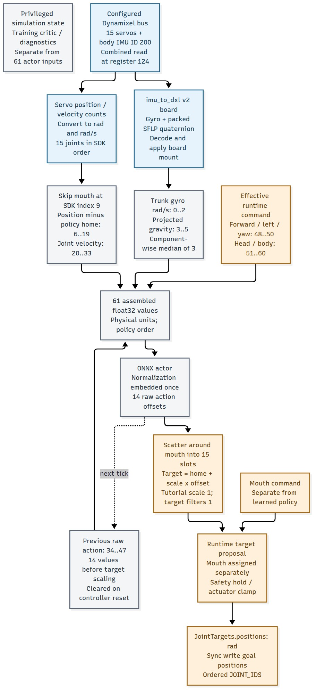
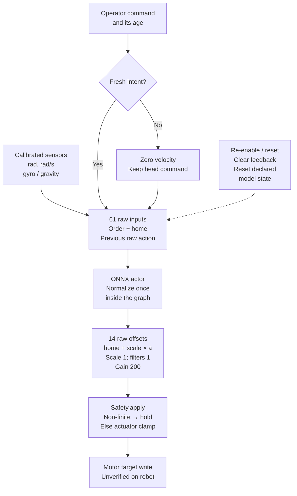
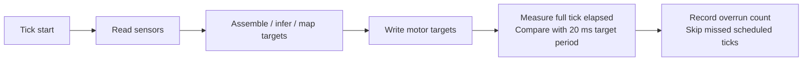

# 13. Export without changing the policy

First check the learned actor across the native/export boundary:

```bash
uv run --project environments/locomotion python scripts/locomotion/evaluate.py --checkpoint latest --export --output outputs/export-check
```

For a controlled robustness checkpoint, add its explicit `--training-profile delay`, `backlash`, or `combined`. The export records the training task/profile separately from the fixed physical conditions actually evaluated.

This exports JIT and ONNX models using RSL-RL's supported exporter and executes **both** against native actions on every actual evaluation observation. ONNX runs on the CPU provider, the deployment inference boundary. The receipt records sample counts, maximum absolute differences, and float32 tolerances (`atol=1e-5`, `rtol=1e-4`). A full-protocol example checked 1000 samples: JIT maximum difference 0, ONNX 1.11e-6. This is numerical agreement, not a hardware walking result.

The evaluator first checks the checkpoint's saved training configuration. A different observation order, preprocessing, action scale/home pose, model, or actuator contract requires a matching evaluator; the task name and tensor widths alone are insufficient. Reward-only candidates remain valid comparisons. Bundle files are staged and published together after the checks pass. Use a fresh output directory for each export; an existing bundle is preserved.

When evaluation applies a fixed physical effect, the manifest retains its `conditions`, complete `effect_settings`, and simulated asset URL alongside the qualification result. A passing intervention trial must stay identifiable as that experiment.

Normalization is embedded in the exported actor. Supply the raw assembled 61-value actor observation exactly once; do not normalize it a second time. Preserve the verified 14-action order, reference offsets, scale, bias convention, timing, and inference/reset state.

## Inspect the standard Duck bundle

The `outputs/export-check/exported/` directory contains `policy.onnx`, a [standard schema-2 manifest](https://github.com/pollen-robotics/microduck/blob/da34a2212ae12eddfd73d0dfbf924f291aaf1dc9/docs/policy-manifest.md), `trace.json` of raw actor inputs, `native-actions.json`, and a reviewable `robotd-policy.toml` settings fragment. Creating this directory never installs a policy or opens a motor bus.

`policy.onnx` embeds its weights. The export check runs after external tensor data has been folded into that file, with the temporary weight sidecar removed. Copying the single ONNX file therefore preserves the graph and its weights together.

The exporter checks the actual resolved home pose, joint order, action scale, control period, and ordered observation blocks before writing the bundle:

| Input indices | Meaning | Units |
| --- | --- | --- |
| 0–2 | trunk angular velocity | rad/s |
| 3–5 | projected gravity | unit vector |
| 6–19 | encoder position minus home, mouth excluded | rad |
| 20–33 | encoder velocity, same joint order | rad/s |
| 34–47 | previous raw policy action | unscaled |
| 48–50 | forward, left, yaw commands | m/s, m/s, rad/s |
| 51–54 | neck pitch, head pitch, head yaw, head roll commands | rad |
| 55–60 | body x, y, z, roll, pitch, yaw commands | m, rad |

The tutorial trained zero head/body commands; keep those ten slots zero. Outputs are 14 raw joint offsets in left-leg, neck/head, right-leg order. The mouth remains outside policy control. Calibrated encoder offsets must use the same sign and home frame; with the backlash model, the encoder observes servo angle plus passive play angle.

<details>
<summary>Trace a joint or IMU signal through the real SDK</summary>

**Try:** the right knee answers on motor ID 13. Which actor position slot and policy action reach it? Trace the paths in this SDK interface schematic before reading the answer.



The right knee is action 12, position input 18, velocity input 32 and previous-action input 46 (zero-based indices). SDK joint index 13 differs because the SDK includes a mouth joint outside the policy. Encoder counts are converted to radians before home subtraction; raw actions feed back before home/scale mapping. The trunk IMU needs its configured board rotation and gyro unit conversion before assembling gravity and angular velocity. Its three-sample component median is preprocessing, not a fixed transport delay.

This follows the [pinned standard Duck control implementation](https://github.com/pollen-robotics/microduck/tree/da34a2212ae12eddfd73d0dfbf924f291aaf1dc9/crates/duck-control). Calibrated physical wiring and board timing still need robot checks.

</details>

**Check the runtime settings before loading.** Standard Duck walking defaults use scale 0.9 and head/leg target filters 0.5/0.7. This tutorial uses scale **1.0** and **no target filter**. Its generated fragment explicitly sets both filter factors to 1.0 and gain 200. Applying the standard defaults would change the controller after export. Review the fragment against the robot's existing policy section and calibration; the manifest's action-scale field alone does not configure every walking-slot setting.

## Follow one hardware control tick

**Predict:** if operator commands stop arriving, does the standard runtime stop inference, relax the motors, or ask for zero velocity?

<details>
<summary>Trace the control path and reveal the answer</summary>



The pinned runtime's intent deadman zeros the velocity command; it does **not** mean torque-off or a stopped inference loop. `robotd` handles configured fall responses and gain changes separately. Likewise, its final range clamp covers actuator travel, not calibrated anatomical joint limits. These source-reviewed behaviors are not hardware tests. The tutorial's single actor handles standing and moving commands; review any separately selected standing or skill policy before treating the installed controller as this tutorial's policy.

The model wrapper also rejects non-finite observations or actions. An inference error takes the runtime's hold path before normal policy targets are proposed.

The PPO actor itself is memoryless, but the control loop still retains previous action and optional target-filter state. Clear that feedback state on re-enable.

</details>

<details>
<summary>Put timestamps around the complete path</summary>



The existing loop counts work that exceeds its period and skips missed ticks. That timing counter is not an automatic deadline-triggered stop. A fast actor-only rehearsal also excludes sensor/bus I/O and cannot establish a complete 20 ms control deadline on the robot board.

Sensor capture time, bus-read time, inference boundaries and motor-write time are separate events. The runtime's `Sensors` value contains joint and IMU values, not a universal per-channel acquisition timestamp. Its repeated-IMU-read counters also do not prove a numerical capture-to-use age: identical values can come from a stationary robot. Record timestamps where the hardware interface actually provides them, label read/receive times separately, and leave unavailable acquisition ages unavailable. Verify sensor freshness and the intended operator stop/hold behavior in the no-actuation robot rehearsal before enabling motion.

The workstation rehearsal checks the actor boundary; hardware wiring, timing and stop trials need measurements on the robot.

</details>

## Rehearse without actuation

In a separate checkout of [the standard Duck runtime](https://github.com/pollen-robotics/microduck/tree/da34a2212ae12eddfd73d0dfbf924f291aaf1dc9), its existing example consumes this bundle directly:

```bash
cargo run --release -p duck-control --example policy-rehearsal -- /absolute/path/exported/policy.onnx /absolute/path/exported/trace.json > rehearsal.json
```

The tool opens no motor bus. Compare its `actions` against `native-actions.json` with the same tolerances; retain its p50/p95/p99 inference latency and `over_20_ms` count. A workstation's timing is not the robot board's timing. The [runtime's rehearsal documentation](https://github.com/pollen-robotics/microduck/blob/da34a2212ae12eddfd73d0dfbf924f291aaf1dc9/docs/recurrent-policies.md) describes prerequisites including ONNX Runtime.

An executed rehearsal of the reference PPO model replayed all 1,000 recorded observations through this Rust example. Maximum action difference from native PPO was **1.20e-6**, within the same tolerances. On the workstation, actor-only latency was p50 **0.011 ms**, p95 **0.014 ms**, p99 **0.026 ms**, with zero calls exceeding 20 ms. These measurements exclude sensor and motor I/O; repeat on the robot board before making a timing claim there.

Next run a **no-actuation sensor rehearsal** on the calibrated robot: assemble sensor observations, log sensor age, raw actions, bounded targets and timestamps, and verify the real watchdog/stop behavior. Only then progress through operator-controlled supported standing, free standing, and low-speed trials using the robot's approved limits. Keep every failed attempt and rollback policy with the trial record.

Export parity establishes software consistency. Simulated robustness establishes behavior under those simulated conditions. Demonstrated transfer additionally requires calibrated hardware trials and their measured outcomes. The existing Duck deployment runtime is the target; board-side rehearsal and hardware evidence remain to be collected.

**Record:** what the export check proves, and one robot-side failure that identical exported actions would not prevent.
