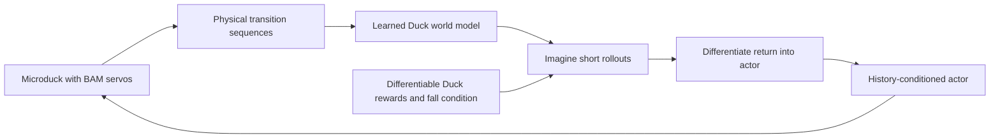

# 14. Explore SuperMimic with a Duck world model

**Try:** can a model learned from real simulated Duck transitions provide useful policy gradients?

This is an optional route after the PPO lessons. Rafael Cathomen's [Isaac Lab integration](https://github.com/isaac-sim/IsaacLab/pull/8867) and [learner](https://github.com/leggedrobotics/rsl_rl/pull/255) implement model-based reinforcement learning: fit physical successors from replay, then optimize an actor through imagined rollouts. It requires no motion-capture demonstrations. The immutable simulator/learner snapshots are recorded in [the workflows environment](../../environments/workflows/pyproject.toml) and its lock.



The [Duck adapter](../../src/isaaclab_tutorial/locomotion/supermimic.py) preserves the nominal task's actual BAM dynamics, reward weights, home pose, and resets. Its training state has 56 values: body velocities, orientation, height, 14 servo positions and velocities, foot velocities and contact clocks, angular-momentum magnitude, foot heights, and swing peaks. Six event labels supervise foot contact/touchdown, self-contact, and orientation falls. Body masses condition dynamics and the critic. These privileged measurements never enter the deployed actor.

The actor consumes the same deployable sensor/action blocks as the PPO policy (48 values), with five frames of history and the current 13 command values. The simulator captures every physical successor before resets and command resampling. This avoids treating a reset as ordinary dynamics.

## Run the complete smoke workflow

Run these commands from the tutorial repository root:

```bash
uv sync --project environments/workflows --locked
uv run --project environments/workflows --locked python -m pytest tests/test_locomotion_supermimic.py -q
uv run --project environments/workflows --locked isaaclab train --rl_library rsl_rl --task MicroDuckTutorial-Velocity-Flat-SuperMimic --agent rsl_rl_supermimic_cfg_entry_point --num_envs 64 --max_iterations 100 --seed 42 --run_name supermimic_smoke --visualizer none agent.algorithm.warmup_steps=8 agent.algorithm.world_model_warmup_iterations=2 agent.algorithm.world_model_batch_size=64 agent.algorithm.policy_batch_size=64 agent.algorithm.horizon=8
uv run --project environments/workflows --locked python scripts/locomotion/evaluate.py --agent supermimic --checkpoint latest --export --output outputs/supermimic-smoke
```

The tests compare each weighted reward and the total against the actual simulator at its pre-reset boundary, including flight, touchdown, standing and moving commands. They also compare deployable sensor features and falls. A separate native/JIT/ONNX sequence exercises history initialization and an episode reset.

The 64-environment smoke performed 37 learner updates with finite model, label, policy and critic losses. It fell after 0.84 s when evaluated. Its 42 action samples matched JIT within 8.94×10⁻⁸ and ONNX within 1.79×10⁻⁷. The standard Duck Rust `policy-rehearsal` executable also reproduced those 42 actions within 1.79×10⁻⁷, using the maintained runtime at `da34a2212ae12eddfd73d0dfbf924f291aaf1dc9`. These checks establish adapter and export operation; they do not establish learned walking or hardware operation.

## Understand the export state

The bundle uses standard Duck **model API 2** with `obs[1,61]`, `h_in/c_in[1,1,193]`, and outputs `actions[1,14]`, `h_out/c_out[1,1,193]`. The network is a history-conditioned MLP. The state tensors are a sensor cache: `h` holds four 48-value frames plus a fresh flag, and `c` passes through unchanged. This is not an LSTM.

Reset both tensors to zero before the first real observation of every episode. The wrapper repeats that first observation to fill history, matching RSL-RL. Preserve each returned state for the next call. The manifest records this contract, and the exported ONNX contains its weights in one file. Continue with the standard Duck rehearsal procedure in [lesson 13](13-deployment.md); use the manifest's API version and retain the reset flags in `trace.json`.

## Train and investigate model horizon

The [runner configuration](../../src/isaaclab_tutorial/tasks/locomotion/config/microduck/agents/rsl_rl_supermimic_cfg.py) defaults to 10,000 collection iterations, one physical step per iteration, a 16-step imagined horizon, and four world-model optimizer steps per learner iteration. At 4096 environments this is 40,960,000 physical transitions. Learner iterations accrue at 0.4 per collection step after replay warm-up; its first 500 learner iterations fit only the model. A collection iteration is therefore different from a learner or optimizer update.

```bash
uv run --project environments/workflows --locked isaaclab train --rl_library rsl_rl --task MicroDuckTutorial-Velocity-Flat-SuperMimic --agent rsl_rl_supermimic_cfg_entry_point --num_envs 4096 --max_iterations 10000 --seed 42 --run_name supermimic_h16 --visualizer none
uv run --project environments/workflows --locked python scripts/locomotion/evaluate.py --agent supermimic --checkpoint latest --export --output outputs/supermimic-h16
```

This is an exploratory training recipe. Retain falls and model/label losses as well as reward. One-step prediction quality can improve while long imagined trajectories drift. Compare horizons 8/16/32 on separate runs with otherwise identical settings, then validate promising settings on fresh training seeds and the same evaluation protocol. Report physical transitions and actual optimizer updates separately.

The adapter currently requires nominal, undelayed sensor features and flat terrain. It rejects reward-function replacements, changed foot ordering, enabled persistent head-bias rewards, corruption and unsupported sensor transforms because these require an extended state or matching actor model. Preserve these guards when adding robustness experiments.

For OSMO, use [lesson 15's workflow](15-flash-sac.md) with `learner=supermimic`, `iterations=10000`, and `horizon=8`, `16`, or `32`. Publish the source first and provide its full commit SHA as `source_revision`; jobs never read uncommitted files.

**Record:** does a longer imagined horizon improve actual command tracking and survival, or only imagined return?
