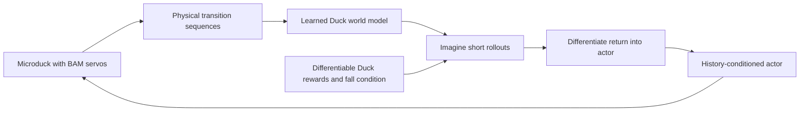

# 14. Explore SuperMimic with a Duck world model

The intended adaptation is Microduck throughout. Rafael Cathomen's [Isaac Lab PR #8867](https://github.com/isaac-sim/IsaacLab/pull/8867) and [learner PR #255](https://github.com/leggedrobotics/rsl_rl/pull/255) define **model-based reinforcement learning**: learn physical successors from replay, then optimize an actor through imagined rollouts. This is not Isaac Lab Mimic's demonstration-generation workflow, and the PR does not require motion-capture demonstrations.

The pinned `environments/workflows` environment includes the incoming learner interfaces. A runnable Duck SuperMimic task remains under development. The upstream G1 task is not a drop-in adapter: it assumes PD actuators and a different reward/contact layout. Replacing BAM with PD to make that class accept the Duck would change the experiment.

The Duck adaptation must supply noise-free physical state, command goals, privileged dynamics context, and contact labels. Its actor features must contain only deployable sensor information. Differentiable reward heads must match Duck tracking, posture, action-rate, foot clearance/slip/air-time/swing-height, self-contact, and angular-momentum terms. Verify each against the simulator's pre-reset reward state before training. Preserve physical successors before resets or interval events so pushes are not mislabeled as learned dynamics.

**Investigation once the adapter passes parity:** compare one-step world-model error with error after 8/16/32 imagined steps. A model can fit immediate transitions and still drift over the horizon used to train its actor. Change the imagined horizon on a new run and retain both model error and actual closed-loop walking metrics.

The actor uses observation history; verify its export input/state/reset contract separately from the feed-forward 61-input PPO/SAC bundle. A matching single-frame width alone does not establish compatibility with the standard Duck runtime.

Tune the Duck implementation on OSMO after a local rollout/update/export smoke test. Screen model size, learning rate, replay reuse, and imagined horizon using independent single-GPU jobs. Confirm promising settings across independent seeds and the same fixed-command protocol. This exploratory branch remains optional to completion of flat PPO locomotion.
