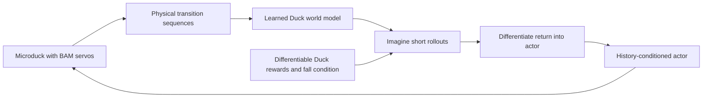
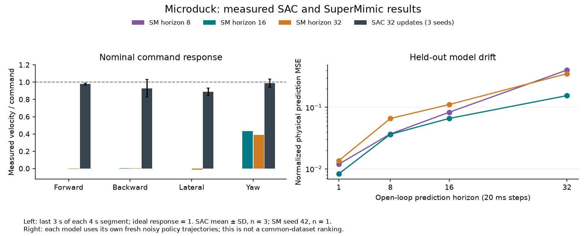

# 14. Explore SuperMimic with a Duck world model

**Try:** can a model learned from real simulated Duck transitions provide useful policy gradients?

This is an optional route after the PPO lessons. Rafael Cathomen's [Isaac Lab integration](https://github.com/isaac-sim/IsaacLab/pull/8867) and [learner](https://github.com/leggedrobotics/rsl_rl/pull/255) implement model-based reinforcement learning: fit physical successors from replay, then optimize an actor through imagined rollouts. It requires no motion-capture demonstrations. The immutable simulator/learner snapshots are recorded in [the workflows environment](../../environments/workflows/pyproject.toml) and its lock.



The [Duck adapter](../../src/isaaclab_tutorial/locomotion/supermimic.py) preserves the nominal task's actual BAM dynamics, reward weights, home pose, and resets. Its training state has 56 values: body velocities, orientation, height, 14 servo positions and velocities, foot velocities and contact clocks, angular-momentum magnitude, foot heights, and swing peaks. Six event labels supervise foot contact/touchdown, self-contact, and orientation falls. Body masses condition dynamics and the critic. These privileged measurements never enter the deployed actor.

The actor consumes the same deployable sensor/action blocks as the PPO policy (48 values), with five frames of history and the current 13 command values. The simulator captures every physical successor before resets and command resampling. This avoids treating a reset as ordinary dynamics.

## Run the complete smoke workflow

Run these commands from the tutorial repository root:

```bash
uv sync --project environments/workflows --locked
uv run --project environments/workflows --locked python -m pytest tests/test_locomotion_supermimic.py -q
uv run --project environments/workflows --locked isaaclab train --rl_library rsl_rl --task MicroDuckTutorial-Velocity-Flat-SuperMimic --agent rsl_rl_supermimic_cfg_entry_point --num_envs 64 --max_iterations 100 --seed 42 --run_name supermimic_smoke --visualizer none agent.algorithm.warmup_steps=8 agent.algorithm.world_model_warmup_iterations=2 agent.algorithm.world_model_batch_size=64 agent.algorithm.policy_batch_size=64 agent.algorithm.horizon=8
uv run --project environments/workflows --locked python scripts/locomotion/evaluate.py --agent supermimic --checkpoint latest --export --output outputs/supermimic-smoke
```

The tests compare each weighted reward and the total against the actual simulator at its pre-reset boundary, including flight, touchdown, standing and moving commands. They also compare deployable sensor features and falls. A separate native/JIT/ONNX sequence exercises history initialization and an episode reset.

The 64-environment smoke performed 37 learner updates with finite model, label, policy and critic losses. It fell after 0.84 s when evaluated. Its 42 action samples matched JIT within 8.94×10⁻⁸ and ONNX within 1.79×10⁻⁷. The standard Duck Rust `policy-rehearsal` executable also reproduced two concatenated copies of that episode, with an explicit reset at samples 0 and 42: all 84 actions matched within 1.35×10⁻⁷. [The rehearsal evidence](evidence/supermimic-runtime-rehearsal.json) identifies the maintained runtime revision, model hash and workstation CPU scope. These checks establish adapter and export operation; they do not establish learned walking or hardware operation.

## Understand the export state

The bundle uses standard Duck **model API 2** with `obs[1,61]`, `h_in/c_in[1,1,193]`, and outputs `actions[1,14]`, `h_out/c_out[1,1,193]`. The network is a history-conditioned MLP. The state tensors are a sensor cache: `h` holds four 48-value frames plus a fresh flag, and `c` passes through unchanged. This is not an LSTM.

Reset both tensors to zero before the first real observation of every episode. The wrapper repeats that first observation to fill history, matching RSL-RL. Preserve each returned state for the next call. The manifest records this contract, and the exported ONNX contains its weights in one file. Continue with the standard Duck rehearsal procedure in [lesson 13](13-deployment.md); use the manifest's API version and retain the reset flags in `trace.json`.

Evaluation and model diagnostics restore the saved training setting for actor EMA before loading the checkpoint, then use the learner's selected deployment policy. Their receipts identify `live` or `ema` weights. Retain `params/agent.yaml` and `params/env.yaml` alongside the checkpoint.

## Train and investigate model horizon

The [runner configuration](../../src/isaaclab_tutorial/tasks/locomotion/config/microduck/agents/rsl_rl_supermimic_cfg.py) defaults to 10,000 collection iterations, one physical step per iteration, a 16-step imagined horizon, and four world-model optimizer steps per learner iteration. At 4096 environments this is 40,960,000 physical transitions. Learner iterations accrue at 0.4 per collection step after replay warm-up; its first 500 learner iterations fit only the model. A collection iteration is therefore different from a learner or optimizer update.

```bash
uv run --project environments/workflows --locked isaaclab train --rl_library rsl_rl --task MicroDuckTutorial-Velocity-Flat-SuperMimic --agent rsl_rl_supermimic_cfg_entry_point --num_envs 4096 --max_iterations 10000 --seed 42 --run_name supermimic_h16 --visualizer none
uv run --project environments/workflows --locked python scripts/locomotion/evaluate.py --agent supermimic --checkpoint latest --export --output outputs/supermimic-h16
```

This is an exploratory training recipe. Retain falls and model/label losses as well as reward. One-step prediction quality can improve while long imagined trajectories drift. Compare horizons 8/16/32 on separate runs with otherwise identical settings, then validate promising settings on fresh training seeds and the same evaluation protocol. Report physical transitions and actual optimizer updates separately.

Measure drift along fresh simulated physical sequences, without adding those samples to replay or updating the model:

```bash
uv run --project environments/workflows --locked python scripts/locomotion/model_error.py --checkpoint latest --num-envs 64 --steps 1024 --seed 123 --output outputs/supermimic-model-error.json
```

This diagnostic adds Gaussian noise with a raw-action standard deviation of 0.05 to the policy's actual physical controls. Every 32 steps it initializes the world model from a measured state, then advances it using those same controls. It reports prediction error at steps 1/8/16/32 in physical units and relative to training increment scales, plus event Brier score and sample counts. Successors at a fall remain valid targets; later predictions in that window are excluded after the physical reset and counted explicitly. Longer horizons can therefore have fewer samples. Different policies visit different states: use these curves to inspect within-model drift, alongside the fixed-command evaluation, rather than treating their model errors as a common-dataset ranking.

### Measured initial horizon screen

Three seed-42 OSMO runs each collected 40,960,000 physical transitions. These short screens overrode the native 250,000-update learning-rate schedule with `agent.algorithm.lr_decay_iterations=4000`, decaying close to its floor by their end. Their checkpoints contain 3974 learner iterations, 15,896 world-model optimizer steps, 3474 actor steps and 69,480 critic steps. All logged losses were finite. Each final policy survived the complete 20-second nominal command schedule and passed 1000-sample native/ONNX parity, with maximum action error below 1.69×10⁻⁶.

| Imagined horizon | Training time on one L40 | Forward tracking RMSE (m/s) | Yaw tracking RMSE (rad/s) |
| --- | --- | --- | --- |
| 8 | 1159.57 s | 0.10051 | 0.26747 |
| 16 | 1466.13 s | 0.10016 | 0.13541 |
| 32 | 2042.96 s | 0.10074 | 0.35840 |

Linear velocity remained near zero under the commanded translations. These policies established a working model-learning and deployment workflow, but did not qualify as walking recipes. The [measured screen evidence](evidence/supermimic-horizon-screen.json) retains checkpoint/source hashes, counters, individual command responses, numerical checks, and held-out model diagnostics. Further optimization experiments follow below.



The left panel uses the last three seconds of each four-second command segment: response near zero reveals standing even when survival is perfect. SAC's error bars describe three training seeds; each SuperMimic horizon has one. The right panel shows accumulating model error on separate policy trajectories. [Plot provenance](evidence/supermimic-horizon-plot.json) records input, renderer and image hashes. Reproduce the figure with `uv run --project environments/workflows --locked python scripts/locomotion/plot_advanced.py`.

The adapter currently requires nominal, undelayed sensor features and flat terrain. It rejects reward-function replacements, changed foot ordering, enabled persistent head-bias rewards, corruption and unsupported sensor transforms because these require an extended state or matching actor model. Preserve these guards when adding robustness experiments.

### Investigate the hard air-time window

The nominal Duck air-time reward counts feet whose air time falls strictly inside a fixed interval. Its exact derivative is zero almost everywhere. This matters for a policy trained by differentiating imagined returns: fitting that reward's forward values does not provide a gradient toward entering the rewarded interval.

An opt-in experiment keeps the exact hard-window forward value and adds a straight-through sigmoid-window backward estimator. Set `agent.algorithm.task_cfg.air_time_gradient_width=0.025` to use a 25 ms sigmoid width, or leave it at `0.0` for the exact hard derivative. The simulator reward, its weights, thresholds, and BAM actuators remain unchanged. The estimator changes the optimization gradient and must be recorded as an experimental setting.

The physical parity test also runs this estimator: every per-term and total reward still matches the real simulator, and an air-time input below the window receives a finite nonzero gradient. Compare widths on independent new trials; establish actual command tracking before describing the result as walking.

Three follow-up seed-42 screens each changed one setting from the 32-step baseline, retaining its 40,960,000-transition budget and 4000-update learning-rate schedule:

| Changed setting | Training time on one L40 | Evaluation survival | Forward RMSE (m/s) | Response qualified |
| --- | --- | --- | --- | --- |
| Air-time gradient width 25 ms | 2112.88 s | 20.00 s | 0.20021 | No |
| Air-time gradient width 50 ms | 2224.78 s | 19.24 s | 0.10991 | No |
| World-model fitting window 16 | 2663.25 s | 20.00 s | 0.10008 | No |

The 25 ms estimator produced motion, but its final policy moved forward during the backward command and drifted during the standing segment. The 50 ms policy fell; the longer model-fitting window still produced standing. Their intermediate checkpoints also failed the response criteria. All logged losses were finite. One-second device-memory sampling recorded maxima of 3270, 3270, and 3268 MiB respectively; these samples can miss brief allocation peaks.

The [optimization evidence](evidence/supermimic-optimization-screen.json) retains final and intermediate checkpoint hashes, full declared response criteria and failures, saved settings, actual optimizer counters, telemetry hashes, and runner timing. These are exploratory single-seed results. A separate experiment restores the native 250,000-update learning-rate schedule; a longer physical budget is a separate comparison.

### Initialize from a qualified teacher and physical replay

This optional experiment starts from the qualified SAC policy in [lesson 15](15-flash-sac.md). Its walking behavior originates in that teacher. The [warm-start command](../../scripts/locomotion/warmstart.py) fits the native SuperMimic history actor on real teacher-controlled BAM transitions, retains those transitions in native replay, fits the world model, and then runs native model-based policy optimization. The final phase makes no further teacher queries; its replay initially still contains teacher data.

The measured recipe uses the following separate budgets per teacher/student seed pair:

| Phase | Physical transitions | Optimizer work |
| --- | --- | --- |
| SAC teacher training | 49,152,000 | 48,000 critic; 24,000 actor; 24,000 temperature |
| History-actor imitation | 524,288 | 8192 supervised actor steps |
| Model-only warm-up | 0 additional | 2000 world-model steps |
| Native SuperMimic fine-tuning | 640,000 | 4000 world-model; 1000 actor; 20,000 critic steps |

The teacher cost remains part of the recipe: 50,316,288 physical transitions in total, of which 1,164,288 are collected by this command. Model-only optimization adds no physical experience. The actor receives only deployable features; privileged model state and mass context remain unavailable at deployment.

```bash
uv run --project environments/workflows --locked python scripts/locomotion/warmstart.py --teacher-checkpoint PATH/TO/SAC/model_1499.pt --teacher-receipt outputs/sac-u32/receipt.json --output outputs/supermimic-warmstart-seed42 --seed 42
uv run --project environments/workflows --locked python scripts/locomotion/evaluate.py --agent supermimic --checkpoint outputs/supermimic-warmstart-seed42/model_2499.pt --start-protocol balance-starts-v1 --seed 0 --export --output outputs/supermimic-warmstart-evaluation
```

Use the exact teacher checkpoint evaluated by that receipt. The command requires complete response qualification and matching checkpoint weights before simulator setup. It writes resolved parameters, the original teacher receipt, producer source files and hashes, one-second device-memory samples, initialization checkpoints, native training events, and `warmstart.json` with each phase's actual counters. Initialization files use separate names so they cannot be mistaken for the final `model_2499.pt` policy.

The conservative native learning rate is `1e-7`, with a 16-step imagined horizon and the 25 ms air-time gradient estimator. The command fixes the actor's fitted observation and goal normalizers after imitation; model and critic statistics continue adapting. The variant with adaptive actor normalizers qualified 20/30 matched-start trials: training seeds 42 and 0 passed ten each, while seed 1 fell on all ten. Seed 1's imitation policy qualified, and restoring only its initial normalizer buffers rescued the final actor in a diagnostic trial. That diagnostic copy is separate from the original failed checkpoint. [The adaptive-statistics evidence](evidence/supermimic-warmstart-adaptive-validation.json) retains every trial and this diagnostic.

Use `--adapt-actor-normalization` to repeat the adaptive-statistics ablation. Fixed normalization remains active when native `train_mode()` runs again. For further optimization after loading a checkpoint, call `freeze_actor_normalization(runner.alg.actor)` from `isaaclab_tutorial.locomotion.warmstart` before `runner.learn`: the native normalizer does not serialize its `until` option. Evaluation uses the saved fixed moments automatically. The mode and sample counts are retained in `warmstart.json`.

In seed-42 feasibility trials, the final policy passed the complete response protocol after 1000 native actor updates; rates `1e-6` and `2e-5` lost that behavior. These experiments assess preservation through conservative model-based fine-tuning. They establish neither improvement over the teacher nor successful learning from scratch. Repeat the full pipeline with independently trained teachers and matched physical starts before judging reliability.

For OSMO, use [lesson 15's workflow](15-flash-sac.md) with `learner=supermimic`, `iterations=10000`, and `horizon=8`, `16`, or `32`. Publish the source first and provide its full commit SHA as `source_revision`; jobs never read uncommitted files.

**Record:** does a longer imagined horizon improve actual command tracking and survival, or only imagined return?
