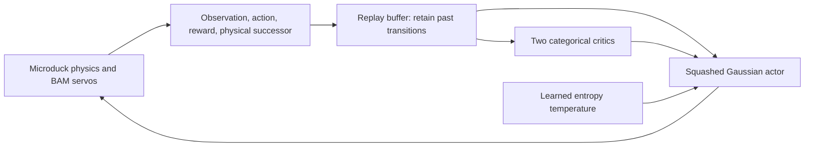

# 15. Explore Flash SAC on Microduck

**Try:** can a learner that reuses old transitions learn the same Duck task efficiently?

This route uses a separate environment pinned to Rafael Cathomen's incoming [Isaac Lab integration](https://github.com/isaac-sim/IsaacLab/pull/8866) and [RSL-RL learner](https://github.com/leggedrobotics/rsl_rl/pull/254). The combined snapshot also contains SuperMimic. These are development snapshots, with immutable revisions recorded in `environments/workflows/pyproject.toml` and its lock. They do not replace the PPO environment.

```bash
uv sync --project environments/workflows --locked
uv run --project environments/workflows --locked isaaclab train --rl_library rsl_rl --task MicroDuckTutorial-Velocity-Flat --agent rsl_rl_sac_cfg_entry_point --num_envs 128 --max_iterations 10 --seed 42 --run_name sac_smoke --visualizer none
uv run --project environments/workflows --locked python scripts/locomotion/evaluate.py --agent sac --checkpoint latest --export --output outputs/sac-evaluation
```

This is the **Microduck task**, with its BAM actuators, 61-value actor inputs, privileged 76-value critic inputs, home pose, physics, commands, rewards, and resets. No G1 robot or G1 differentiable task is substituted. The configuration is [the Duck SAC preset](../../src/isaaclab_tutorial/tasks/locomotion/config/microduck/agents/rsl_rl_sac_cfg.py).

The short budget is 128 × 8 × 10 = **10,240 transitions**. Replay warm-up ends at 8,192, leaving real optimizer updates to inspect. A smoke trial performed finite actor/critic/temperature updates and passed ONNX parity over its 42-sample evaluation, then fell at 0.84 s. That demonstrates the workflow, not learned walking.



**Inspect:** change `agent.algorithm.num_updates` on a new run. More optimizer work per collection iteration changes both wall time and replay reuse. Keep collection transitions separate from critic updates. FlashSAC's residual BatchNorm networks, categorical critics, held exploration noise, and CUDA-graph updates are enabled explicitly; they are additional design choices beyond basic SAC.

The initial action interval is **[-1, 1] raw**, or ±1 rad about each home joint. PPO's Gaussian actor is not identically bounded. Report this difference; tuning the interval is an explicit experiment, not an unnoticed change in the action interface. Normalization stays inside the exported actor, and the inference-only evaluator disables training concerns by running deterministic actor outputs.

For a larger new trial, increase `--num_envs` and `--max_iterations`. The 4096 × 8 × 1500 setting collects 49,152,000 transitions. Use independent training seeds and the same named evaluation protocol before comparing recipes. The nominal reset is deterministic: changing only its evaluation seed does not create independent initial states. Robustness comparisons need explicit, recorded state or perturbation variation. Keep numerical failures and falls.

## Measured nominal validation

An OSMO screen held training seed 42, transition budget and learning-rate decay phase fixed while changing replay updates per collection iteration. All three final policies survived the 20-second fixed-command evaluation:

| Updates | Forward RMSE (m/s) | Lateral RMSE (m/s) | Yaw RMSE (rad/s) |
| --- | --- | --- | --- |
| 8 | 0.05022 | 0.05466 | 0.29010 |
| 16 | 0.02005 | 0.02820 | 0.12914 |
| 32 | 0.02014 | 0.02169 | 0.06874 |

The 32-update setting was then trained independently with seeds 0 and 1. Their RMSE vectors were `(0.02418, 0.02340, 0.09237)` and `(0.02574, 0.02568, 0.09492)`; both also survived all 20 seconds. All three 32-update policies passed native/ONNX parity over 1000 observations each, with maximum absolute action error below 2.02×10⁻⁶. Training took 441–450 seconds per 32-update trial on one NVIDIA L40, including learner startup and compilation. Bootstrap, evaluation, and collection time are additional.

These are exploratory nominal results from three training seeds and one deterministic evaluation schedule, with no randomized-state or hardware validation. They support 32 updates as a candidate recipe for this task; they do not establish algorithm superiority. [The compact evidence](evidence/sac-nominal-validation.json) records immutable source revisions, checkpoint hashes, device, budgets, individual timings, metrics and parity.

To reproduce the candidate locally:

```bash
uv run --project environments/workflows --locked isaaclab train --rl_library rsl_rl --task MicroDuckTutorial-Velocity-Flat --agent rsl_rl_sac_cfg_entry_point --num_envs 4096 --max_iterations 1500 --seed 42 --run_name sac_u32 --visualizer none agent.algorithm.num_updates=32 agent.algorithm.schedule_updates=48000
uv run --project environments/workflows --locked python scripts/locomotion/evaluate.py --agent sac --checkpoint latest --export --output outputs/sac-u32
```

## Tune with OSMO

The supplied [one-GPU workflow](../../scripts/locomotion/osmo.yaml) runs one independent trial. These incoming learners do not support multi-GPU training; parallelize trials instead. It fetches a published, immutable tutorial commit, including its experimental lock:

```bash
osmo workflow submit scripts/locomotion/osmo.yaml --pool YOUR_POOL --set workflow_name=microduck-sac-seed42 seed=42 updates=16
osmo workflow query WORKFLOW_ID
```

Choose the image, platform, and optional image credential for your pool. The workflow records its default `source_repository` and full `source_revision`; override them to use another published tutorial commit. Uncommitted edits are not included. Replace `WORKFLOW_ID` with the returned name. The task has queue/execution limits and writes the fetched source archive, SHA-256, Git revision, device details, bootstrap/training logs, checkpoints, evaluation receipt, and checked ONNX bundle to OSMO's output directory. Its exit handler allows five minutes for artifact download on **success or failure**, preserving the original exit status. Download with `osmo workflow rsync download` before that collection window ends when no output bucket is configured. For unattended sweeps, add your approved output storage URL as described in [OSMO inputs and outputs](https://nvidia.github.io/OSMO/release/6.3/user_guide/workflows/specification/inputs_and_outputs.html).

Start with one smoke job, then screen update ratios 8/16/32 under the same seed and transition budget. Validate promising settings across fresh seeds before selecting a teaching recipe. PPO warm-start is a separate experiment.

Report wall time, actual environment transitions, optimizer updates, throughput excluding warmup, peak memory, task metrics, seeds, and failures. A single short run can teach the workflow; it cannot establish that one algorithm is generally faster or better.

**Record:** did changing replay reuse improve task success, or only increase update throughput?
