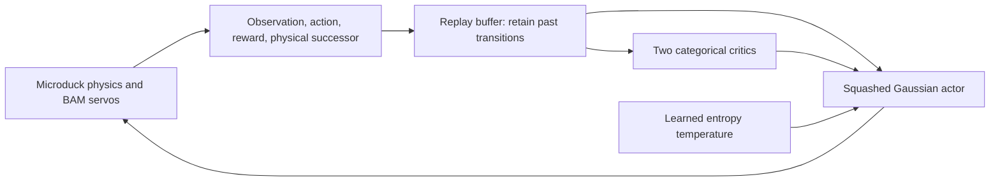
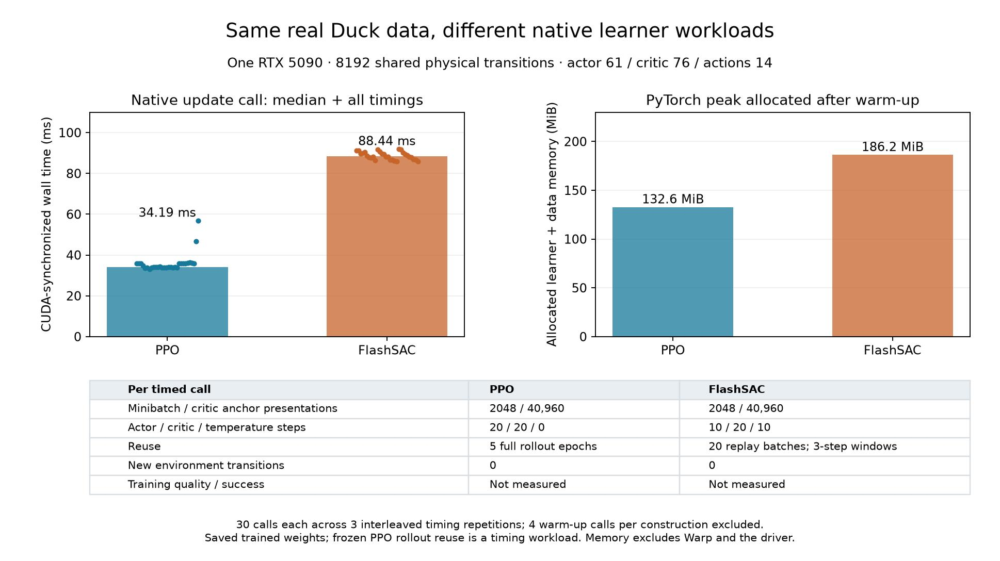

# 15. Explore Flash SAC on Microduck

**Try:** can a learner that reuses old transitions learn the same Duck task efficiently?

This route uses a separate environment pinned to Rafael Cathomen's incoming [Isaac Lab integration](https://github.com/isaac-sim/IsaacLab/pull/8866) and [RSL-RL learner](https://github.com/leggedrobotics/rsl_rl/pull/254). The combined snapshot also contains SuperMimic. These are development snapshots, with immutable revisions recorded in `environments/workflows/pyproject.toml` and its lock. They do not replace the PPO environment.

```bash
uv sync --project environments/workflows --locked
uv run --project environments/workflows --locked isaaclab train --rl_library rsl_rl --task MicroDuckTutorial-Velocity-Flat --agent rsl_rl_sac_cfg_entry_point --num_envs 128 --max_iterations 10 --seed 42 --run_name sac_smoke --visualizer none
uv run --project environments/workflows --locked python scripts/locomotion/evaluate.py --agent sac --checkpoint latest --export --output outputs/sac-evaluation
```

This is the **Microduck task**, with its BAM actuators, 61-value actor inputs, privileged 76-value critic inputs, home pose, physics, commands, rewards, and resets. No G1 robot or G1 differentiable task is substituted. The configuration is [the Duck SAC preset](../../src/isaaclab_tutorial/tasks/locomotion/config/microduck/agents/rsl_rl_sac_cfg.py).

The short budget is 128 × 8 × 10 = **10,240 transitions**. Replay warm-up ends at 8,192, leaving real optimizer updates to inspect. A smoke trial performed finite actor/critic/temperature updates and passed ONNX parity over its 42-sample evaluation, then fell at 0.84 s. That demonstrates the workflow, not learned walking.



**Inspect:** change `agent.algorithm.num_updates` on a new run. More optimizer work per collection iteration changes both wall time and replay reuse. Keep collection transitions separate from critic updates. FlashSAC's residual BatchNorm networks, categorical critics, held exploration noise, and CUDA-graph updates are enabled explicitly; they are additional design choices beyond basic SAC.

The initial action interval is **[-1, 1] raw**, or ±1 rad about each home joint. PPO's Gaussian actor is not identically bounded. Report this difference; tuning the interval is an explicit experiment, not an unnoticed change in the action interface. Normalization stays inside the exported actor, and the inference-only evaluator disables training concerns by running deterministic actor outputs.

For a larger new trial, increase `--num_envs` and `--max_iterations`. The 4096 × 8 × 1500 setting collects 49,152,000 transitions. Use independent training seeds and the same named evaluation protocol before comparing recipes. The nominal reset is deterministic: changing only its evaluation seed does not create independent initial states. Robustness comparisons need explicit, recorded state or perturbation variation. Keep numerical failures and falls.

## Measured nominal validation

An OSMO screen held training seed 42, transition budget and learning-rate decay phase fixed while changing replay updates per collection iteration. All three final policies survived the 20-second fixed-command evaluation:

| Updates | Forward RMSE (m/s) | Lateral RMSE (m/s) | Yaw RMSE (rad/s) |
| --- | --- | --- | --- |
| 8 | 0.05022 | 0.05466 | 0.29010 |
| 16 | 0.02005 | 0.02820 | 0.12914 |
| 32 | 0.02014 | 0.02169 | 0.06874 |

The 32-update setting was then trained independently with seeds 0 and 1. Their RMSE vectors were `(0.02418, 0.02340, 0.09237)` and `(0.02574, 0.02568, 0.09492)`; both also survived all 20 seconds. The saved counters confirm 49,152,000 physical transitions, 48,000 critic updates, 24,000 actor updates, and 24,000 temperature updates in each trial. All three policies passed native/ONNX parity over 1000 observations each, with maximum absolute action error below 2.02×10⁻⁶. Training took 441–450 seconds per 32-update trial on one NVIDIA L40, including learner startup and compilation. Bootstrap, evaluation, and collection time are additional.

After discarding the first 100 collection iterations, the sum of runner collection and learning durations corresponds to 129.8–132.1 thousand physical transitions/s. This measurement excludes logging overhead as well as bootstrap and evaluation. Peak GPU memory was not recorded for these completed trials.

The maintained Duck Rust runtime also reproduced each 1000-sample trace within 2.02×10⁻⁶. This rehearsal ran on the workstation CPU and exercised no robot hardware. These initial nominal results used three training seeds and one deterministic evaluation schedule. [Their compact evidence](evidence/sac-nominal-validation.json) records immutable source revisions, checkpoint hashes, device, budgets, individual timings, metrics and parity. The separate physical-start validation follows below.

To reproduce the candidate locally:

```bash
uv run --project environments/workflows --locked isaaclab train --rl_library rsl_rl --task MicroDuckTutorial-Velocity-Flat --agent rsl_rl_sac_cfg_entry_point --num_envs 4096 --max_iterations 1500 --seed 42 --run_name sac_u32 --visualizer none agent.algorithm.num_updates=32 agent.algorithm.schedule_updates=48000
uv run --project environments/workflows --locked python scripts/locomotion/evaluate.py --agent sac --checkpoint latest --export --output outputs/sac-u32
```

## Validate independent training seeds on matched physical starts

The 32-update policies trained with seeds 42, 0, and 1 each passed all ten `balance-starts-v1` trials: **30/30 valid, 30/30 response qualified, zero falls**. The protocol applies a 1 cm lift, small roll/pitch and velocity perturbations, and a randomized heading before the first observation. Each training seed faces the same ten sampled states. Actual recorded poses and velocities matched across policies; the shared aggregator counted ten distinct physical starts, rather than treating thirty evaluations as thirty independent states.

| Training seed | Qualified / attempted | Mean per-trial forward RMSE (m/s) | Mean per-trial yaw RMSE (rad/s) |
| --- | --- | --- | --- |
| 42 | 10 / 10 | 0.02035 | 0.07047 |
| 0 | 10 / 10 | 0.02481 | 0.09237 |
| 1 | 10 / 10 | 0.02346 | 0.09428 |

Each attempt must complete the full 20-second schedule and satisfy `flat-response-v1`: all five command segments, standing drift limits, per-segment tracking limits, and directional gains between 0.5 and 1.5 after settling. Survival alone cannot pass. Qualification and survival rates are 100% for each training seed, with sample standard deviation zero across these three seed-level rates. This small declared simulation box is a teaching challenge, not a calibrated hardware distribution or an algorithm-superiority result.

The [physical-start evidence](evidence/sac-physical-start-validation.json) retains the shared aggregation result, actual initial states, individual metrics, receipt hashes, saved seeds, source revisions, and realized optimizer counters. The original seed-42 run saved checkpoints every 50 iterations; the fresh seed-0/1 runs saved every 500. All other resolved task/learner settings and their actual experience/update budgets match.

To repeat one varied-start trial with your own candidate:

```bash
uv run --project environments/workflows --locked python scripts/locomotion/evaluate.py --agent sac --checkpoint latest --start-protocol balance-starts-v1 --seed 0 --export --output outputs/sac-varied-start-0
```

For fresh runs using the same saved recipe and realized budget, collect the matrix with the [shared qualification tool](09-evaluation.md#repeat-the-same-physical-starts-across-training-seeds):

```bash
uv run --project environments/workflows --locked python scripts/locomotion/qualify.py --agent sac --checkpoint logs/rsl_rl/microduck_tutorial_sac/SEED_42_RUN/model_1499.pt --checkpoint logs/rsl_rl/microduck_tutorial_sac/SEED_0_RUN/model_1499.pt --checkpoint logs/rsl_rl/microduck_tutorial_sac/SEED_1_RUN/model_1499.pt --output outputs/sac-qualification
```

Replace the example run directories with your saved runs. Keep every receipt, including invalid or fallen attempts. The default ten physical starts and seed-level aggregation match PPO; use separate studies for command or observation delays. The historical screen above retains its declared checkpoint-save cadence difference; the collector requires new replicates to share their saved recipe, including that cadence.

## Measure native learners on the same physical data



A local learner-only measurement used **the same 8192 real Duck transitions** for both algorithms: 256 environments × 32 physical control steps, collected with the saved seed-42 PPO policy and collection seed 77. The pinned workflows environment supplied both native learners and the original BAM task. Actor inputs have 61 values, critic inputs 76, and actions 14. [Input checks](evidence/learner-throughput-input-check.json) verify exact observation, action, reward and done equality between the physical dataset and PPO rollout; SAC replay receives that same dataset without substituting generated tensors. All physical values were finite. This short batch contains no terminal transitions; the collector preserves `final_obs` and native PPO timeout/GAE handling, but this timing sample does not exercise a reset boundary.

Each timed call used a minibatch size of 2048 and 20 critic minibatches, or **40,960 critic anchor sample presentations**. PPO visits the entire rollout in each of five epochs and performs 20 joint actor/critic optimizer steps. FlashSAC samples anchors with replacement, constructs up to three chronological transitions per anchor, and performs 20 critic, ten actor and ten temperature steps. Those windows can stop at a terminal boundary or the newest data. Each SAC anchor reaches two critics; PPO uses one. Matching anchors therefore does not equalize network work. Sample presentations and window entries are replay reuse; each timed call adds **zero** physical transitions.

| Local native workload on one RTX 5090 | Median synchronized call | Critic anchor presentations/s | PyTorch peak allocated |
| --- | --- | --- | --- |
| PPO, five epochs × four minibatches | 34.19 ms | 1,198,095 | 132.6 MiB |
| FlashSAC, 20 replay updates | 88.44 ms | 463,129 | 186.2 MiB |

These measurements retain the native network architectures, normalizers, losses and optimizer implementations, including FlashSAC's residual BatchNorm categorical critics and CUDA graphs. The saved trained actor/critic weights initialize each workload; fresh optimizers are used and the temporary updates are discarded. PPO's Gaussian collection actions range from −2.78 to 3.53 raw in this dataset, while the SAC actor remains bounded to [−1, 1]. The SAC critics receive the common physical actions without clipping them. Repeated frozen-rollout updates are a timing workload, not an on-policy training recipe. These differences prevent an algorithmic or training-quality ranking from the timing table.

Three interleaved timing repetitions each excluded four complete warm-up calls, including CUDA graph capture, then retained ten measured calls per algorithm. Each wall-clock interval synchronizes CUDA before and after native `update()`, including sampling, native loss reductions, normalization and optimizer work. Collection, simulator construction, GAE preparation, logging and evaluation are excluded. The actual Adam counters advanced by 200 critic steps per ten-call block; SAC also advanced by 100 actor and 100 temperature steps. All measured losses were finite. The reported memory is PyTorch's peak allocated memory after warm-up, including the current learner, its storage and input tensors; it excludes Warp and driver allocations and is not whole-device peak memory. The repetitions measure timing variation on one local GPU, not independent training seeds or task success.

[The timing evidence](evidence/learner-throughput.json) retains every interval and loss, optimizer counters, full resolved configurations, input/checkpoint/source hashes and device identity. [Plot provenance](evidence/learner-throughput-plot.json) identifies the renderer and small JPG; the renderer also produces a local SVG master. The 17 MB frozen physical dataset remains an external artifact identified by its checksum. Repeat the collection with your saved checkpoints, then time both learners without stepping physics:

```bash
uv run --project environments/workflows --locked python scripts/locomotion/benchmark_learners.py collect --dataset outputs/duck-transitions.pt --ppo-checkpoint PATH/TO/PPO/model_999.pt --sac-checkpoint PATH/TO/SAC/model_1499.pt
uv run --project environments/workflows --locked python scripts/locomotion/benchmark_learners.py measure --dataset outputs/duck-transitions.pt --sac-checkpoint PATH/TO/SAC/model_1499.pt --output outputs/learner-throughput.json
uv run --project environments/workflows --locked python scripts/locomotion/plot_learner_throughput.py --evidence outputs/learner-throughput.json --output outputs/learner-throughput.jpg
```

## Tune with OSMO

The supplied [one-GPU workflow](../../scripts/locomotion/osmo.yaml) runs one independent trial. These incoming learners do not support multi-GPU training; parallelize trials instead. It fetches a published, immutable tutorial commit, including its experimental lock:

```bash
osmo workflow submit scripts/locomotion/osmo.yaml --pool YOUR_POOL --set workflow_name=microduck-sac-seed42 seed=42 updates=16
osmo workflow query WORKFLOW_ID
```

Choose the image, platform, and optional image credential for your pool. The workflow records its default `source_repository` and full `source_revision`; override them to use another published tutorial commit. Uncommitted edits are not included. Replace `WORKFLOW_ID` with the returned name. The task has queue/execution limits and writes the fetched source archive, SHA-256, Git revision, device details, bootstrap/training logs, checkpoints, evaluation receipt, and checked ONNX bundle to OSMO's output directory. Its exit handler allows five minutes for artifact download on **success or failure**, preserving the original exit status. Download with `osmo workflow rsync download` before that collection window ends when no output bucket is configured. For unattended sweeps, add your approved output storage URL as described in [OSMO inputs and outputs](https://nvidia.github.io/OSMO/release/6.3/user_guide/workflows/specification/inputs_and_outputs.html).

Start with one smoke job, then screen update ratios 8/16/32 under the same seed and transition budget. Validate promising settings across fresh seeds before selecting a teaching recipe. PPO warm-start is a separate experiment.

The exit handler stages a compact `collection` directory with the last checkpoint, its parameters, metrics/events, source archive and logs. New workflow runs also record one-second `gpu-samples.csv` measurements during training; their sampled maximum can miss brief memory peaks. Collect artifacts during the five-minute window and then release the GPU from an interactive terminal:

```bash
osmo workflow rsync download WORKFLOW_ID train /osmo/data/output/collection/:outputs/WORKFLOW_ID
cd outputs/WORKFLOW_ID/collection
sha256sum -c source.sha256 checkpoint.sha256
```

After the checks pass, release the GPU:

```bash
osmo workflow exec WORKFLOW_ID train --entry "bash -lc 'touch /osmo/run/workspace/microduck-input/collected'"
```

Verify that the downloaded files have nonzero sizes and retain the source/checkpoint hashes before releasing. If your service exposes a different output path, substitute the path shown by its task. Automated collectors must allocate a terminal for `workflow exec` on CLI versions that require one.

For checkpoint selection, `keep_checkpoints=1` retains every nonzero saved checkpoint in the compact collection. Choose a bounded `checkpoint_interval` so this stays small. SuperMimic's `lr_decay_iterations` is measured in learner updates and defaults to the native 250,000; the initial horizon screen explicitly used 4,000. Record this setting alongside the physical transition budget.

Report wall time, actual environment transitions, optimizer updates, throughput excluding warmup, peak memory, task metrics, seeds, and failures. A single short run can teach the workflow; it cannot establish that one algorithm is generally faster or better.

**Record:** did changing replay reuse improve task success, or only increase update throughput?
