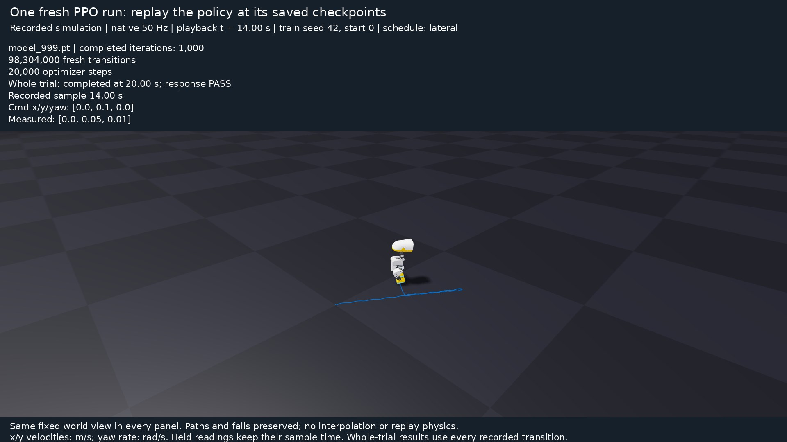
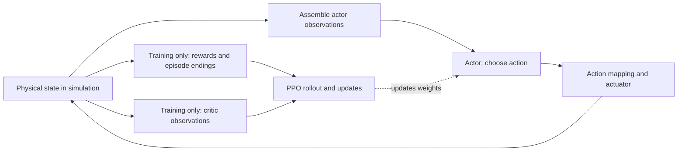

# Play, train, and understand Microduck

Teach a small biped to follow velocity commands on flat ground with PPO. Start by trying things, then explain the result. A duck that falls gives you something concrete to investigate.

This development path uses an **opt-in environment** pinned to a public Microduck/BAM source revision and its matching Newton/MuJoCo packages. The repository's root environment continues to serve the SO-101 tutorial. The Microduck task is not assumed to exist in the released Isaac Lab wheel.

Run all commands below from the **repository root**. Python 3.12, uv, and a compatible NVIDIA GPU are required for simulation/training. Native sliders need a graphical desktop; each activity also has a headless route.

<details>
<summary>Preview a trained policy following flat-ground commands</summary>



[Watch the native movie](https://github.com/AntoineRichard/IsaacLabTutorial/releases/download/microduck-tutorial-media-3463b86/flat-walking-overview.mp4).

This is the longer seed-42 policy after 98,304,000 transitions, independently evaluated from `balance-starts-v1`, physical-start seed 0. The recorded 20-second protocol covers standing, forward, backward, lateral and turning commands. Its overlays use the actual recorded heading-frame forward/left velocities and world-Z yaw rate; the fixed camera preserves the whole world path.

This policy passed the response criteria on this start. It is separate from the short first attempt you will train next, and one movie does not establish robustness. Later, [drive a frozen policy yourself](09-evaluation.md) with bounded command sliders.

</details>

## Your first session

1. [Set up and try training immediately](02-first-training.md). No PPO theory prerequisite.
2. [Play with the puppet duck](03-puppet.md): move joint sliders and compare pose with balance.
3. [Follow a command through the actuator](04-actions.md).
4. [Investigate observations](05-observations.md) and [experiment with rewards](06-rewards.md).
5. [Understand PPO](07-ppo.md), [play with the batch calculator and compare real training curves](08-training.md), then [evaluate physical starts and drive the frozen policy](09-evaluation.md).
6. [Map the reality gap](10-reality-gap.md), [investigate delays/backlash](11-effects.md), [train for robustness](12-robustness.md), and [export for deployment](13-deployment.md).

The runnable path includes supported/free-base joint control, a bounded actuator reversal with actual 5 ms delay telemetry, observation inspection, a bounded fresh PPO run, failure-aware evaluation, reward rescoring/retraining, independent reference-ghost comparisons, and executed JIT/ONNX inference checks. A short run is not a validated walking controller. Hardware walking and board-side timing still require calibrated robot trials.

## How to use the lessons

**Try → predict → change one thing → observe → explain → retry.** The main path is hands-on; theory panels explain what you have already seen. Record one sentence after each experiment. Keep the seed and reset protocol fixed when comparing changes.

<details>
<summary>See the loop you are exploring</summary>



The frozen policy workshop keeps the observation/action/physics loop running. Learning additionally collects a rollout and updates weights; display sliders and ghost playback do not perform those updates.

</details>

A **Run** block is an executable command. A **Reference** block explains code; it is not an instruction to paste it. Expected behavior describes what to look for, not a guaranteed training outcome. Checkpoint and hardware paths are inputs you choose explicitly.

<details>
<summary>Try a trained policy before your own run is ready</summary>

An optional [PPO policy bundle](https://github.com/AntoineRichard/IsaacLabTutorial/releases/download/microduck-tutorial-media-3463b86/ppo-reference-policies.tar.gz) contains nominal and delay-trained policies with their saved parameters. Each used 4,096 environments, 24 rollout steps and 1,000 iterations: 98,304,000 transitions. These are separate longer runs from the first-attempt exercise.

Download and unpack the archive from the repository root:

```bash
mkdir -p outputs/reference-policies
curl --fail --location https://github.com/AntoineRichard/IsaacLabTutorial/releases/download/microduck-tutorial-media-3463b86/ppo-reference-policies.tar.gz -o outputs/ppo-reference-policies.tar.gz
printf '%s  %s\n' 454a6ed1446a46cda3b8e3acfc2922477c08801aded9aef4f3e516fe1641794a outputs/ppo-reference-policies.tar.gz | sha256sum --check
tar -xzf outputs/ppo-reference-policies.tar.gz -C outputs/reference-policies
uv run --project environments/locomotion python scripts/locomotion/playground.py --mode policy --checkpoint outputs/reference-policies/nominal/model_999.pt
```

Add `--headless --scripted --steps 500` without a desktop. Keep the model's adjacent `run.json` and `params/` files. The delay-trained model requires `--training-profile delay` in the evaluator and effects workshop. Neither is a validated hardware controller.

</details>
