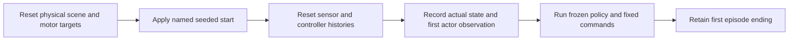

# Declared evaluation protocols

Use this reference after trying the [evaluation lesson](../09-evaluation.md). The runnable implementation is `locomotion/protocols.py`; receipts retain its definition and criteria hashes.

## Change the starting state deliberately

```bash
uv run --project environments/locomotion python scripts/locomotion/evaluate.py --checkpoint latest --start-protocol balance-starts-v1 --seed 0
```

Inspect `start_condition`, `initial_state`, and `initial_actor_observation` in the receipt. Change the evaluation seed and predict which fields will change. Keep an exact checkpoint path for comparisons.

| Start protocol | Physical state at the start |
| --- | --- |
| `nominal-v1` (default) | Ordinary task home pose and zero velocities. Its physical state does not vary with the evaluation seed. |
| `balance-starts-v1` | Home joints; root lifted 0.01 m; roll/pitch sampled uniformly within ±0.025 rad; yaw within ±π; heading-frame forward/left velocities within ±0.04 m/s; body-frame angular velocities within ±0.15 rad/s. |

The second profile is a declared simulation challenge, not a measured hardware distribution. Its small lift provides room for the initial tilt before the feet settle onto the plane. It changes initial state, not masses, friction, backlash, noise, or the trained policy. Recovery after a fall remains a later task.

Sampling uses an independent PCG64 stream. Loading a different learner must not consume random numbers that change its requested physical start. The receipt saves the numerical draw, profile definition and hashes, and the actual root/joint poses and velocities before stepping. A reset event applies the start **after** the normal scene reset and **before** observation/action histories reset and initial observations are formed.



Use the same start protocol and evaluation seed for baseline/candidate trials. Ghost comparisons also check their profile/sample hashes and initial linear, angular, and joint velocities. Matching poses alone is insufficient when one robot starts moving. Legacy recording pairs remain replayable; regenerate both sides when adding explicit start metadata.

## Survival is only one check

The receipt's `qualification` applies the declared **flat-response-v1** teaching criteria. It requires the complete 20-second protocol, no fall, and all five command responses. A policy that stands still for 20 seconds fails the translation/turning checks.

For moving segments, the mean commanded-axis response after the first second must be 0.5–1.5 times the signed command. Tracking RMSE uses the entire four-second segment, including its transient:

| Segment | Forward RMSE limit (m/s) | Left RMSE limit (m/s) | Yaw RMSE limit (rad/s) |
| --- | ---: | ---: | ---: |
| Stand | 0.04 | 0.04 | 0.15 |
| Forward | 0.10 | 0.07 | 0.30 |
| Backward, lateral, turn | 0.07 | 0.07 | 0.30 |

Standing also requires planar drift ≤0.03 m and absolute yaw drift ≤0.15 rad, measured between the first and last available pre-step standing samples. The receipt records this scope, coverage, steady response gains, and requested-target rate RMS in rad/s. Unattempted segments keep `null` scores; they never become zero-error successes. These are versioned teaching targets, not hardware acceptance criteria.

`valid` means the trial remained numerically usable and uninterrupted. `qualification.passed` means it met this task response test. Export parity checks numerical equivalence of inference implementations; it does not assess walking. A finite failed or standing policy can still export for debugging, with an explicit false qualification in its manifest. Hardware validation is separate.
