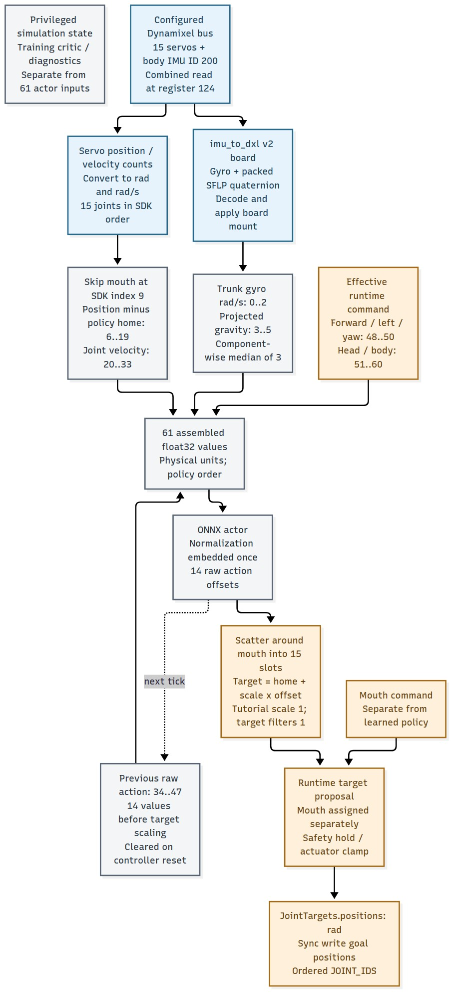

# Follow a signal through the standard Duck

**Trace:** the right knee answers on motor ID 13. Which position observation and policy action belong to it? Follow the blue sensor path and orange target path before opening the answer.

This is a source-reviewed interface schematic for runtime commit `da34a2212ae12eddfd73d0dfbf924f291aaf1dc9`. Blue marks hardware-reported inputs, grey marks computation, and orange marks requested commands. It describes the code's data path and configured units. Physical cable routing, encoder signs on a particular robot, timing and actuation have not been measured here.

The [editable Mermaid master](hardware-signal-map.mmd) and [source/render receipt](../evidence/hardware-signal-map.json) identify every source boundary and output. The separate [control-tick diagram](../13-deployment.md#follow-one-hardware-control-tick) covers intent gating and hold behavior.

Reveal the right-knee route and all joint slots

The right knee is **SDK joint 13**, **policy action 12**, **position input 18**, and **velocity input 32**. The mouth occupies SDK joint 9 but no policy slot. Right-leg policy slots therefore shift by one relative to the 15-joint SDK array.

| Policy slot | Joint | Motor ID | Position input | Velocity input |
| --- | --- | --- | --- | --- |
| 0 | left_hip_yaw | 20 | 6 | 20 |
| 1 | left_hip_roll | 21 | 7 | 21 |
| 2 | left_hip_pitch | 22 | 8 | 22 |
| 3 | left_knee | 23 | 9 | 23 |
| 4 | left_ankle | 24 | 10 | 24 |
| 5 | neck_pitch | 30 | 11 | 25 |
| 6 | head_pitch | 31 | 12 | 26 |
| 7 | head_yaw | 32 | 13 | 27 |
| 8 | head_roll | 33 | 14 | 28 |
| 9 | right_hip_yaw | 10 | 15 | 29 |
| 10 | right_hip_roll | 11 | 16 | 30 |
| 11 | right_hip_pitch | 12 | 17 | 31 |
| 12 | right_knee | 13 | 18 | 32 |
| 13 | right_ankle | 14 | 19 | 33 |

All indices are zero-based. The mouth is motor ID 34 and stays outside the learned actor's 14 outputs. The SDK's [joint/ID tables](https://github.com/pollen-robotics/microduck/blob/da34a2212ae12eddfd73d0dfbf924f291aaf1dc9/duck-ipc-proto/src/lib.rs#L634) and [shared gather/scatter mapping](https://github.com/pollen-robotics/microduck/blob/da34a2212ae12eddfd73d0dfbf924f291aaf1dc9/duck-control/src/obs.rs#L109) define this order.

## Decode units before assembling observations

The [bus read](https://github.com/pollen-robotics/microduck/blob/da34a2212ae12eddfd73d0dfbf924f291aaf1dc9/duck-control/src/bus.rs#L514) fetches the first 12 bytes at register 124 from the body IMU and each servo. A combined transaction does not establish identical sensor acquisition times.

| Reported source | SDK transformation | Actor receives |
| --- | --- | --- |
| Signed servo position count `n` | `q = 2π n / 4096 − π` | `q − home`, radians, mouth skipped |
| Signed servo velocity count `v` | `dq = v × 0.229 × 2π / 60` | rad/s, same policy joint order |
| Body gyro signed counts | Multiply by `0.0175 × π / 180`, rotate sensor → trunk, component-wise median of three | Trunk-frame rad/s |
| Body SFLP quaternion | Decode packed components, apply inverse mount to orientation, normalize, project world down into trunk; then median of three | Dimensionless projected gravity |

Keep **servo EEPROM homing**, **policy home subtraction**, and **any simulated calibration intervention** distinct. The pinned runtime asserts a −512-count knee homing offset at the servo; that is already reflected upstream of the reported position. It is not an extra −45° to add again while constructing the actor feature. The policy home is the separate 14-angle reference checked by the export manifest. [Source calibration definitions](https://github.com/pollen-robotics/microduck/blob/da34a2212ae12eddfd73d0dfbf924f291aaf1dc9/duck-control/src/model.rs#L137).

## Find the correct IMU frame

The policy consumes the **body IMU in trunk coordinates**, rather than the separate head IMU. The configured board selects the [mount](https://github.com/pollen-robotics/microduck/blob/da34a2212ae12eddfd73d0dfbf924f291aaf1dc9/robotd/src/main.rs#L1593):

| Configured board | Sensor → trunk vector mapping |
| --- | --- |
| `zero3` | `[raw_z, raw_y, −raw_x]`, a +90° rotation about Y |
| `beta` or `face-board-v1` | Identity |

These are the pinned runtime's configured transforms, not a measurement of your robot's mounting. The [decoder](https://github.com/pollen-robotics/microduck/blob/da34a2212ae12eddfd73d0dfbf924f291aaf1dc9/duck-control/src/imu.rs#L108) uses scalar-first quaternions internally; the actor receives gyro and gravity vectors, not that quaternion. A median applied component by component can change the gravity vector's norm. Its history is stateful preprocessing, rather than the fixed observation-delay knob from lesson 11. Startup can hold an earlier quaternion; readiness and repeated-read counters do not supply a numerical capture-to-use age.

## Separate measurements, commands and simulation truth

The [observation builder](https://github.com/pollen-robotics/microduck/blob/da34a2212ae12eddfd73d0dfbf924f291aaf1dc9/duck-control/src/obs.rs#L174) also copies the **previous raw action**, not the filtered target or measured joint angle. It places the runtime's effective forward/left/yaw command in slots 48–50, followed by head/body slots. Runtime command smoothing and optional mixers happen upstream. Check the assembled packet in the no-actuation rehearsal: this tutorial trained all ten head/body slots at zero.

The 76-wide training critic and simulator-only diagnostics can use privileged model state. The physical SDK's `Sensors` API supplies joint/IMU values; it does not supply simulator ground truth, separate passive backlash coordinates, or a world-velocity observation for this actor. Keep those diagnostic and training streams separate from the 61-value deployment packet.

On the output side, [the controller](https://github.com/pollen-robotics/microduck/blob/da34a2212ae12eddfd73d0dfbf924f291aaf1dc9/robotd/src/control.rs#L655) stores the raw action for the next tick, scatters around the mouth, adds home and applies the configured scale/filter. The [bus writer](https://github.com/pollen-robotics/microduck/blob/da34a2212ae12eddfd73d0dfbf924f291aaf1dc9/duck-control/src/bus.rs#L574) consumes radians in the same `JOINT_IDS` order. The mouth is assigned separately before the final safety/hold/clamp stage. The tutorial's generated runtime fragment chooses scale 1 and filter factors 1; verify additional configured policy/mode selection in the robot rehearsal.

**Record:** trace one different right-leg joint, then name a signal in the diagram that is a command rather than a measurement.
