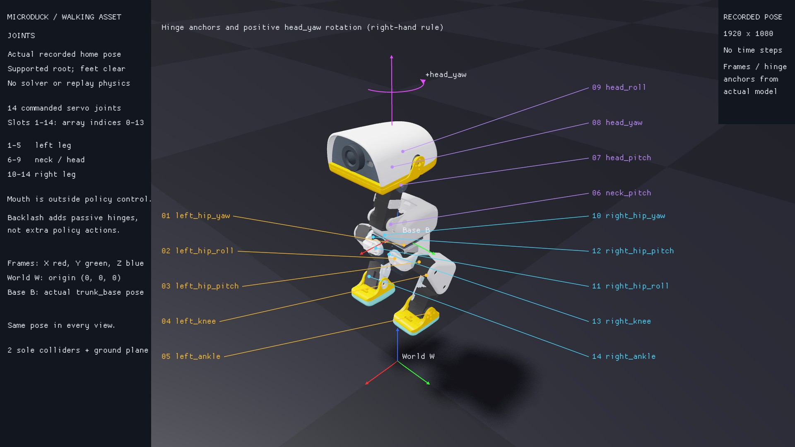
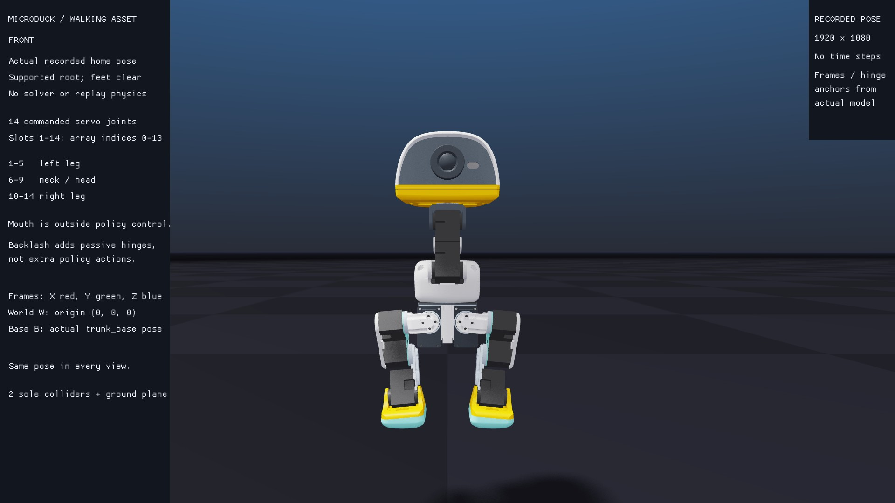
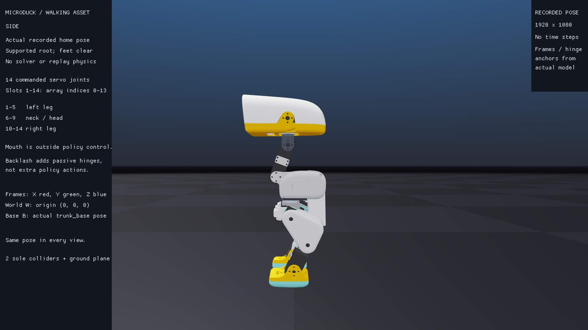
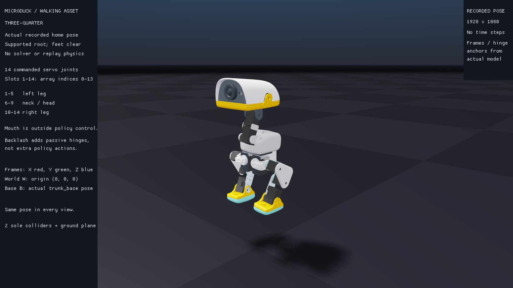
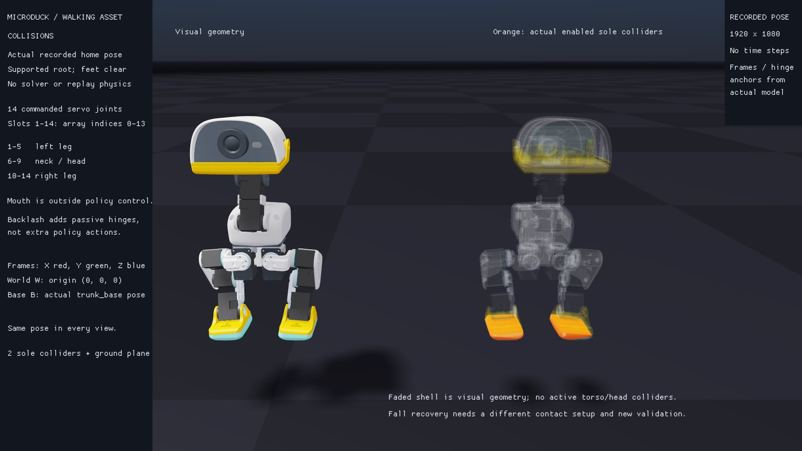

# Locate a joint, then inspect its contacts

Keep the [puppet activity](../03-puppet.md) open. Pick a joint name before moving its slider, then find its marker below. The numbers are **action slots 1–14**; Python indices are **0–13**. Selecting by name preserves this order even when the asset's internal order differs.



The markers come from the imported joint frames evaluated at the recorded physical pose. Gold labels identify the left leg, purple the neck/head, and cyan the right leg. World axes start at `(0, 0, 0)`; base axes start at the actual `trunk_base` pose. X is red, Y green and Z blue. The extended magenta axis and curved arrow explain positive `head_yaw`; the curve is an annotation, not a recorded motion. Predict the direction, then try a small positive slider change.

The nominal walking asset has 14 independently commanded servo hinges. The mouth is outside this policy's action vector. The backlash variant adds 14 passive series hinges, which do not become additional policy actions. [Follow the servo/output coordinates](../11-effects.md#watch-a-bounded-reversal) to investigate that variant.

## Same home pose, different cameras

These native views use exactly the same recorded rigid-body transforms at reset time 0.000 s. The root was supported at 0.22 m and the feet hang above the floor; this is a reference stance, not evidence of balancing. The cameras view from world +X, world +Y, and a three-quarter direction respectively.







## Which geometry can make contact?

**Try:** in the live Newton viewer's **Visualization** section, toggle **Show Collision** and **Show Visual**. Compare the sole shapes with the visible feet, then restore the visuals before continuing the puppet challenge.



The orange shapes are the actual enabled convex sole colliders. A separate inspection of the real Newton/MJWarp task confirms the same two paths, flags and geometry types. The torso and head meshes are visual geometry in this walking asset. A fall-recovery task needs a different contact setup and fresh validation; it is later tutorial work.

Both copies use the same recorded pose. Their ±0.17 m offsets along world Y are display offsets. Fading changes only visual opacity. Rendering runs no solver, collision pipeline or dynamics; it does not measure contact forces or prove that the robot is walking. [Runtime collider inspection](../evidence/runtime-contacts.json).

<details>
<summary>Rebuild the plates and check the source</summary>

Run from the repository root in the pinned locomotion environment:

```bash
uv run --project environments/locomotion python scripts/locomotion/capture_reference.py --output outputs/robot-reference
uv run --project environments/locomotion python scripts/locomotion/inspect_contacts.py --output outputs/runtime-contacts.json
```

The [portable physical snapshot](../evidence/reference-pose.json) is an actual reset frame extracted from the nominal supported joint experiment, with its full source-receipt hash. The renderer checks the locked USD bytes, body names, joint/root forward kinematics and hinge-anchor agreement. It also checks the positive head-yaw axis against a small central finite difference of forward kinematics, and verifies annotation projection against the public camera's pixel-to-world rays. Those checks perform kinematics only; no integration steps occur.

The [capture receipt](../evidence/reference-capture.json) retains all 14 names, action indices, world hinge positions/axes, camera settings, display offsets, numerical check results and image/source hashes. The contact-inspection command instantiates the actual supported task and reads its enabled robot shapes after reset; it collects no controller rollout. Use a fresh inspection output path to preserve earlier results.

</details>
